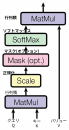
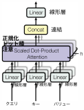
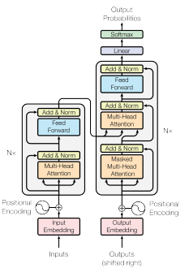
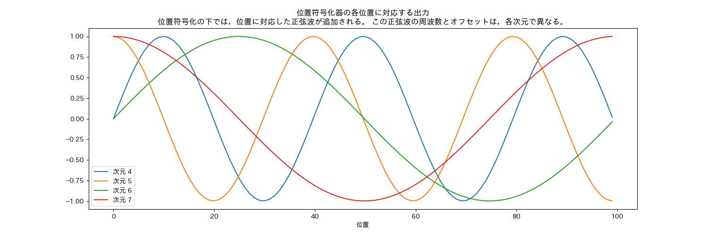
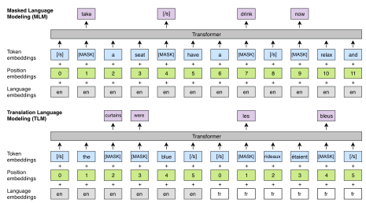
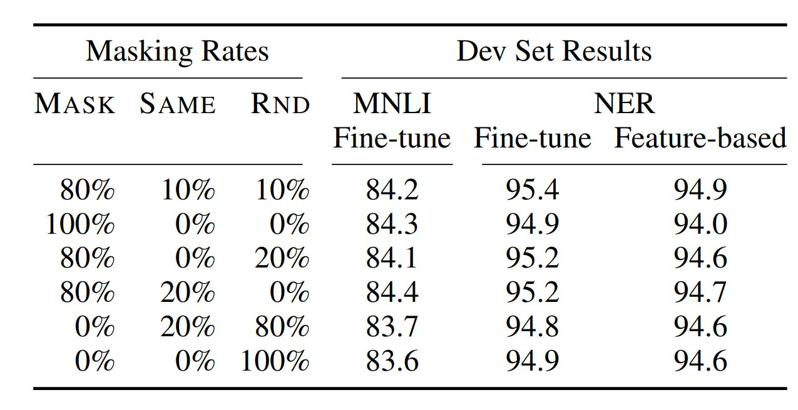
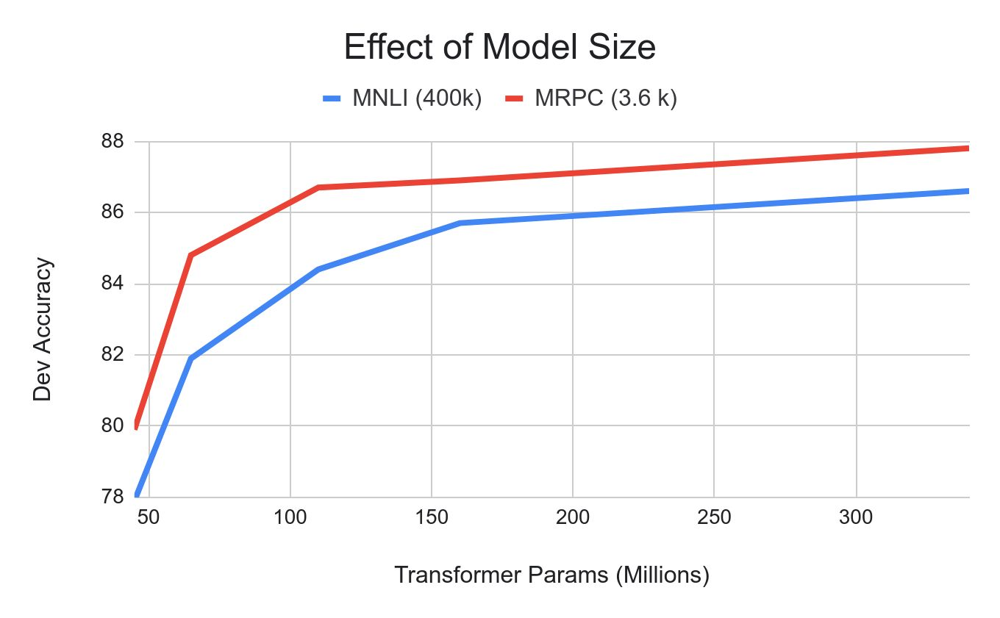
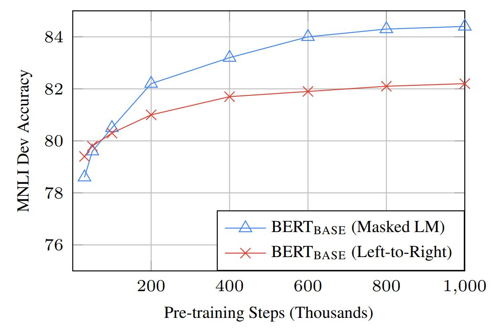
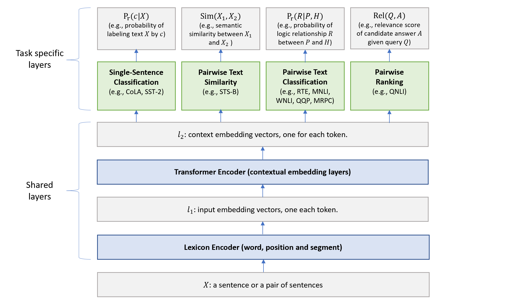

<link href="/css/asamarkdown.css" rel="stylesheet">

$$
\newcommand{\of}[1]{\left(#1\right)}
\newcommand{\Of}[1]{\left[#1\right]}
\newcommand{\OF}[1]{\left\{#1\right\}}
\newcommand{\bs}[1]{\boldsymbol{#1}}
\newcommand{\mb}[1]{\mathbf{#1}}
\newcommand{\Brc}[1]{\left(#1\right)}
\newcommand{\BRc}[1]{\left[#1\right]}
\newcommand{\Rank}{\text{rank}\;}
\newcommand{\Hat}[1]{\widehat{#1}}
\newcommand{\Prj}[1]{\mb{#1}\Brc{\mb{#1}^{\top}\mb{#1}}^{-1}\mb{#1}^{\top}}
\newcommand{\RegP}[2]{\Brc{\mb{#1}^{\top}\mb{#1}}^{-1}\mb{#1}^{\top}\mb{#2}}
\newcommand{\NSQ}[1]{\left|\mb{#1}\right|^2}
\newcommand{\Norm}[1]{\left|#1\right|}
\newcommand{\IP}[2]{\left({#1}\cdot{#2}\right)}
\newcommand{\Bar}[1]{\overline{\;#1\;}}
$$

<a href='mailto:educ0233@komazawa-u.ac.jp'>Shin Aasakawa</a>, all rights reserved. 
Date: 13/Nov./2026 
Appache 2.0 license  

* [課題提出用フォルダ](https://drive.google.com/drive/u/7/folders/1iHQ5EzA2C8hhfkVC-kw5-Vi5RNVzSUOZ){:target="_blank"}

### 実習ファイル

* [JGLUE のデモ ](https://colab.research.google.com/github/komazawa-deep-learning/komazawa-deep-learning.github.io/blob/master/2026notebooks/20261023JGLUE_BERT_demo.ipynb){:target="_blank"}
* [PyTorch による Transfomer 実装 ](https://colab.research.goog
le.com/github/komazawa-deep-learning/komazawa-deep-learning.github.io/blob/master/2023notebooks/2
023_0602Transformer_from_scratch.ipynb){:target="_blank"}
* [chatGPT ](https://colab.research.google.com/github/komazawa-
deep-learning/komazawa-deep-learning.github.io/blob/master/2023notebooks/2023_0608rinna_chatGPT_d
emo.ipynb){:target="_blank"}
* [百人一首 上の句→下の句 ](https://colab.research.google.com/github/komazawa-deep-learning/komazawa-deep-learning.github.io/blob/master/2026notebooks/2026_1002chihaya_Transformer_LSTM_SRN_comparison.ipynb){:target="_blank"}

## Transformer, [Attention is all you need](https://arxiv.org/abs/1706.03762)

<!-- 
単語の多義性解消のために，あるいは単語のベクトル表現を超えて，より大きな意味単位である，句，節，文のベクトル表現を得る努力がなされてきた。
適切な普遍文表現ベクトルを得ることができれば，翻訳を含む多くの下流課題にとって有効だと考えられる。

そこで，注意機構を積極的に取り込んだゲームチェンジャーが Transformer である。 -->

Transformer は人工知能へのアプローチを根本的に変えたニューラルネットワークのアーキテクチャである。Transformer は、画期的な論文 [Attention is All You Need](https://dl.acm.org/doi/10.5555/3295222.3295349 "ACM Digital Library") で初めて導入され、それ以来、深層学習モデルの定番アーキテクチャとなった。OpenAI の **GPT**、Meta の **Llama**、Google の **Gemini** といったテキスト生成モデルを支えている。テキスト以外にも、Transformer は[音声合成](https://huggingface.co/learn/audio-course/en/chapter3/introduction "Hugging Face")にも応用されている。[画像認識](https://huggingface.co/learn/computer-vision-course/unit3/vision-transformers/vision-transformers-for-image-classification "Hugging Face")、[タンパク質構造予測](https://elifesciences.org/articles/82819 "eLife")、さらには[ゲームプレイ](https://www.deeplearning.ai/the-batch/reinforcement-learning-plus-transformers-equals-efficiency/ "Deep Learning AI")まで、様々な分野でその汎用性を示している。

基本的に、テキスト生成型 Transformer モデルは**次単語予測**原理で動作する。ユーザからのテキストプロンプトが与えられた時、この入力に続く**最も確率の高い次単語** を予測する。
Transformer の中核的な革新性は、**自己注意機構** である。これにより、従来のアーキテクチャよりも効果的に系列全体を処理し、長距離依存関係を捕捉できる。

* Transformer: マルチヘッド注意機構，位置符号化器，埋め込み表現，ソフトマックス関数
* 事前訓練とファインチューニング: マスク言語モデル，次文予測  <!--Masked Language model, next sentence prediction--->
* GTP-4: 符号化器・復号化器モデルを用いた画像と言語との融合
* プロンプトエンジニアリングと RLHF (人間のフィードバックによる強化学習): 報酬モデルと代理方針最適化 (Proximal Policy Optimization)

* 注意を用いて，RNN を置き換える [Devlin+2017,Attention Is All You Need](https://arxiv.org/abs/1706.03762)
* Transformer の注意とは，このソフトマックス関数である。
* 専門用語としては，**多頭=自己注意** Multi-Head Self-Attention (以下 MHSA と表記)と呼ぶ。
* **自己** がつく注意である理由は，トップダウン信号がないためであろう。
* 上図，クエリ，キー，バリュー ，意味としては，問い合わせ，キー（鍵），値，であるが，とりわけ，Q と K との間に明確な相違はない。
* ある問い合わせ Q に対して，キー K を与えて，その答え A となる値を得ることに相当する。
* この操作を入力情報から作り出して答えを出力する仕組みに，ワンホット表現を使う。

<!-- 下図左は上図右と同じものです。この下図右を複数個束ねると下図中央になります。 -->

#### Transformer の概略図

&nbsp;&nbsp;&nbsp;&nbsp;&nbsp;&nbsp;&nbsp;&nbsp;&nbsp;
&nbsp;&nbsp;&nbsp;

Transformer [2017Vaswani++](https://arxiv.org/abs/1706.03762) Fig.2 を改変。
`matmul` は行列の積，`scale` は，平均 0 分散 1 への標準化，`mask` は 0 と 1 とで，データを制限すること，`softmax` はソフトマックス関数

Transformer における注意 = ソフトマックス関数。 

- 図中央の Scaled Dot-Product Attention と書かれた右脇に小さく h と書かれている。この h とは ヘッド の意味。
- 図中央を 1 つの単位として，次に来る情報と連結させる。図右。
- リカレントニューラルネットワークでは，中間層の状態が次の時刻の処理に継続して用いられていた。
- ところが 多頭=自己注意 MHSA では一つ前の入力情報を，現在の時刻の情報に対するクエリとキーのように扱って情報を処理する。
- 図右の下から入力される情報は，input と output と書かれている。
さらに output の下には (Shifted right) と書かれています。
すなわち，時系列情報を一時刻分だけ右にずらし（シフト）させて逐次情報を処理することを意味している。
- 図右の下から入力される情報は，embedding つまり埋め込み表現 と 位置符号化 position embedding が足し合わされたもの。
埋め込み表現とは先週 word2vec で触れたベクトルで表現された，単語（あるいはそれぞれの項目）の 意味表現 に対応。

### Transformer における位置符号化器 (PE: position encoders)

$$
\text{PE}_{(\text{pos},2i)} = \sin\left(\frac{\text{pos}}{10000^{\frac{2i}{d_{\mathop{model}}}}}\right)
$$

$$
\mathop{PE}_{(\mathop{pos},2i+1)} = \cos\left(\frac{\mathop{pos}}{10000^{\frac{2i}{d_{\mathop{model}}}}}\right)
$$

Transformer の位置符号化器の出力。
Transformer は位置情報を持たないので，位置情報を周波数変換して用いる。

### 事前訓練

#### マスク化言語モデル

#### 次文予測課題

言語モデルの欠点を補完する目的，次の文を予測

[SEP] トークンで区切られた 2 文入力

- 入力: the man went to the store [SEP] he bought a gallon of milk.
- ラベル:  IsNext
- 入力:  the man went to the store [SEP] penguins are flightless birds.
- ラベル:  NotNext

#### ファインチューニング GLUE 課題 (General Language Understanding Evaluation)

- **CoLA**: 入力文が英語として正しいか否かを判定
- **SST-2**: スタンフォード大による映画レビューの極性判断
- **MRPC**: マイクロソフトの言い換えコーパス。2 文 が等しいか否かを判定
- **STS-B**: ニュースの見出し文の類似度を5段階で評定
- **QQP**: 2 つの質問文の意味が等価かを判定
- **MNLI**: 2 入力文が意味的に含意，矛盾，中立を判定
- **QNLI**: 2 入力文が意味的に含意，矛盾，中立を判定
- **RTE**: MNLI に似た2つの入力文の含意を判定
- **WNI**: ウィノグラッド会話チャレンジ

### ファインチューニング手続きによる性能比較

マスク化言語モデルのマスク化割合は マスクトークン:ランダム置換:オリジナル=80:10:10 だけでなく，他の割合で訓練した場合の 2 種類下流課題，
MNLI と NER で変化するかを下図 に示した。
80:10:10 の性能が最も高いが大きな違いがあるわけではないようである。

 

マスク化言語モデルのマスク化割合の違いによる性能比較

#### モデルサイズ比較

 

モデルのパラメータ数による性能比較

パラメータ数を増加させて大きなモデルにすれば精度向上が期待できる。
下図では，横軸にパラメータ数で MNLI は青と MRPC は赤 で描かれている。
パラメータ数増加に伴い精度向上が認められる。
図に描かれた範囲では精度が天井に達している訳ではない。
パラメータ数が増加すれば精度は向上していると認められる。

#### モデル単方向，双方向モデル比較

 

言語モデルの相違による性能比較

# NLP の主要課題

## 主要課題 1: 分類

- 入力：文や文書　→　出力：カテゴリラベル
- 例：スパム判定、感情分析（ポジティブ／ネガティブ）、トピック分類
- 出力が離散的で固定集合であることが特徴

<!-- (所要目安：2分) -->

<!-- 最初のタスクは分類です。入力が文や文書、出力がカテゴリラベル。先ほどの入力→処理→出力の型に当てはめると、出力側が「あらかじめ決まった選択肢の中から1つを選ぶ」という形になります。
具体例を 3 つ挙げます。スパム判定（スパムか否かの2択）、感情分析（ポジティブ/ネガティブ、場合によっては中立を含む3択）、トピック分類（政治・スポーツ・経済…といった複数のカテゴリ）。
ここで覚えておいてほしいのは「出力が離散的で固定集合である」という性質です。これは後で評価の話をするときに効いてきます。正解が有限個の選択肢から一意に決まるので、「当たったか外れたか」を機械的に判定できる。これが分類タスクの評価のしやすさにつながります。次のタスクと比較すると、この性質のありがたみが分かります。 -->

### GLUE leaderboard

- [GLUE leaderboard](https://gluebenchmark.com/leaderboard)
- [SuperGlue leaderboard](https://super.gluebenchmark.com/leaderboard)

##### GLUE 下位課題

- CoLA: 入力文が英語として正しいか否かを判定
- SST-2: スタンフォード大による映画レビューの極性判断
- MRPC: マイクロソフトの言い換えコーパス。2文 が等しいか否かを判定
- STS-B: ニュースの見出し文の類似度を5段階で評定
- QQP: 2 つの質問文の意味が等価かを判定
- MNLI: 2 入力文が意味的に含意，矛盾，中立を判定
- QNLI: Q and A
- RTE: MNLI に似た 2 つの入力文の含意を判定
- WNI: ウィノグラッド会話チャレンジ

### JGLUE

* [JGLUE](https://github.com/yahoojapan/JGLUE/tree/main){:target="_blank"}
* [JGLUE の課題ガイドライン](https://github.com/yahoojapan/JGLUE/blob/main/task_guidelines.md){:target="_blank"}

* [Amazon Reviews Multi (Japanese) テストセット](https://huggingface.co/datasets/SetFit/amazon_reviews_multi_ja/viewer/default/test){:target="_blank"}
* [JCoLA Out-of-Domain Validation Set](https://github.com/osekilab/JCoLA/blob/main/data/jcola-v1.0/out_of_domain_valid-v1.0.tsv){:target="_blank"}

## 主要課題 2: 翻訳

- 入力：ある言語の文　→　出力：別の言語の文
- 系列 to 系列（sequence-to-sequence）の代表例
- 出力の長さが入力と一致しない点が分類と根本的に異なる

<!-- (所要目安：2〜3分) -->
<!-- 2 つ目は翻訳です。ここで話が変わります。入力はある言語の文、出力は別の言語の文。分類との違いに気づいてください——出力はもう「選択肢の中から選ぶ」ものではありません。文そのものを新しく作り出す必要があります。
（問いかけ）：「日本語の 1 文を英語に訳すとき、出力の英文の長さは、何によって決まるでしょうか？」——入力の長さで決まるわけではない、という点に気づいてもらう。「今日は雨です」は 3 語程度ですが、英訳は "It is raining today" のように語数が変わり得る。
この「入力の長さと出力の長さが一致しない」という性質が、翻訳を含む系列to系列（sequence-to-sequence）タスク全般の技術的な難しさの出発点です。この後、第 18 回でエンコーダ・デコーダモデルを扱いますが、そこで解決しようとしている問題がまさにこれです。今日は「そういう問題がある」ということだけ頭に入れておいてください。 -->

## 主要課題 3: 要約

- 入力：長い文書　→　出力：短い文書
- 抽出型要約（原文から重要な文を抜き出す）と生成型要約（新たに文を作る）の2方式
- 「何を残すか」の判断基準が評価を難しくする

<!-- (所要目安：2分) -->
<!-- 3 つ目は要約です。入力が長い文書、出力が短い文書。翻訳と同じく系列to系列型ですが、翻訳と違うのは「情報を落とす」ことが目的そのものだという点です。
要約には 2 つの方式があります。抽出型——原文の中から重要な文をそのまま抜き出して並べる方式。生成型——原文の内容を踏まえて、新しい文を作り出す方式。ChatGPTのような大規模言語モデルがやっているのは基本的に後者です。
（問いかけ）：「良い要約とは何でしょうか？短ければ短いほど良いのでしょうか？」——「何を残すべきかは、目的や読み手によって変わる」という点に気づいてもらう。この「正解が一意に決まらない」という性質が、次のブロック（評価の考え方）で改めて問題になります。ここでは「要約は評価が難しいタスクの代表格だ」ということだけ印象づけておいてください。 -->

## 主要課題 4: その他の代表課題

- 質問応答（QA）：質問文 → 回答
- 固有表現抽出（NER）：文中の人名・地名・組織名等を同定
- 構文解析：文の構造（係り受け）を同定
- 後期後半で扱う RAG・LLM は、これらの課題を統一的な枠組みで扱おうとする試み

<!-- (所要目安：1〜2分、次章への橋渡し) -->
<!-- 最後に、代表的な他のタスクを 3 つだけ簡単に触れておきます。質問応答——質問文を入力し、回答を出力する。固有表現抽出——文中の人名や地名、組織名を同定する。構文解析——文の構造、単語同士の係り受け関係を同定する。それぞれ深入りはしません。
ここで大事なのは最後の一文です。後期後半で扱うRAGやLLMは、実はここまで見てきた個別のタスク（分類、翻訳、要約、質問応答…）を、バラバラに専用モデルを作るのではなく、ひとつの大きなモデルで統一的に扱おうとする試みです。今日見た「タスクごとに入出力の形式が違う」という区別は、後半になるとむしろ「LLM がこの区別をどう乗り越えているか」を理解するための土台になります。
このタスクの整理を踏まえて、次は「では、これらのタスクをどう評価するか」という話に移ります。 -->

 
From [@2019Liu_mt-dnn] Fig. 1

# 2. 課題評価の考え方

<!-- (所要目安：30秒) -->

<!-- 先ほど4つのタスクを見ました。次に、それぞれをどう評価するかという話に移ります。
実はこの評価の話、単なる技術的な後日談ではありません。後期後半で扱うハルシネーション問題（LLMがもっともらしい嘘をつく現象）は、根本的には「評価が難しい」という今日の話とつながっています。そのつもりで聞いてください。 -->

## なぜ評価が問題になるのか

- 分類タスクは「正解」が明確 → 評価しやすい
- 翻訳・要約タスクは「正解」が一意に決まらない → 評価が本質的に難しい
- 同じ内容でも表現は無数にあり得る

<!-- (所要目安：2分) -->
<!-- 分類タスクは「正解」が明確です。スパムかスパムでないか、白黒はっきりしている。だから評価しやすい。
一方、翻訳や要約は「正解」が一意に決まりません。（問いかけ）：「『今日は雨です』を英訳してください、と言われたら、正しい訳は1つだけでしょうか？」——"It is raining today" でも "It's raining today" でも、あるいは "Rain today" でも、間違いとは言い切れない。同じ内容でも表現は無数にあり得る。
この「唯一の正解がない」という性質が、これから話す評価指標の話全体を難しくしています。分類の評価と、翻訳・要約の評価は、根本的に別物だと思って聞いてください。 -->

## 評価指標 1: 分類課題

- 正解率（Accuracy）：全体に対する正答の割合
- 適合率（Precision）／再現率（Recall）／F値（F1スコア）
- クラスの不均衡がある場合、正解率だけでは評価を誤る

<!-- 
 -->

| |  「単語」と反応  |   「非単語」と反応|
|:---:|:---:|:---:|
| 実在語  |  TP（正答） 96.2%  |  FN（見逃し）3.8%|
| 非単語  | FP（誤警報） 11.6%  | TN（正棄却）88.4%|

  JALEX (Mochizuki & Ohta, 2025, JALEX: Japanese version of lexical decision database, DOI:10.3389/flang.2024.1506509)  語彙判断課題の 4 セル
<!-- 
 -->

<!-- (所要目安：2〜3分) -->
<!-- 分類タスクの評価から始めます。最も単純なのは正解率——全体のうち正しく分類できた割合です。
ただし正解率だけでは不十分な場合があります。（問いかけ）：「1000件中999件が『スパムでない』メールだとして、すべて『スパムでない』と答えるだけのモデルを作ったら、正解率は何%になるでしょうか？」——99.9%になる、しかしこのモデルはスパムを1件も検出できていない、無意味なモデルです。
ここで適合率（Precision）・再現率（Recall）・F値（F1スコア）という指標が出てきます。細かい数式はここでは深追いしませんが、「クラスの不均衡があるときは、正解率だけでは評価を誤る」という結論だけは持ち帰ってください。この問題は、心理学の実験デザインで言えば、基準率（base rate）の問題と同じ構造です。 -->

## 評価指標 2: 翻訳・要約課題

- BLEU（翻訳）：機械出力と参照訳のn-gram一致度
- ROUGE（要約）：機械出力と参照要約の語の重なり
- いずれも「表層的な一致」を測るものであり、意味の一致を直接測ってはいない

<!-- (所要目安：2分) -->
<!-- 翻訳・要約は「正解」が一意でないので、別のアプローチが必要になります。BLEU（翻訳）、ROUGE（要約）という指標が広く使われています。
どちらも基本的な考え方は同じです——機械が出した文と、人間が作った「模範解答」の文を比べて、単語や語のまとまり（n-gram）がどれだけ重なっているかを数える。
これは正解率のような厳密な一致ではなく、「表層的などれだけ似ているか」の指標だという点を意識してください。次のスライドで、この「表層的」という言葉の意味が問題になります。 -->

## 評価の限界と課題

- 自動評価指標と人間の判断が一致しない場合が多い
- 「流暢だが不正確」な出力を自動指標は見抜きにくい
- 後期後半で扱うハルシネーション問題も、この評価の難しさと表裏一体

<!-- (所要目安：2分、次章への橋渡し) -->
<!-- BLEU や ROUGE には大きな弱点があります。自動評価指標と人間の判断が一致しないことが多いのです。
（問いかけ）：「文法的に完璧で、読んでいて違和感のない文章。でも、書かれている内容が事実と違う。これを BLEU や ROUGE は見抜けるでしょうか？」——見抜けません。これらの指標は「表現が似ているか」を測るのであって、「内容が正しいか」を測るものではないからです。
この「流暢だが不正確」という問題、実は後期後半（第20回）で扱う LLM のハルシネーション（幻覚）問題と直結しています。もっともらしい文章を生成しているのに、中身が事実と違う——これはまさに、今日話した評価の限界そのものです。今の時点では答えを出さず、「評価が難しい」という感覚だけ持ち帰ってください。
このタスクと評価の整理を踏まえて、後半は「では、どうやって単語の意味そのものをコンピュータに扱わせるか」という話に入ります。 -->
