

<a href='mailto:educ0233@komazawa-u.ac.jp'>Shin Aasakawa</a>, all rights reserved. 
Date: 27/Nov/2026 
Appache 2.0 license 

<link href="/css/asamarkdown.css" rel="stylesheet">

* [課題提出用フォルダ](https://drive.google.com/drive/u/7/folders/1CVhnSTDF3_rAqlySP0ouXHwY55YQnV80){:target="_blank"}

#### キーワード

## 実習

* [位置符号化器 (PE) の効果: without PE, PE オリジナル, RoPE 比較 ](https://colab.research.google.com/github/komazawa-deep-learning/komazawa-deep-learning.github.io/blob/master/2026notebooks/2026_1127pe_three_conditions.ipynb){:target="_blank"}
* [足し算でみる位置符号化器 ](https://colab.research.google.com/github/komazawa-deep-learning/komazawa-deep-learning.github.io/blob/master/2026notebooks/2026_1127pe_addition.ipynb){:target="_blank"}
* [逆唱で見る長さの外挿: 正弦波 PE と RoPE の違い ](https://colab.research.google.com/github/komazawa-deep-learning/komazawa-deep-learning.github.io/blob/master/2026notebooks/2026_1127pe_reversal.ipynb){:target="_blank"}
* [エンコーダとデコーダ，どちらの PE が効いているのか: 2×2 設計と並べ替えテスト ](https://colab.research.google.com/github/komazawa-deep-learning/komazawa-deep-learning.github.io/blob/master/2026notebooks/2026_1127pe_2x2_shuffle.ipynb){:target="_blank"}

* [Stable-baselines3 を用いた PPO デモ CartPole 1 ](https://colab.research.google.com/github/komazawa-deep-learning/komazawa-deep-learning.github.io/blob/master/2025notebooks/2025_1121StableBaselines3_1_getting_started.ipynb){:target="_blank"}
* [Stable-baselines3 を用いた PPO デモ Atari Lunalander 月面着陸 ](https://colab.research.google.com/github/komazawa-deep-learning/komazawa-deep-learning.github.io/blob/master/2023notebooks/2023_0619stable_baselines3_demo_LunaLander_V2.ipynb)

# ２ つの位置符号化器 (PE) 

* [位置符号化器は何をしているのか](/2026ai/位置符号化器は何をしているのか){:target="_blank"}

<iframe
    src="/2026ai/sinusoidal_pe_vs_rope_toy_2d.html"
    style="width: 55%; height: 600pt; border: none;"
    loading="lazy">
</iframe>

<!-- #### 図の読み方 -->

*  左（足す）オリジナルの位置符号化器 (PE: Position Encoder)

    - 点線の矢印が単語そのもの、細い矢印が足した「名札」（位置ベクトル）、太い矢印が足した結果。
    - p を動かすと、結果の点は単語の先端を中心とする円の上をぐるぐる回る。**単語の中身と位置が1本のベクトルに混ざる** ので、犬と噛むを比べた値（類似度）も p によって上下する。犬と噛むはいつも隣同士なのに、「文のどこにいるか」で関係の強さが変わる。

*  右（回す）RoPE 回転位置埋め込み器
    - 2 本の矢印は長さを保ったまま、一緒に回る。噛むは常に犬より 1 目盛り（約 57°）先にいるので、2 本の間の角度はどこまで行っても同じ。
    - すなわち類似度は一定であり、下のグラフの「回す」の線は水平となる。**比べた結果が「何個離れているか」だけで決まる**、のが RoPE の意味の本質。

* たとえ話：

    - **足す方式**は、座席番号の名札を服に縫い付けるようなもの。席を移ると、その人の見た目そのものが変わってしまう。
    - **回す方式**は、全員が同じ方向に同じだけ向きを変えるようなもの。二人の向きの差、つまり関係だけが保たれる。

- Vaswani らの主張自体は正しく、PE(p) と PE(p+k) の内積は k だけで決まる。
- 問題は、実際に比べるのが「単語＋PE」どうしだという点。内積を展開すると「単語・単語」「単語・位置」「位置・単語」「位置・位置」の 4 項になり、**真ん中の 2 項（単語と位置が混ざった項）が絶対位置 p に依存する**。図の左側で類似度が揺れるのはこの項のため。
- RoPE は足さずに回すので、この混ざった項がそもそも生じない。そのため相対位置だけが **厳密に** 残る。

<!-- - 前回の逆唱実験で、正弦波 PE は「番地で覚え」、RoPE は「距離で覚えた」という違いが出たのも、この差の現れです。 -->

<!-- ## 図で簡略化したところ（学生に見せる前に把握しておいてください） -->

1. **Q, K の変換は省略してある。** 実際には単語ベクトルに行列 $W_Q$, $W_K$ をかけてから比べ、RoPE はその $Q$ と $K$ を回す。結論は変わりません。
2. **2 枚目の平面の回転の速さを変えてある。** 実際の base は 10000 だが、ここでは見えるように 100 にした。そのため 2 枚目の平面は 1 目盛りで約 6° しか回らない「遅い時計」になる。速い時計と遅い時計を組み合わせる点は、正弦波 PE も RoPE も同じ。
3. **RoPE は入力で 1 回だけでなく、注意の各層で比べるたびにかける。** また単語の「中身」（V）は回さない。

<!-- この図と説明をスライドの「位置の入れ方」の次に1〜2枚として追加することもできます。追加しますか？-->
<!-- 2026-11-26 08:05 JST -->

#### 教師付き微調整<!-- ## 5.3 Supervised Fine-Tuning-->

OpenAI GPT が提案した最も実質的なアップグレードは，課題固有のモデルを取り除き，事前に学習された言語モデルを直接使用することである。この方法は，課題特化モデルから，課題特化モデルへの移行を可能にする。
<!-- The most substantial upgrade that OpenAI GPT proposed is to get rid of the task-specific model and use the pre-trained language model directly! -->

分類を例にとって考えてみる。ラベル付きデータセットにおいて，各入力は $n$ 個のトークン，$\mathbf{x}=(x_1, \dots, x_n)$，1 つのラベル $y$ を持っているとする。GPT はまず，入力系列 $\mathbf{x}$ を事前に学習した変換復号化器で処理し，最後のトークン$x_n$ に対する最終層出力は $\mathbf{h}_L^{(n)}$ となる。そして，1 つの新しい学習可能な重み行列 $\mathbf{W}_y$ のみで，クラスラベル上の分布を予測することができる。
<!-- Let's take classification as an example. Say, in the labeled dataset, each input has $n$ tokens, $\mathbf{x} = (x_1, \dots, x_n)$, and one label $y$. GPT first processes the input sequence $\mathbf{x}$ through the pre-trained transformer decoder and the last layer output for the last token $x_n$ is $\mathbf{h}_L^{(n)}$. Then with only one new trainable weight matrix $\mathbf{W}_y$, it can predict a distribution over class labels. -->

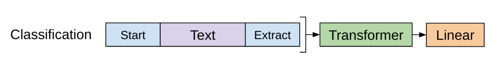

$$ P(y|x_1, \dots, x_n) = \text{softmax}(\mathbf{h}_L^{(n)}\mathbf{W}_y) $$

この損失は，真のラベルに対する負の対数尤度を最小化するものである。
また，LM 損失を補助的な損失として追加することは，以下の理由で有益であることがわかった。
<!-- The loss is to minimize the negative log-likelihood for true labels.
In addition, adding the LM loss as an auxiliary loss is found to be beneficial, because:-->

1. 学習時の収束を早めることができる。
2. 教師付きモデルの汎化性を向上させることが期待される。

<!-- 1. it helps accelerate convergence during training and
2. it is expected to improve the generalization of the supervised  model. -->

$$ \begin{aligned}
{L}_\text{cls} &= \sum_{(\mathbf{x}, y) \in {D}} \log P(y\mid x_1, \dots, x_n) = \sum_{(\mathbf{x}, y) \in {D}} \log \text{softmax}(\mathbf{h}_L^{(n)}(\mathbf{x})\mathbf{W}_y) \\
{L}_\text{LM}  &= -\sum_{i} \log p(x_i\mid x_{i-k}, \dots, x_{i-1}) \\
{L}            &= {L}_\text{cls} + \lambda {L}_\text{LM}
\end{aligned}$$

同様の設計で，他の終端課題のためにカスタマイズされたモデル構造は必要ない (図 7 参照)。
課題の入力が複数の文を含む場合，特別なデリミタトークン (`$`) が文の各対の間に追加される。
このデリミタトークンの埋め込みは新たに学習する必要のあるパラメータであるが，かなり最小限のものであるはずである。
<!-- With similar designs, no customized model structure is needed for other end tasks (see Fig. 7).
If the task input contains multiple sentences, a special delimiter token (`$`) is added between each pair of sentences.
The embedding for this delimiter token is a new parameter we need to learn, but it should be pretty minimal.-->

文の類似性課題では，順序は重要ではないので，両方の順序が含まれる。多肢選択課題では，文脈は全ての回答候補と対になる。
<!-- For the sentence similarity task, because the ordering does not matter, both orderings are included.
For the multiple choice task, the context is paired with every answer candidate. -->

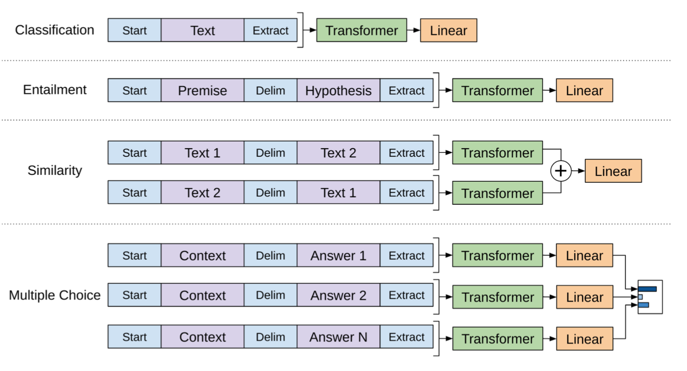

##### 下流課題のために変更した GPT Transformer モデルで訓練対象 (画像出典: [原著論文](https://s3-us-west-2.amazonaws.com/openai-assets/research-covers/language-unsupervised/language_understanding_paper.pdf))
<!-- ##### Fig. 8. Training objects in slightly modified GPT transformer models for downstream tasks. -->
<!-- (Image source: [original paper](https://s3-us-west-2.amazonaws.com/openai-assets/research-covers/language-unsupervised/language_understanding_paper.pdf)) -->

**まとめ**: このような一般的な枠組みが，当時 (2018 年 6 月) のほとんどの言語課題で SOTA に勝るというのは，超すてきで心強いことである。
第一段階では，言語モデルの生成的な事前学習は，可能な限り多くのフリーテキストを吸収することができる。
その後，第 2 段階では，少ないラベル付きデータセットと学習する新しいパラメータの最小セットで，特定の課題でモデルの微調整を行う。
<!-- **Summary**: It is super neat and encouraging to see that such a general framework is capable to beat SOTA on most language tasks at that time (June 2018).
At the first stage, generative pre-training of a language model can absorb as much free text as possible.
Then at the second stage, the model is fine-tuned on specific tasks with a small labeled dataset and a minimal set of new parameters to learn.-->

GPT の限界の一つは，その一方向的な性質であり，モデルは将来の左から右への文脈を予測するためにのみ学習される。
<!-- One limitation of GPT is its uni-directional nature --- the model is only trained to predict the future left-to-right context. -->

<!-- #### 微調整 (fine-tunig) 以外の課題調整法

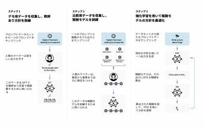

instructGPT の概要 [2022Quyang+](https://arxiv.org/abs/2203.02155) Fig.2 を改変

 -->

#### GPT

OpenAI は **GPT**（**Generative Pre-training Transformer**の略）([Radford+2018](https://s3-us-west-2.amazonaws.com/openai-assets/research-covers/language-unsupervised/language_understanding_paper.pdf)) として，教師なし言語モデルを膨大なフリーテキストコーパスで学習することでより大きな規模に拡張している。

##### 言語モデルとしての Transformer 復号化器<!-- ## 5.1 Transformer Decoder as Language Model-->

[transformer 復号化器](https://arxiv.org/abs/1801.10198) は，[オリジナル Transformer](https://arxiv.org/abs/1706.03762) と比較して，符号化器部分を削除したモデルであり，入力文はソースとターゲットの 2 つではなく，1 つのみである。
<!-- Compared to the [original transformer](https://arxiv.org/abs/1706.03762) architecture, the [transformer decoder](https://arxiv.org/abs/1801.10198) model discards the encoder part, so there is only one single input sentence rather than two separate source and target sequences. -->

このモデルは入力配列の埋め込みに対して複数の Transformer ブロックを適用する。各ブロックはマスク化 **多頭自己注意** 層と **点毎フィードフォワード** 層を含む。最終出力は，ソフトマックス正規化後の目標トークンに対する分布を生成する。
<!-- This model applies multiple transformer blocks over the embeddings of input sequences. Each block contains a masked *multi-headed self-attention* layer and a *pointwise feed-forward* layer. The final output produces a distribution over target tokens after softmax normalization. -->

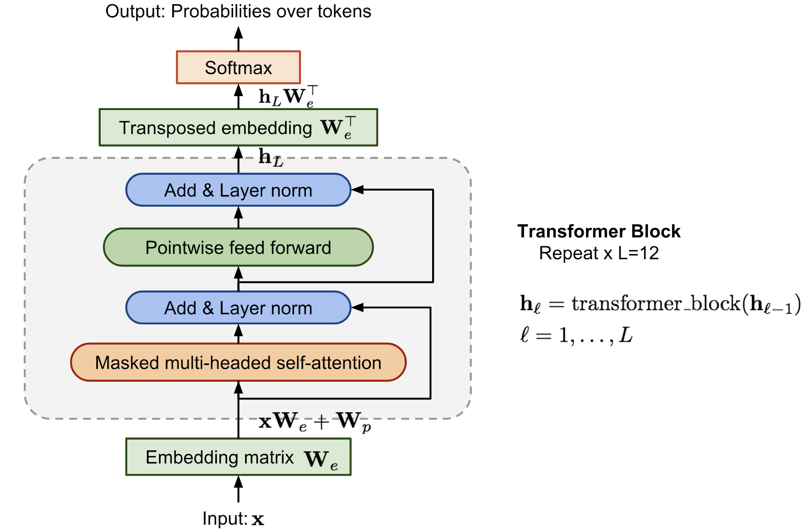

OpenAI の GPT における transformer 復号化器モデルアーキテクチャ<!-- Fig. 7. The transformer decoder model architecture in OpenAI GPT. -->

損失は負の対数尤度であり，[ELMo](#elmo) と同じであるが，後方計算は行わない。例えば，サイズ $k$ の文脈窓が対象単語の前にあるとすると，損失は次のようになる:
<!-- The loss is the negative log-likelihood, same as [ELMo](#elmo), but without backward computation. Let's say, the context window of the size $k$ is located before the target word and the loss would look like: -->

$$ {L}_\text{LM} = -\sum_{i} \log p(x_i\mid x_{i-k}, \dots, x_{i-1}) $$

##### GPT-4
chatGPT の後続モデルである GPT-4 では，マルチモーダル，すなわち，視覚と言語の統合が進んだ。

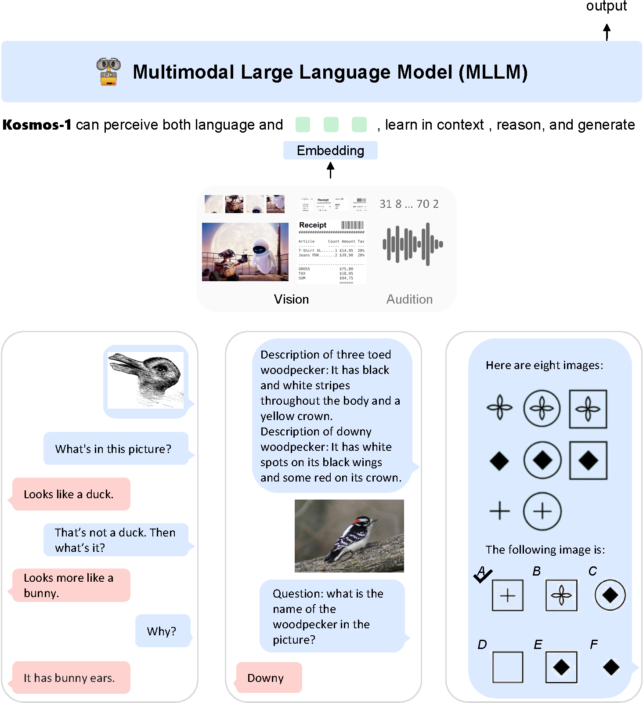

[Kosmos-1 の概念図](https://arXiv.org/abs/2302.14045)

### LangChain と StableDiffusion

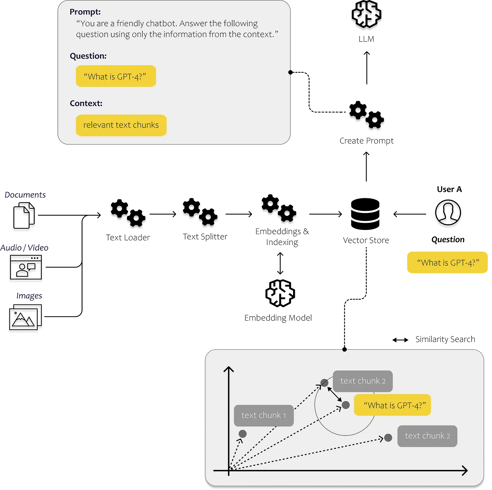
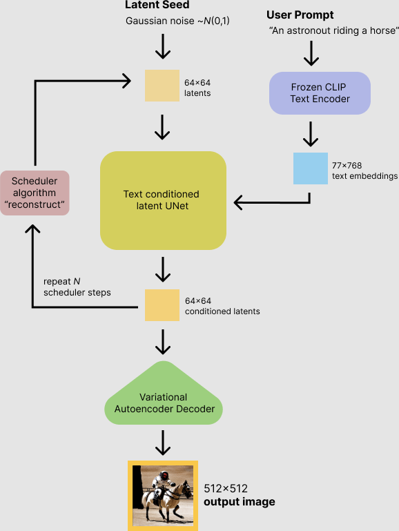

左: [Polzer2023](https://towardsdatascience.com/all-you-need-to-know-to-build-your-first-llm-app-eb982c78ffac) より
右: `https://github.com/patrickvonplaten/scientific_images/tree/master`，

<!-- * [StableDiffusion ](https://colab.research.google.com/github/komazawa-deep-learning/komazawa-deep-learning.github.io/blob/master/2023notebooks/2023_0714stable_diffusion.ipynb) -->

## [Retrieval-augmented generation](https://en.wikipedia.org/wiki/Retrieval-augmented_generation)

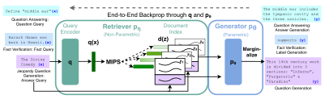

RAG アプローチの概要 
事前学習済みの検索器（クエリ符号化器 + 文書インデックス）と事前学習済みの seq2seq モデル（生成器）を組み合わせ、エンドツーエンドで微調整を行う。クエリ $x$ に対して、最大内積探索（MIPS）を用いて上位 $K$ 個のドキュメント$z_i$ を検索する。最終的な予測値 $y$ については、$z$ を潜在変数として扱い、異なるドキュメントを与えられた seq2seq 予測値に対して周辺化を行う。
<!-- Overview of our approach. We combine a pre-trained retriever (Query Encoder + Document Index) with a pre-trained seq2seq model (Generator) and fine-tune end-to-end. For query x, we use Maximum Inner Product Search (MIPS) to find the top-K documents zi. For final prediction y, we treat z as a latent variable and marginalize over seq2seq predictions given different documents.  -->

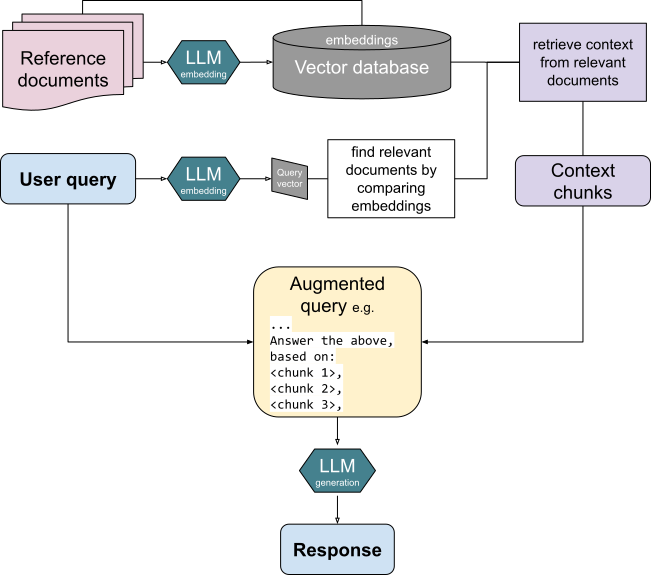

RAG 概要：外部ドキュメントとユーザー入力を LLM プロンプトに統合し、カスタマイズされた出力を生成する。
<!-- Overview of RAG process, combining external documents and user input into an LLM prompt to get tailored output -->

検索拡張生成（RAG）は、大規模言語モデル（LLM）が新しい情報を検索して組み込むことを可能にする技術である[1]。
RAG とは LLM プロセスを Web 検索またはその他のドキュメント検索プロセスと融合させることで LLM の性能を向上させる方法である。
RAG によりり LLM が事実に忠実になる。

RAG では、LLM は指定された文書セットを参照するまで、ユーザーのクエリに応答しない。これらの文書は、LLM の既存の訓練データからの情報を補完する。これにより、LLM は訓練データでは利用できないドメイン固有の情報や更新された情報を使用することができる。

静的な訓練データに依存する LLM とは異なり、RAG はデータベース、アップロードされたドキュメント、または Web ソースから関連するテキストを取得する[1]。

この方法は、AI の幻覚を軽減するのに役立つ。

RAG は、LLM を新しいデータで再学習させる必要性を軽減し、計算コストと費用を節約する[1]。効率性の向上に加え、RAG は LLM が回答に出典を含めることを可能にするため、ユーザーは引用元を検証できる。これにより、ユーザーは取得したコンテンツを相互に確認し、正確性と関連性を確認できるため、透明性が向上する。
<!-- RAG also reduces the need to retrain LLMs with new data, saving on computational and financial costs.[1] Beyond efficiency gains, RAG also allows LLMs to include sources in their responses, so users can verify the cited sources. This provides greater transparency, as users can cross-check retrieved content to ensure accuracy and relevance. -->

### RAG と LLM の限界<!-- ### RAG and LLM Limitations-->

LLM は誤った情報を提供することがある。例えば Google が LLM ツール Google Bard を初公開した際、LLM はジェームズ・ウェッブ宇宙望遠鏡について誤った情報を提供した。この誤りは同社の株価を 1000 億ドル下落させる一因となった[4]。RAG はこうした誤りを防ぐために用いられるが、全ての問題を解決するわけではない。例えば、事実上正しい情報源から引用しても、文脈を誤って解釈すれば誤った情報を生成する可能性がある。[MIT テクノロジーレビュー](https://en.wikipedia.org/wiki/MIT_Technology_Review)は、AI が生成した「米国にはバラク・フセイン・オバマというムスリム大統領が 1 人いた」という回答を例に挙げている。このモデルは学術書『バラク・フセイン・オバマ：アメリカ初のムスリム大統領か？』から引用した。LLM はタイトルの文脈を「知らず」「理解せず」、虚偽の主張を生成した[2]。
<!-- LLMs can provide incorrect information. For example, when Google first demonstrated its LLM tool "Google Bard", the LLM provided incorrect information about the James Webb Space Telescope. This error contributed to a $100 billion decline in the company’s stock value[4]. RAG is used to prevent these errors, but it does not solve all the problems. For example, LLMs can generate misinformation even when pulling from factually correct sources if they misinterpret the context. MIT Technology Review gives the example of an AI-generated response stating, "The United States has had one Muslim president, Barack Hussein Obama." The model retrieved this from an academic book rhetorically titled Barack Hussein Obama: America’s First Muslim President? The LLM did not "know" or "understand" the context of the title, generating a false statement[2]. -->

RAG を備えた LLM は、新規情報を優先するようプログラムされている。この手法は プロンプトスタッフィング prompt stuffing と呼ばれる。プロンプトスタッフィングなしでは、LLM の入力はユーザーによって生成される。プロンプトスタッフィングでは、この入力に追加の関連文脈が加えられ、モデルの応答を誘導する。このアプローチにより、LLM はプロンプトの早い段階で重要な情報を得られ、既存の訓練知識よりも提供されたデータを優先するよう促される[5]。
<!--LLMs with RAG are programmed to prioritize new information. This technique has been called "prompt stuffing." Without prompt stuffing, the LLM's input is generated by a user; with prompt stuffing, additional relevant context is added to this input to guide the model’s response. This approach provides the LLM with key information early in the prompt, encouraging it to prioritize the supplied data over pre-existing training knowledge[5]. -->

### プロセス<!-- ### Process-->

検索拡張生成（RAG）は、情報検索メカニズムを組み込むことで大規模言語モデル（LLM）を強化する。これによりモデルは元の訓練データセットを超えた追加データにアクセスし活用できる。Ars Technica は「新たな情報が利用可能になった場合、モデルを再訓練する必要はなく、更新された情報でモデルの外部知識ベースを拡張するだけでよい」と指摘している（拡張）[4]。IBM は「生成フェーズにおいて、LLM は拡張されたプロンプトと、その訓練データの内部表現から引き出し、その瞬間のユーザーに合わせた魅力的な回答を合成する」と述べている。[1]
<!--Retrieval-augmented generation (RAG) enhances large language models (LLMs) by incorporating an information-retrieval mechanism that allows models to access and utilize additional data beyond their original training set. Ars Technica notes that "when new information becomes available, rather than having to retrain the model, all that’s needed is to augment the model’s external knowledge base with the updated information" ("augmentation").[4] IBM states that "in the generative phase, the LLM draws from the augmented prompt and its internal representation of its training data to synthesize an engaging answer tailored to the user in that instant".[1] -->

### RAG の主要な段階<!-- ### RAG key stages-->

通常、参照対象となるデータは、大規模なベクトル空間の形式で数値表現された LLM 埋め込みに変換されます。RAG は、非構造化データ（通常はテキスト）、半構造化データ、または構造化データ（例えばナレッジグラフ）に使用できる。これらの埋め込みは、ドキュメント検索を可能にするためにベクトルデータベースに保存される。
<!-- Typically, the data to be referenced is converted into LLM embeddings, numerical representations in the form of a large vector space. RAG can be used on unstructured (usually text), semi-structured, or structured data (for example knowledge graphs). These embeddings are then stored in a vector database to allow for document retrieval. -->

ユーザークエリが与えられると、まずドキュメントリト検索器が呼び出され、クエリを拡張するために使用する最も関連性の高いドキュメントが選択される[2][3]。この比較は、使用されるインデックスの種類に応じてさまざまな方法で行うことができる[1]。
<!-- Given a user query, a document retriever is first called to select the most relevant documents that will be used to augment the query[2][3]. This comparison can be done using a variety of methods, which depend in part on the type of indexing used[1]. -->

モデルは、ユーザーの元のクエリを迅速にエンジニアリングすることで、この関連性の高い検索情報を LLM に入力する。新しい実装（2023 年現在）では、クエリを複数のドメインに拡張したり、メモリと自己改善を利用して以前の検索から学習したりする機能を備えた特定の拡張モジュールを組み込むこともできる。
<!-- The model feeds this relevant retrieved information into the LLM via prompt engineering of the user's original query. Newer implementations (as of 2023) can also incorporate specific augmentation modules with abilities such as expanding queries into multiple domains and using memory and self-improvement to learn from previous retrievals. -->

最後に、LLM はクエリと取得した文書の両方に基づいて出力を生成することができる[2][6]。一部のモデルでは、取得した情報の再ランク付け、コンテキスト選択、微調整など、出力を改善するための追加ステップが組み込まれている。
<!--Finally, the LLM can generate output based on both the query and the retrieved documents[2][6]. Some models incorporate extra steps to improve output, such as the re-ranking of retrieved information, context selection, and fine-tuning. -->

<!--### 改善 Improvements

上述の基本過程の改善には RAG フローの種々の段階で適用されている。
Improvements to the basic process above can be applied at different stages in the RAG flow.

#### 符号化器Encoder

これらの手法は、テキストを密ベクトルまたは疎ベクトルとして符号化することに重点を置いている。単語の同一性を符号化する疎ベクトルは、通常辞書長で、ほとんどがゼロで構成される。意味を符号化する密ベクトルはよりコンパクトで、ゼロの数が少なくなる。様々な機能強化により、ベクトルストア（データベース）における類似度の計算方法を改善できる[7]。
These methods focus on the encoding of text as either dense or sparse vectors. Sparse vectors, which encode the identity of a word, are typically dictionary-length and contain mostly zeros. Dense vectors, which encode meaning, are more compact and contain fewer zeros. Various enhancements can improve the way similarities are calculated in the vector stores (databases).[7] 

* ベクトル類似度の計算方法を最適化することで、性能が向上する。ドット積は類似度得点を強化し、近似最近傍法（ANN）検索は K 近傍法（KNN）検索よりも検索効率を向上させる[8]。
* 後インタラクション（Late Interactions）によって精度が向上する可能性がある。後インタラクションは、検索後に系がより正確に単語を比較することを可能にする。これは、文書のランキングを精緻化し、検索の関連性を向上させるのに役立つ[9]。
* ハイブリッドベクトルアプローチは、密ベクトル表現とスパースなワンホットベクトルを組み合わせるために使用でき、スパースドット積の計算効率を密ベクトル演算よりも活用できる[7]。
* 他の検索手法は、文書の選択方法を改善することで精度を向上させることに重点を置いている。SPLADE などの一部の検索手法では、スパース表現とクエリ拡張戦略を組み合わせることで、検索精度と再現率を向上させる[10]。

* Performance improves by optimizing how vector similarities are calculated. Dot products enhance similarity scoring, while approximate nearest neighbor (ANN) searches improve retrieval efficiency over K-nearest neighbors (KNN) searches.[8]
* Accuracy may be improved with Late Interactions, which allow the system to compare words more precisely after retrieval. This helps refine document ranking and improve search relevance.[9]
* Hybrid vector approaches may be used to combine dense vector representations with sparse one-hot vectors, taking advantage of the computational efficiency of sparse dot products over dense vector operations.[7]
* Other retrieval techniques focus on improving accuracy by refining how documents are selected. Some retrieval methods combine sparse representations, such as SPLADE, with query expansion strategies to improve search accuracy and recall.[10]

#### 検索器中心の手法Retriever-centric methods

これらの手法は、ベクトルデータベースにおける文書検索の品質向上を目的としている。
These methods aim to enhance the quality of document retrieval in vector databases:

* 逆クローズタスク（ICT: Inverse Cloze Task）を用いて検索器を事前学習する。これは、文書内のマスクされたテキストを予測することでモデルが検索パターンを学習するのを支援する手法である[11]。
* 教師あり検索器最適化は、検索確率を生成モデルの尤度分布に一致させる。これは、与えられたプロンプトに対して上位 k 個のベクトルを取得し、生成された応答のパープレキシティをスコアリングし、検索器の選択とモデルの尤度との間の KL ダイバージェンスを最小化することで、検索を改良する[12]。
* 再ランキング手法は、学習中に最も関連性の高い検索文書を優先することで、検索器の性能を向上させることができる[13]。

* Pre-training the retriever using the Inverse Cloze Task (ICT), a technique that helps the model learn retrieval patterns by predicting masked text within documents[11].
* Supervised retriever optimization aligns retrieval probabilities with the generator model’s likelihood distribution. This involves retrieving the top-k vectors for a given prompt, scoring the generated response’s perplexity, and minimizing KL divergence between the retriever’s selections and the model’s likelihoods to refine retrieval[12].
* Reranking techniques can refine retriever performance by prioritizing the most relevant retrieved documents during training[13].

### 言語モデルLanguage model

RAG 用 Retro 言語モデル。各 Retro ブロックは、注意層、チャンク化交差注意層、フィードフォワード層で構成される。黒文字のボックスは変更されるデータを示し、青文字は変更を実行するアルゴリズムを示す。
 Retro language model for RAG. Each Retro block consists of Attention, Chunked Cross Attention, and Feed Forward layers. Black-lettered boxes show data being changed, and blue lettering shows the algorithm performing the changes.

検索器を考慮して言語モデルを再設計することで、25 分の 1 の小さなネットワークで、はるかに大きなネットワークと同等のパープレキシティを実現できる[14]。この手法（Retro）はゼロから学習するため、従来の RAG 方式では回避できた高い学習コストが発生する。Retro は学習中にドメイン知識を与えることで、ドメインへの集中度が低くなり、より小さな重みリソースを言語意味論にのみ割り当てることができるという仮説が立てられている。再設計された言語モデルを以下に示す。
By redesigning the language model with the retriever in mind, a 25-time smaller network can get comparable perplexity as its much larger counterparts[14]. Because it is trained from scratch, this method (Retro) incurs the high cost of training runs that the original RAG scheme avoided. The hypothesis is that by giving domain knowledge during training, Retro needs less focus on the domain and can devote its smaller weight resources only to language semantics. The redesigned language model is shown here.

Retro は再現性がないことが報告されているため、再現性を高めるための修正が行われた。より再現性の高いバージョンは Retro++ と呼ばれ、コンテキスト内 RAG[15] を備えている。
It has been reported that Retro is not reproducible, so modifications were made to make it so. The more reproducible version is called Retro++ and includes in-context RAG[15].

### チャンク化 Chunking

チャンキングとは、データをベクトルに分割するための様々な手法を指す。これにより検索システムが詳細情報を見つけられるようになる。
Chunking involves various strategies for breaking up the data into vectors so the retriever can find details in it.

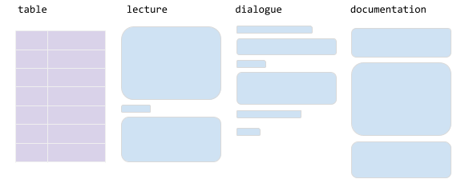

異なるデータ形式には、適切なチャンキングが活用できるパターンが存在する
Different data styles have patterns that correct chunking can take advantage of.

チャンク化戦略には 3 つの種類がある[要出典]。Three types of chunking strategies are:[citation needed]

* 固定長でオーバーラップさせる。これは高速かつ簡単である。連続するチャンクをオーバーラップさせることで、チャンク間の意味的コンテキストを維持するのに役立つ。
* 構文ベースのチャンクは、ドキュメントを文に分割できる。spaCy や NLTK などのライブラリも役立つ。
* ファイル形式ベースのチャンク化。特定のファイルタイプには自然なチャンクが組み込まれているため、それを尊重するのが最善である。例えば、コードファイルは関数またはクラス全体としてチャンク化し、ベクトル化するのが最適である。HTML ファイルでは、`<table>` 要素または base64 エンコードされた `` 要素をそのまま残す必要がある。PDF ファイルについても同様の考慮が必要である。Unstructured や Langchain などのライブラリは、この方法に役立つ。

* Fixed length with overlap. This is fast and easy. Overlapping consecutive chunks helps to maintain semantic context across chunks.
* Syntax-based chunks can break the document up into sentences. Libraries such as spaCy or NLTK can also help.
* File format-based chunking. Certain file types have natural chunks built in, and it's best to respect them. For example, code files are best chunked and vectorized as whole functions or classes. HTML files should leave <table> or base64 encoded  elements intact. Similar considerations should be taken for pdf files. Libraries such as Unstructured or Langchain can assist with this method.

### ハイブリッド検索 Hybrid search

ベクトルデータベース検索では、ユーザーの質問に答えるために必要な重要な事実が見逃されることがある。これを軽減する方法の一つは、従来のテキスト検索を行い、その結果をベクトル検索で取得したベクトルにリンクされたテキストチャンクに追加し、そのハイブリッドテキストを言語モデルに入力して生成することである[要出典]。
<!-- Sometimes vector database searches can miss key facts needed to answer a user's question. One way to mitigate this is to do a traditional text search, add those results to the text chunks linked to the retrieved vectors from the vector search, and feed the combined hybrid text into the language model for generation.[citation needed]

### 評価とベンチマークEvaluation and benchmarks

RAG システムは、検索可能性、検索精度、生成品質をテストするために設計されたベンチマークを用いて評価されるのが一般的である。よく使用されるデータセットには、多様な分野にわたる情報検索課題群である BEIR や、オープンドメイン QA 用の Natural Questions や Google QA などがある[要出典]。
RAG systems are commonly evaluated using benchmarks designed to test retrievability, retrieval accuracy and generative quality. Popular datasets include BEIR, a suite of information retrieval tasks across diverse domains, and Natural Questions or Google QA for open-domain QA.[citation needed]

### 課題 Challenges

RAG は LLM における幻覚を防ぐものではない。Ars Technica によると、「LLM は依然として応答においてソース資料に関する幻覚を生じる可能性があるため、直接的な解決策ではあない[4]」。
RAG does not prevent hallucinations in LLMs. According to Ars Technica, "It is not a direct solution because the LLM can still hallucinate around the source material in its response."[4]

RAG は大規模言語モデル（LLM）の精度を向上させるが、すべての課題を解消するわけではない。RAG の限界の一つは、頻繁なモデルの再学習の必要性は軽減するものの、完全に排除できるわけではないことである。さらに、LLM は信頼できる応答を提供するのに十分な情報が不足している場合、それを認識するのが困難になる場合がある。特別な学習を行わないと、モデルは不確実性を示すべき場合でも回答を生成する可能性がある。IBM によると、この問題は、モデルが自身の知識の限界を評価できない場合に発生する可能性がある[1]。
While RAG improves the accuracy of large language models (LLMs), it does not eliminate all challenges. One limitation is that while RAG reduces the need for frequent model retraining, it does not remove it entirely. Additionally, LLMs may struggle to recognize when they lack sufficient information to provide a reliable response. Without specific training, models may generate answers even when they should indicate uncertainty. According to IBM, this issue can arise when the model lacks the ability to assess its own knowledge limitations.[1]

RAG システムは、事実上は正しいものの誤解を招くような情報源を取得し、解釈の誤りにつながる可能性がある。場合によっては、LLM は文脈を考慮せずに情報源から文を抽出し、誤った結論に至ることがある。さらに、矛盾する情報に直面した場合、RAG モデルはどちらの情報源が正確であるかを判断するのに苦労する可能性がある。この制限による最悪の結果は、モデルが複数の情報源からの詳細情報を統合し、古い情報と最新の情報を混在させた誤解を招くような回答を生成する可能性があることである。MIT Technology Review によると、これらの問題は RAG システムが取得したデータを誤って解釈する可能性があるために発生する[2]。
RAG systems may retrieve factually correct but misleading sources, leading to errors in interpretation. In some cases, an LLM may extract statements from a source without considering its context, resulting in an incorrect conclusion. Additionally, when faced with conflicting information RAG models may struggle to determine which source is accurate. The worst case outcome of this limitation is that the model may combine details from multiple sources producing responses that merge outdated and updated information in a misleading manner. According to the MIT Technology Review, these issues occur because RAG systems may misinterpret the data they retrieve.[2]

## Reference-->

1. "[What is retrieval-augmented generation?](https://research.ibm.com/blog/retrieval-augmented-generation-RAG)". IBM. 22 August 2023. Retrieved 7 March 2025.
2. "[Why Google's AI Overviews gets things wrong](https://www.technologyreview.com/2024/05/31/1093019/why-are-googles-ai-overviews-results-so-bad/)". MIT Technology Review. 31 May 2024. Retrieved 7 March 2025.
3. Kiela Douwe, Lewis Patrick, Perez Ethan, Piktus Aleksandra, Petroni Fabio, Karpukhin Vladimir, Goyal Naman, Küttler Heinrich, Lewis Mike, Yih Wen-Tau, Rocktäschel Tim, Riedel Sebastian (2020). [Retrieval-Augmented Generation for Knowledge-Intensive NLP Tasks](https://dl.acm.org/doi/abs/10.5555/3495724.3496517). pp. 9459–9474. arXiv:2005.11401. ISBN 978-1-7138-2954-6.
4. "[Can a technology called RAG keep AI models from making stuff up?](https://arstechnica.com/ai/2024/06/can-a-technology-called-rag-keep-ai-models-from-making-stuff-up/)". Ars Technica. 6 June 2024. Retrieved 7 March 2025.
5. "[Mitigating LLM hallucinations in text summarisation](https://www.bbc.co.uk/rd/articles/2024-06-mitigating-llm-hallucinations-in-text-summarisation)". BBC. 20 June 2024. Retrieved 7 March 2025.
6. Lewis, Patrick; Perez, Ethan; Piktus, Aleksandra; Petroni, Fabio; Karpukhin, Vladimir; Goyal, Naman; Küttler, Heinrich; Lewis, Mike; Yih, Wen-tau; Rocktäschel, Tim; Riedel, Sebastian; Kiela, 
 Douwe (2020). "[Retrieval-Augmented Generation for Knowledge-Intensive NLP Tasks](https://proceedings.neurips.cc/paper/2020/hash/6b493230205f780e1bc26945df7481e5-Abstract.html)". Advances in Neural Information Processing Systems. 33. Curran Associates, Inc.: 9459–9474. arXiv:2005.11401.

<!-- 7. Luan, Yi; Eisenstein, Jacob; Toutanova, Kristina; Collins, Michael (26 April 2021). "[Sparse, Dense, and Attentional Representations for Text Retrieval](https://direct.mit.edu/tacl/article/doi/10.1162/tacl_a_00369/100684/Sparse-Dense-and-Attentional-Representations-for)". Transactions of the Association for Computational Linguistics. 9: 329–345. arXiv:2005.00181. doi:10.1162/tacl_a_00369. Retrieved 15 March 2025.
8. "[Information retrieval](https://learn.microsoft.com/en-us/azure/architecture/ai-ml/guide/rag/rag-information-retrieval)". Microsoft. 10 January 2025. Retrieved 15 March 2025.
9. Khattab, Omar; Zaharia, Matei (2020). "[ColBERT: Efficient and Effective Passage Search via Contextualized Late Interaction over BERT](https://dl.acm.org/doi/10.1145/3397271.3401075)". Proceedings of the 43rd International ACM SIGIR Conference on Research and Development in Information Retrieval. pp. 39–48. doi:10.1145/3397271.3401075. ISBN 978-1-4503-8016-4.
10.  Wang, Yup; Conroy, John M.; Molino, Neil; Yang, Julia; Green, Mike (2024). "[Laboratory for Analytic Sciences in TREC 2024 Retrieval Augmented Generation Track](https://trec.nist.gov/pubs/trec33/index.html)". NIST TREC 2024. Retrieved 15 March 2025.
11. Lee, Kenton; Chang, Ming-Wei; Toutanova, Kristina (2019). "[Latent Retrieval for Weakly Supervised Open Domain Question Answering](https://aclanthology.org/P19-1612.pdf)" (PDF).
12. Shi, Weijia; Min, Sewon; Yasunaga, Michihiro; Seo, Minjoon; James, Rich; Lewis, Mike; Zettlemoyer, Luke; Yih, Wen-tau (June 2024). "[REPLUG: Retrieval-Augmented Black-Box Language Models](https://aclanthology.org/2024.naacl-long.463/)". Proceedings of the 2024 Conference of the North American Chapter of the Association for Computational Linguistics: Human Language Technologies (Volume 1: Long Papers). pp. 8371–8384. arXiv:2301.12652. doi:10.18653/v1/2024.naacl-long.463. Retrieved 16 March 2025.
13. Ram, Ori; Levine, Yoav; Dalmedigos, Itay; Muhlgay, Dor; Shashua, Amnon; Leyton-Brown, Kevin; Shoham, Yoav (2023). "[In-Context Retrieval-Augmented Language Models](https://aclanthology.org/2023.tacl-1.75/)". Transactions of the Association for Computational Linguistics. 11: 1316–1331. arXiv:2302.00083. doi:10.1162/tacl_a_00605. Retrieved 16 March 2025.
14. Borgeaud, Sebastian; Mensch, Arthur (2021). "[Improving language models by retrieving from trillions of tokens](https://proceedings.mlr.press/v162/borgeaud22a/borgeaud22a.pdf)" (PDF).
15. Wang, Boxin; Ping, Wei; Xu, Peng; McAfee, Lawrence; Liu, Zihan; Shoeybi, Mohammad; Dong, Yi; Kuchaiev, Oleksii; Li, Bo; Xiao, Chaowei; Anandkumar, Anima; Catanzaro, Bryan (2023). "[Shall We Pretrain Autoregressive Language Models with Retrieval? A Comprehensive Study](https://aclanthology.org/2023.emnlp-main.482/)". Proceedings of the 2023 Conference on Empirical Methods in Natural Language Processing. pp. 7763–7786. doi:[10.18653/v1/2023.emnlp-main.482](https://doi.org/10.18653%2Fv1%2F2023.emnlp-main.482). -->
# 強化学習，条件付けの古典

<a href="https://www.nobelprize.org/prizes/medicine/1904/pavlov/biographical/">Ian Pavlov</a>&nbsp;&nbsp;

<a href="https://www.bfskinner.org/archives/photos/">Burrhus Frederic Skinner</a>&nbsp;&nbsp;

<a href="https://awards.acm.org/award-recipients/sutton_0160594">Richard S. Sutton,</a>&nbsp;&nbsp;
<!--  -->
<!--  -->
<!-- <a href="http://incompleteideas.net/">Richard S. Sutton,</a>&nbsp;&nbsp; -->

<a href="https://people.cs.umass.edu/~barto/">Andrew G. Barto</a>

- [パブロフ](https://en.wikipedia.org/wiki/Ivan_Pavlov) (Ivan Petrovich Pavlov; 1849/Sep/14-1936/Feb/27)古典的条件づけ 1904 年ノーベル医学生理学賞
- [スキナー](https://en.wikipedia.org/wiki/B._F._Skinner) (Burrhus Frederic Skinner; 1904/Mar/20-1990/Aug/18) 道具的条件付け， オペラント条件づけ，[スキナー箱, Skinner(1938) Fig.1, page 39 より](./assets/1938Skinner_Fig1_skinnerBOX.jpg)
- [Sutton](http://incompleteideas.net/) and [Barto](http://www-anw.cs.umass.edu/~barto/) の強化学習 [初版 1998年](http://incompleteideas.net/book/first/the-book.html), [第2版 2018年](http://incompleteideas.net/book/the-book-2nd.html), [初版は翻訳あり](https://www.amazon.co.jp/dp/4627826613/)，第2版は pdf ファイルで[ダウンロード可能](http://incompleteideas.net/book/bookdraft2017nov5.pdf)

# 強化学習とは何か？

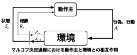 

Sutton & Barto (2018) Fig. 3.2 を改変

強化学習という言葉は古い言葉だが機械学習の文脈では，環境とその環境におかれた動作主（エージェントと言ったり，ロボットシステムだったり）が，環境と相互作用しながらより良い行動を形成するためのモデルである。
動作主は，環境から受け取った現在の状態を分析して，次にとるべき行動を選択する。強化学習とは，将来に渡って報酬が最大となるような行動を学習する手法の一つである。

2015 年には，Google 傘下のデープマインドというスタートアップチームが開発した囲碁プログラム AlphaGo がプロ棋士のイ・セドル氏に勝利し話題となった。
AlphaGo は強化学習を基本技術の一つとして用いている。

<!-- 1. [強化学習(1): 基礎](https://komazawa-deep-learning.github.io/rl01_elements.pdf)
2. [強化学習(2): エージェントと環境](https://komazawa-deep-learning.github.io/rl02_agentAndEnv.pdf)
3. [強化学習(3): 目標と報酬](https://komazawa-deep-learning.github.io/rl03_goalAndReward.pdf)
4. [強化学習(4): マルコフ決定過程](https://komazawa-deep-learning.github.io/rl04_mdp.pdf)
5. [強化学習(5): 価値反復，方策反復](https://komazawa-deep-learning.github.io/rl05_vi.pdf)
6. [強化学習(6): ](https://komazawa-deep-learning.github.io/rl06_advanced.pdf)
6. [強化学習(7): ](https://komazawa-deep-learning.github.io/rl07_robotics.pdf) -->

#### 用語

- エージェント，環境，マルコフ決定過程 MDP，POMDP，効用関数，ベルマン方程式，探索と利用のジレンマ，SARSA, REINFORCE
- 価値，方針，Q 学習，モデルベース対モデルフリー，アクター=クリティック
- 深層 Q 学習:
- ゲーム AI へ (AlphaGo，AlphaGoZero，OpenAI five)
- セルフプレイ:
- A3C，Rainbow，RDT，World models

<!-- ### 方針 Policy，報酬 Reward，価値関数 Value functions, 状態-価値関数 State Value function，(環境)モデル

- $s,s'$: 状態 state
- $a$: 行動，行為 action
- $r$: 報酬 reward
- $t$: 時間 (離散時間 $t=1,2,\ldots,T$)
- $p(s',r\vert s, a)$: 状態 $s$ で行為 $a$ を行ったとき，報酬 $r$ を受け取って 状態 $s'$ に遷移する確率
- $p(s'\vert s, a)$: 状態 $s$ で行為 $a$ を行った場合，状態 $s'$ へ遷移する確率
- $r(s,a)$: 状態 $s$ で行為 $a$ を行った場合の即時報酬 immediate reward の期待値
- $r(s,a,s')$: 行為 $a$ を行った場合状態が $s$ から $s'$ へ変化したときの即時報酬の期待値
- $v_\pi(s)$: 方策 $\pi$ での状態 $s$ の価値 (期待報酬)
- $v_*(s)$: 最適方策化での状態 $s$ の価値
- $q_\pi(s,a)$: 方策 $\pi$ のもとで状態 $s$ で行為 $a$ をおこなた場合の価値
- $q_*(a)$: 行動 $a$ を行った場合の期待報酬(真の報酬) <!-- true value (expected reward) of action $a$

- $Q_t(a)$: 時刻 $t$ での $q_*(a)$ の期待値 q estimates at time $t$ of $q_*(a)$
- $N_t(a)$: 時刻 $t$ で行為 $a$ を行った回数 number of times action $a$ has been selected up prior to time $t$
- $H_t(a$) 時刻 $t$ で行為 $a$ を行う傾向(選好 preference) learned preference for selecting action a at time $t$
- $\pi_t(a)$: 時刻 $t$ で行為 $a$ を選択する確率 probability of selecting action a at time $t$
- $R_t$: $\pi_t$ が与えられた場合，時刻 $t$ における の期待報酬estimate at time $t$ of the expected reward given $\pi_t$ -->

### [Richard Sutton, ACM Turing Award 2024](https://awards.acm.org/award-recipients/sutton_0160594)

 
Award Recipient: Dr. Richard Sutton, ACM A. M. Turing Award (2024)

Andrew Barto と Richard Sutton が、2024 年度 ACM A.M.チューリング賞を受賞した。1980 年代に始まった一連の論文において、Barto と Sutton は、知能システムを構築するための最も重要なアプローチの一つである強化学習の主要なアイデアを提示し、数学的基礎を構築し、重要なアルゴリズムを開発した。Barto はマサチューセッツ大学 Amherst 校のコンピュータサイエンスの名誉教授であり、Sutton は Alberta 大学のコンピュータサイエンスの教授であり、Keen Technologies キーン・テクノロジーズの研究者。
<!-- Andrew Barto and Richard Sutton are the recipients of the 2024 ACM A.M. Turing Award. In a series of papers beginning in the 1980s, Barto and Sutton introduced the main ideas, constructed the mathematical foundations, and developed important algorithms for reinforcement learning, one of the most important approaches for creating intelligent systems. Barto is Professor Emeritus of Computer Science at the University of Massachusetts, Amherst; Sutton is Professor of Computing Science at the University of Alberta and Research Scientist at Keen Technologies. -->

人工知能（AI）の分野は、一般的にエージェント、つまり知覚し行動する存在の構築に取り組んでいる。より知的なエージェントとは、より良い行動方針を選択するエージェントのことである。したがって、ある行動方針が他の行動方針よりも優れているという概念は、AI の中心的な概念である。
<!-- The field of artificial intelligence (AI) is generally concerned with constructing agents-that is, entities that perceive and act. More intelligent agents are those that choose better courses of action. Thus, the notion that some courses of action are better than others is central to AI.-->

報酬 Reward（心理学と神経科学から借用された用語）とは、エージェントの行動の質に関連してエージェントに与えられる信号を指す。強化学習（RL: Reinforcement Learning）とは、この信号を与えられてより成功する行動をとるように学習する過程である。
<!-- Reward-a term borrowed from psychology and neuroscience-denotes a signal provided to an agent related to the quality of its behavior; and reinforcement learning (RL) is the process of learning to behave more successfully given this signal. -->

報酬から学習するという考え方は、動物の調教師には数千年もの間、よく知られていた。Alan Turing 自身も、1950 年の論文「計算機械と知能」の中で、「報酬と罰」に基づく機械学習のアプローチを提案し、このアプローチを用いていくつかの初期実験を行ったと報告している。Arthur Samuel が 1956 年にテレビで実演した自己学習型チェッカープログラムは、おそらく強化学習の最初の成功例と言えるだろう。ただし、それがなぜ機能するのか、あるいは機能するかどうかについて、いかなる根拠もなかった。
<!-- The idea of learning from reward has been familiar to animal trainers for thousands of years. Alan Turing himself, in his 1950 paper "Computing Machinery and Intelligence," proposed an approach to machine learning based on "rewards and punishments" and reported having conducted some initial experiments with this approach. Arthur Samuel's self-learning checker-playing program, demonstrated on television in 1956, was perhaps the first successful example of reinforcement learning-although it lacked any form of justification as to why or whether it would work. -->

AI 分野において、この点でのさらなる進歩はほとんど見られなかったが、1980 年代初頭、Barto と博士課程の学生 Sutton が心理学の観察に着想を得て、強化学習を一般的な問題枠組みとして定式化し始めた。彼らは、マルコフ決定過程（MDP: Markov Decision Process）の数学的基盤を利用した。MDP では、エージェントは確率的な環境において意思決定を行い、各遷移ごとに報酬信号を受け取り、長期的な累積報酬の最大化を目指す。標準的な MDP 理論では、エージェントが MDP に関するすべての情報を知っていると想定されているが、RL の枠組みでは、環境と報酬が未知であっても構わない。RL の最小限の情報要件と MDP の枠組みの汎用性を組み合わせることで、RL アルゴリズムを幅広い問題に適用することが可能になる。詳細は後述する。
<!-- Within the field of AI, little further progress occurred in this vein until the early 1980s, when Barto and his Ph.D. student Sutton, motivated by observations from psychology, began to formulate reinforcement learning as a general problem framework. They drew on the mathematical foundation provided by Markov decision processes (MDPs), wherein an agent makes decisions in a stochastic environment, receiving a reward signal after each transition and aiming to maximize its long-term cumulative reward. Whereas standard MDP theory assumes that everything about the MDP is known to the agent, the RL framework allows for the environment and the rewards to be unknown. The minimal information requirements of RL, combined with the generality of the MDP framework, allows RL algorithms to be applied to a vast range of problems, as explained further below. -->

Barto と Sutton は、共同で、また他の研究者と共同で、時間差分学習 Temporal Difference、方針勾配法 Policy Gradient、学習済み関数を表現するツールとしてのニューラルネットワークの利用など、RL の基本的なアルゴリズム的アプローチの多くを開発した。彼らはまた、学習と計画を組み合わせたエージェント設計を提案し、計画の基礎として環境に関する知識を獲得することの価値を示した。同様に重要なのは、この分野の標準的な参考文献であり、75,000 回以上引用されている教科書『強化学習入門』（1998年）であろう。この本によって、何千人もの研究者がこの新興分野を理解し、貢献することができた。その結果、強化学習は今日のコンピュータサイエンスにおいて最も活発な研究分野の一つとなっている。
<!-- Barto and Sutton, jointly and with other authors, developed many of the basic algorithmic approaches for RL, including temporal difference learning, policy-gradient methods, and the use of neural networks as a tool to represent learned functions. They also proposed agent designs that combined learning and planning, demonstrating the value of acquiring knowledge of the environment as a basis for planning. Perhaps equally important was the textbook, Reinforcement Learning: An Introduction (1998), which is the standard reference in the field and has been cited over 75,000 times. It allowed thousands of researchers to understand and contribute to this emerging field. As a result, RL is among the most active research areas in computer science today. -->

近年の強化学習の最も顕著な例は、2016 年と 2017 年に AlphaGo が人間の最強囲碁プレイヤーに勝利したことである。しかし、強化学習はロボットの運動技能学習、ネットワーク輻輳制御、チップ設計、インターネット広告、最適化、グローバルサプライチェーンの最適化、チャットボットの行動と推論能力の向上、さらにはコンピュータサイエンスにおける最も古い問題の一つである行列乗算のアルゴリズムの改善など、多くの分野で成功を収めている。ついに、神経科学に部分的にヒントを得た技術が恩返しをした。Barto の研究を含む最近の研究では、AI で開発された特定の RL アルゴリズムが、脳内のドーパミン系に関するさまざまな発見を最もよく説明することが示されている。
<!--The most prominent example of RL in recent years was the victory by AlphaGo over the best human Go players in 2016 and 2017; but RL has achieved success in many areas including robot motor skill learning, network congestion control, chip design, internet advertising, optimization, global supply chain optimization, improving the behavior and reasoning capabilities of chatbots, and even improving algorithms for one of the oldest problems in computer science, matrix multiplication. Finally, a technology that was partly inspired by neuroscience has returned the favor: recent research, including work by Barto, has shown that specific RL algorithms developed in AI provide the best explanations for a wide range of findings concerning the dopamine system in the brain. -->

<iframe width="705" height="397" src="https://www.youtube.com/embed/sNtuVLO3yaE" title="2024 ACM A.M. Turing Award" frameborder="0" allow="accelerometer; autoplay; clipboard-write; encrypted-media; gyroscope; picture-in-picture; web-share" referrerpolicy="strict-origin-when-cross-origin" allowfullscreen></iframe>
<!-- <video src="/2025assets/2024ACM_Turing_Award.mp4" type="video/mp4" autoplay muted playsinline loop style="margin:auto; width:44%;" ></video> -->

ACM は、強化学習の概念的およびアルゴリズム的基盤の構築に尽力した功績により、[Andrew G. Barto](https://awards.acm.org/award-recipients/barto_9471663){:target="_blank"} と [Richard S. Sutton](https://awards.acm.org/award-recipients/sutton_0160594){:target="_blank"} を 2024 年度 ACM A.M. Turing 賞の受賞者に選出した。1980 年代に始まった一連の論文において、Burto と Sutton は、強化学習の主要なアイデアを提示し、数学的基盤を構築し、重要なアルゴリズムを開発しました。強化学習は、知能システムを構築するための最も重要なアプローチの 1 つである。

Burto は、マサチューセッツ大学 Amherst 校の情報科学・コンピュータサイエンス科の名誉教授です。Sutton は、Alberta 大学のコンピュータサイエンス科教授、Keen Technologies の研究者、そして Amii（アルバータ機械知能研究所）のフェローである。

ACM A.M.チューリング賞は「コンピューター界のノーベル賞」とも呼ばれ、Google 社による資金援助を受けて 100 万ドルの賞金が授与される。この賞は、コンピューターの数学的基礎を明確にしたイギリスの数学者、アラン・M・Turing にちなんで名付けられた。

<!-- ACM has named Andrew G. Barto and Richard S. Sutton as the recipients of the 2024 ACM A.M. Turing Award for developing the conceptual and algorithmic foundations of reinforcement learning. In a series of papers beginning in the 1980s, Barto and Sutton introduced the main ideas, constructed the mathematical foundations, and developed important algorithms for reinforcement learning—one of the most important approaches for creating intelligent systems.

Barto is Professor Emeritus of Information and Computer Sciences at the University of Massachusetts, Amherst. Sutton is a Professor of Computer Science at the University of Alberta, a Research Scientist at Keen Technologies, and a Fellow at Amii (Alberta Machine Intelligence Institute).

The ACM A.M. Turing Award, often referred to as the “Nobel Prize in Computing,” carries a $1 million prize with financial support provided by Google, Inc. The award is named for Alan M. Turing, the British mathematician who articulated the mathematical foundations of computing. -->

### 強化学習とは？<!-- ### What is Reinforcement Learning?-->

人工知能（AI）の分野は、一般的にエージェント、つまり知覚し行動する存在の構築に取り組んでいる。より知的なエージェントとは、より良い行動方針を選択するエージェントのことである。したがって、ある行動方針が他の行動方針よりも優れているという概念は AI の中心的な概念である。報酬（心理学と神経科学から借用された用語）とは、エージェントの行動の質に関連してエージェントに与えられる信号を指す。強化学習（RL）とは、この信号を与えられたときに、より効果的な行動をとるように学習過程である。
<!-- The field of artificial intelligence (AI) is generally concerned with constructing agents—that is, entities that perceive and act. More intelligent agents are those that choose better courses of action. Therefore, the notion that some courses of action are better than others is central to AI. Reward—a term borrowed from psychology and neuroscience—denotes a signal provided to an agent related to the quality of its behavior. Reinforcement learning (RL) is the process of learning to behave more successfully given this signal. -->

報酬から学習するという考え方は、動物の調教師にとって数千年もの間馴染み深いものであった。その後、Alan Turing が 1950 年に発表した論文「計算機械と知能」は、「機械は考えることができるか？」という問いに答え、報酬と罰に基づく機械学習へのアプローチを提案した。
<!-- The idea of learning from reward has been familiar to animal trainers for thousands of years. Later, Alan Turing’s 1950 paper “Computing Machinery and Intelligence,” addressed the question “Can machines think?” and proposed an approach to machine learning based on rewards and punishments. -->

Turing はこのアプローチを用いた初期の実験を行ったと報告し、Arther Samuel は 1950 年代後半に自己対戦から学習するチェッカー・プログラムを開発したが、その後数十年間、この分野の AI はほとんど進歩しなかった。1980 年代初頭、心理学の観察に触発され、Burto と博士課程の学生 Sutton は、強化学習を一般的な問題枠組みとして定式化し始めた。
<!-- While Turing reported having conducted some initial experiments with this approach and Arthur Samuel developed a checker-playing program in the late 1950s that learned from self-play, little further progress occurred in this vein of AI in the following decades. In the early 1980s, motivated by observations from psychology, Barto and his PhD student Sutton began to formulate reinforcement learning as a general problem framework. -->

彼らは、Markov 決定過程（MDP）が提供する数学的基盤を利用した。MDP では、エージェントは確率的（ランダムに決定される）環境において意思決定を行い、各遷移後に報酬信号を受け取り、長期的な累積報酬の最大化を目指す。標準的な MDP 理論では、エージェントが MDP に関するすべての情報を知っていると想定されるが、強化学習（RL）の枠組みでは、環境と報酬が未知であっても構わない。強化学習の最小限の情報要件と MDP の枠組みの汎用性を組み合わせることで、強化学習アルゴリズムを幅広い問題に適用することが可能になる。これについては後述する。
<!-- They drew on the mathematical foundation provided by Markov decision processes (MDPs), wherein an agent makes decisions in a stochastic (randomly determined) environment, receiving a reward signal after each transition and aiming to maximize its long-term cumulative reward. Whereas standard MDP theory assumes that everything about the MDP is known to the agent, the RL framework allows for the environment and the rewards to be unknown. The minimal information requirements of RL, combined with the generality of the MDP framework, allows RL algorithms to be applied to a vast range of problems, as explained further below. -->

Barto と Sutton は、他の研究者と共同で、強化学習（RL）の基本的なアルゴリズム的アプローチの多くを開発した。これには、報酬予測問題の解決に重要な進歩をもたらした時間差分学習（TDP）の最も重要な貢献、方針勾配法、そして学習済み関数を表現するツールとしてのニューラルネットワークの利用が含まれる。また、学習と計画を組み合わせたエージェント設計を提案し、計画の基礎として環境に関する知識を獲得することの価値を示した。
<!--Barto and Sutton, jointly and with others, developed many of the basic algorithmic approaches for RL. These include their foremost contribution, temporal difference learning, which made an important advance in solving reward prediction problems, as well as policy-gradient methods and the use of neural networks as a tool to represent learned functions. They also proposed agent designs that combined learning and planning, demonstrating the value of acquiring knowledge of the environment as a basis for planning. -->

おそらく同等に影響力があったのは、彼らの教科書『強化学習入門』（1998 年）である。これは今なおこの分野の標準的な参考文献であり、75,000 回以上引用されている。この本によって数千人の研究者がこの新興分野を理解し貢献することが可能となり、今日でもコンピュータサイエンスにおける多くの重要な研究活動の原動力となっている。
<!-- Perhaps equally influential was their textbook, Reinforcement Learning: An Introduction (1998), which is still the standard reference in the field and has been cited over 75,000 times. It allowed thousands of researchers to understand and contribute to this emerging field and continues to inspire much significant research activity in computer science today.-->

Barto と Sutton のアルゴリズムは数十年前に開発されたが、強化学習の実用的な応用における大きな進歩は、過去 15 年間に強化学習と深層学習アルゴリズム（2018 年チューリング賞受賞者 Bengio, Hinton, LeCun が先駆けた）を融合させることで実現した。これが深層強化学習という技術につながった。
<!-- Although Barto and Sutton’s algorithms were developed decades ago, major advances in the practical applications of RL came about in the past fifteen years by merging RL with deep learning algorithms (pioneered by 2018 Turing Awardees Bengio, Hinton, and LeCun). This led to the technique of deep reinforcement learning. -->

強化学習の最も顕著な事例は、2016 年と 2017 年に AlphaGo が人間のトップ囲碁プレイヤーを破った勝利だ。最近のもう一つの大きな成果は、チャットボット ChatGPT の開発である。ChatGPT は大規模言語モデル（LLM）であり、二段階の訓練を経ており、第二段階では人間の期待値を捉えるために「人間からのフィードバックによる強化学習（RLHF）」と呼ばれる技術が用いられている。
<!-- The most prominent example of RL was the victory by the AlphaGo computer program over the best human Go players in 2016 and 2017. Another major achievement recently has been the development of the chatbot ChatGPT. ChatGPT is a large language model (LLM) trained in two phases, the second of which employs a technique called reinforcement learning from human feedback (RLHF), to capture human expectations. -->

強化学習は他の多くの分野でも成功を収めている。注目すべき研究例として、ロボットの運動技能学習が挙げられる。具体的には、ロボットによる物理的操作（ルービックキューブ）の解決において、強化学習の全工程をシミュレーション環境で実施しながらも、最終的には大きく異なる実世界での成功を可能にした。
<!-- RL has achieved success in many other areas as well. A high-profile research example is robot motor skill learning in the in-hand robotic manipulation and solution of a physical (Rubik’s Cube), which showed it possible to do all the reinforcement learning in simulation yet ultimately be successful in the significantly different real world. -->

その他の応用分野には、ネットワーク輻輳制御、チップ設計、インターネット広告、最適化、グローバルサプライチェーン最適化、チャットボットの行動・推論能力向上、さらにはコンピュータサイエンスにおける最も古い問題の一つである行列乗算のアルゴリズム改善まで含まれる。
<!-- Other areas include network congestion control, chip design, internet advertising, optimization, global supply chain optimization, improving the behavior and reasoning capabilities of chatbots, and even improving algorithms for one of the oldest problems in computer science, matrix multiplication. -->

最後に、神経科学から部分的に着想を得た技術が恩返しをした。Barto らの研究を含む最近の知見は、AI で開発された特定の強化学習アルゴリズムが、ヒト脳のドーパミン系に関する広範な発見を最もよく説明することを示している。
<!--Finally, a technology that was partly inspired by neuroscience has returned the favor. Recent research, including work by Barto, has shown that specific RL algorithms developed in AI provide the best explanations for a wide range of findings concerning the dopamine system in the human brain. -->

* [スットン 苦い教訓 Bitter Lesson](/2021cogpsy/2019Sutton_Bitter_Lesson.pdf){:target="_blank"}

## 複雑な状況をどう理解して解決するのか？

- 強化学習というニューラルネットワークモデルがあるわけではない
- 動的で複雑な環境に対処 $\rightarrow$ **強化学習** + DL $\rightarrow$ 一般人工知能への礎

- DQN ATARIのビデオゲーム, [https://www.nature.com/articles/nature14236](https://www.nature.com/articles/nature14236){:target="_blank"}
- AlphaGo 囲碁, [https://www.nature.com/articles/nature16961](https://www.nature.com/articles/nature16961){:target="_blank"}
- AlphaGoZero 囲碁, [https://www.nature.com/articles/nature24270](https://www.nature.com/articles/nature24270){:target="_blank"}

# Deep Q Network

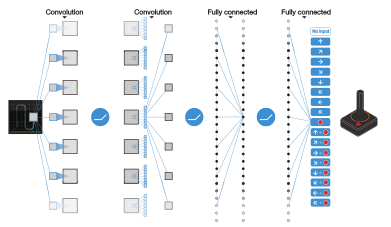 
DQN の模式図, 原著論文より

<!-- <video src="/assets/MOV_0013s.mp4" type="video/mp4" autoplay muted playsinline loop style="margin:auto; width:44%;" ></video>
<video src="/assets/MOV_0071s.mp4" type="video/mp4" autoplay muted playsinline loop style="margin:auto; width:44%;" ></video> -->

<!-- - [ギャラガ1](/assets/MOV_0013s.mp4)
- [ギャラガ2](/assets/MOV_0071s.mp4) -->

- **Q 学習** Q learning に DNN を採用
- CNN が LeNet, [@1998LeCun] そうであったように，強化学習 RL も昔からの技術 [@Sutton_and_Barto1998]
- ではなぜ，今になって囲碁や自動運転に応用できるようになったのか？
  - $\Rightarrow$ コンピュータの能力, データ規模，アルゴリズムの改良, エコシステム(ArXiv, Linux, Git, ROS, AMT, TensorFlow)

- 強化学習 $\Rightarrow$ 意思決定
  - **エージェント** agent が **行動**(行為) action をする
  - 行動によって **状態** が変化する
  - **環境** から与えられる **報酬** によって**目標**が決定
- 深層学習: $\Rightarrow$ 表現，表象
  - 教師信号として目標が与えられる
  - 目標を達成するために外部状況の **表現** を獲得

強化学習 + 深層学習 = 人工知能

  - 強化学習 $\Rightarrow$ 目標の設定
  - 深層学習 $\Rightarrow$ 内部表象の獲得機構を提供

# 用語の整理

- 教師信号なし **報酬信号** reward signal
- 遅延フィードバック

- **価値** Value
- **行為** Action
- **状態** State
- TD 学習
  - **Sarsa**
  - **Q 学習**
  - **アクタークリティック**
- 報酬 $R_t$: **スカラ値**
  - 時刻 $t$ でエージェントのとった行動を評価する指標
  - エージェントは**累積報酬** cumulative reward の最大化する
  - 報酬仮説: **目標は累積期待報酬の最大化として記述可能**

## DQN 結果

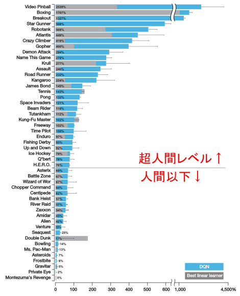 

## YouTube 上でのデモ動画

* ブロック崩し: [https://www.youtube.com/watch?v=V1eYniJ0Rnk](https://www.youtube.com/watch?v=V1eYniJ0Rnk)
* スペースインベーダー: [https://www.youtube.com/watch?v=W2CAghUiofY](https://www.youtube.com/watch?v=W2CAghUiofY)

<!--- packman: [https://www.youtube.com/watch?v=r3pb-ZDEKVg](https://www.youtube.com/watch?v=r3pb-ZDEKVg)
- OpenMind selfplay: [https://www.youtube.com/watch?v=OBcjhp4KSgQ](https://www.youtube.com/watch?v=OBcjhp4KSgQ)

-->
<!--
* DQN の動画 スペースインベーダー

<video style="width:33%" controls src="/assets/2015Mnih_DQN-Nature_Video1.mp4" type="video/mp4" >

* DQN の動画 ブロック崩し

<video style="width:33%" controls src="/assets/2015Mnih_DQN-Nature_Video2.mp4" type="video/mp4" >

-->

<!-- ## なぜ DQN には難しいのか？

<video style="width:74%" controls src="/assets/Montezuma.mp4" type="video/mp4" /> 
**Montezuma**

<video style="width:74%" controls src="/assets/PrivateEye.mp4" type="video/mp4" /> 
**Private Eye**

<video width="39%" autoplay loop markdown="0" controls muted>
  <source src="./assets/Montezuma.mp4">
</video>
<video width="39%" autoplay loop markdown="0" controls muted>
  <source src="./assets/privateEye.mp4">
</video>
 -->

## 人間にはできて強化学習には難しいこと

- Montenzuma's Revenge の動画 [https://www.youtube.com/watch?v=Klxxg9JM5tY](https://www.youtube.com/watch?v=Klxxg9JM5tY)
- Private Eys の動画 [https://www.youtube.com/watch?v=OfyS-Wj1M78](https://www.youtube.com/watch?v=OfyS-Wj1M78)

<!---
## エージェントと環境

- At each step $t$ the agent:
  - Executes action $A_t$
  - Receives observation $O_t$
  - Receives scalar reward $R_t$
- The environment:
  - Receives action $A_t$
  - Emits observation $O_{t+1}$
  - Emits scalar reward $R_{t+1}$
- $t$ increments at env. step
-->

<!--
- **エージェント**: 学習と意思決定を行う主体
  1. **行動** action **$A_t$** を行い
  1. 環境の **観察** observation **$O_t$** を行う
  1. 環境からスカラ値の **報酬** reward **$R_t$** を受け取る
- **環境**: エージェント外部の全て
  1. エージェントから **行為** $A_t$ を受け取り
  1. エージェントに **観察** $O_{t+1}$ を与え
  1. エージェントへ **報酬** $R_{t+1}$ を与える

## エージェントの要素

- **方策** Policy
- **価値関数** Value function
- **モデル** エージェントが持つ環境の表象

## 方策 policy

- **方策** : エージェントの行為
- 決定論的方策: $a=\pi(S)$
- 確率論的方策: $\pi(a|s)=p(A_{t=a}|S_{t=s})$

## 価値関数
- 将来の報酬予測
- 状態評価(良/悪)
- 行為の選択
$$
v_\pi(S)=\mathbb{E}_\pi\left\{R_{t+1}+\gamma R_{t+2} + \gamma^2R_{t+3}+\ldots|S_{t=s}\right\}
$$

## 強化学習のモデル
- 価値ベース
  - 方策:なし
  - 価値関数:あり
- 方策ベース
  - 方策:あり
  - 価値関数:なし
- アクター=クリティック Actor Critic
  - 方策: あり
  - 価値関数: あり

- モデルフリー
  - 方策，価値関数: あり
  - モデル: なし
- モデルベース
  - 方策，価値関数: あり
  - モデル: あり

## 探索と利用のジレンマ Exploration and exploitaion dilemma
- 過去の経験から，一番良いと思う行動ばかりをしていると，さらに良い選択肢を見つけ出すことができない **探索不足**
- 更に良い選択肢ばかり探していると過去の経験が活かせない **過去の経験の利用不足**

## 目標，収益，報酬

- エージェントの目標は累積報酬を最大化すること (報酬仮説)
  - **報酬仮説** Reward Hypothesis
  - 目標: 期待報酬の最大化

- 時刻 $t$ における報酬 $R_t$ : **スカラ値**
- 時刻 $t$ におけるエージェント行為の評価

## 逐次的意思決定 Sequential Decision Making
- 目標 Goal: 総収益を最大化する行動を選択すること
- 行為，行動 Actions は長期的結果
- 収益は遅延することも有る
- 直近の報酬を選ぶよりも，長期的な報酬を考えた方が良い場合がある

## 収益 Return
- **収益** return $G_t$: 割引付き収益
$$
G_t=R_{t+1}+\gamma R_{t+2}+\ldots=\sum_{k=0}^{\infty}\gamma^k R_{t+k+1}
$$

- 割引率 The discount $\gamma\in\left\{0,1\right\}$ : 現時点から見た将来の報酬を計算するため

- **遅延報酬** delayed reward の評価
- $0$ に近ければ __近視眼的__ 評価
- $1$ に近ければ __将来を見通した__ 評価

## 価値関数 Value Function

- **状態価値関数 $v$ ** と **行動価値関数 $q$ **

- **価値関数** $v(s)$: gives the long-term value of state $s$
- **状態価値関数** $v(s)$ of an MRP is the expected return starting from state $s$
$$
v(s)=\mathbb{E}\left\{G_t|S_{t=2}\right\}
$$

- **状態価値関数** state-value function:
$$
v_\pi(s)=\mathbb{E}_\pi\left\{G_t|S_{t=s}\right\}
$$

# ベルマン期待期待 Bellman Expectation Equation
- **状態価値関数** : 即時報酬と後続状態の割引付き報酬の和に分解できる

$$
v_\pi(s)=\mathbb{E}_\pi\left\{R_{t+1}+\gamma v_\pi(S_{t+1}|S_t=s)\right\}
$$

- **行動価値関数** action-value function:
$$
q_\pi(s,a)=\mathbb{E}_\pi\left\{G_t|S_{t}=s,A_{t}=a\right\}
$$

- **行動価値関数** 同じく分解可能 The action-value function can similarly be decomposed,
$$
q_\pi(s,a)=\mathbb{E}_\pi\left\{R_{t+1}+\gamma q_\pi(S_{t+1},A_{t+1})|S_{t}=s,A_{t}=a\right\}
$$

## 最適価値関数 Optimal Value Function
- 最適状態価値関数
$$
v_{*}(s) = \max_{\pi} v_{\pi}(s)
$$
- 最適行動価値関数
$$
q_{*}(s,a)=\max q_{\pi}(s,a)
$$

- ベルマン方程式 一般に非線形になるので難しい
-->

<!--
- No closed form solution (in general)
- Many iterative solution methods
- 幾つかの解法:
  - 価値反復
  - 方策反復
  - Q 学習
  - sarsa
-->

<!--
  - Value Iteration
  - Policy Iteration
  - Q-learning
  - Sarsa
-->

<!--
# Markov Reward Process
A Markov reward process is a Markov chain with values.

- A Markov Reward Process is a tuple $<S,P,R,\gamma>$
  - $S$ is a finite set of states
  - $P$ is a state transition probability matrix,
  - $P_{ss'}=P\of{S_{t+1}=s'\given{S_t=s}}$
  - $R$ is a reward function, $R_s=\mathbb{E}\BRc{R_{t+1}\given{S_t=s}}$
  - $\gamma$ is a discount factor

# Bellman Equation for MRPs
The value function can be decomposed into two parts:
  - immediate reward $R_{t+1}$
  - discounted value of successor state $\gamma v\of{S_{t+1}}$

$$
\begin{array}{lll}
v\of{s}&=&\mathbb{E}\BRc{G_t\given{S_t=s}}\\
&=&\mathbb{E}\BRc{R_{t+1}+\gamma R_{t+2}+\gamma^2R_{t+3}+\ldots\given{S_{t}=s}}\\
&=&\mathbb{E}\BRc{R_{t+1}+\gamma\Brc{R_{t+2}+\gamma R_{t+3}+\ldots}\given{S_{t}=s}}\\
&=&\mathbb{E}\BRc{R_{t+1}+\gamma G_{t+1}\given{S_{t}=s}}\\
&=&\mathbb{E}\BRc{R_{t+1}+\gamma v\of{S_{t+1}\given{S_{t}=s}}}
\end{array}
$$

# Bellman Equation for MRPs

$$
v\of{s}=\mathbb{E}\BRc{R_{t+1}+\gamma v\of{S_{t+1}}\given{S_t=s}}
$$

$$
v\of{s}=R_s +\gamma\sum_{s'\in S} P_{ss'}v\of{s'}
$$

# Solving the Bellman Equation
- The Bellman equation is a linear equation
- It can be solved directly:
$$
\begin{array}{lll}
v &=& R +\gamma Pv\\
\Brc{I - \gamma P}v &=& R\\
v &=& \Brc{I-\gamma P}^{-1}R
\end{array}
$$

- Computational complexity is $O(n^3)$ for $n$ states
- Direct solution only possible for small MRPs
- There are many iterative methods for large MRPs, e.g.
  - Dynamic programming
  - Monte-Carlo evaluation
  - Temporal-Difference learning
-->

<!-- # 価値関数 Value Function -->
<!-- - 将来の報酬予測の関数 -->
<!--   - ある状態である行動を起こすとどれほどの報酬が得られるか -->
<!-- - **Q-値関数** Q-value function : 総期待報酬を得る関数<\!--gives expected total reward-\-> -->
<!--   - 方策 $\pi$ のもとで -->
<!--   - 状態 $s$ で行動 $a$ を行ったとき -->
<!-- $$ -->
<!--   Q^\pi\of{s,a}=\mathbb{E}\BRc{r_{t+1}+\gamma r_{t+2}+\gamma^2 r_{t+3}+\ldots\given{s,a}} -->
<!-- $$   -->

<!--
# 最適価値関数 Optimal Value Functions
- 最大の価値を与える関数
$$
Q^*(s,a)=\max_{\pi}Q^\pi(s,a)=Q^{\pi^*}(s,a)
$$
- 最適価値関数 $Q^*$ が得られれば最適方策 $\pi^*$ を求めることができる
$$
\pi^*(s)=\operatorname{argmax}_aQ^*(s,a)
$$

- 全ての意思決定における最適価値:
$$
\begin{array}{lll}
Q^*(s,a)&=&r_{t+1}+\gamma\max_{a_{t+1}}r_{t+2}+\gamma^2\max_{a_{t+2}}r_{t+3}+\ldots\\
       &=&r_{t+1}+\gamma\max_{a_{t+1}}Q^*(s_{t+1},a_{t+1})
\end{array}
$$
-->

<!-- from sliver (2016) icml lecture -->
<!--
- **ベルマン方程式** Bellman equation:
$$
Q^*(s,a)=\mathbb{E}_{s'}\left\{r+\gamma\max_{a'}Q^*(s',a')|s,a\right\}.
$$
-->

<!--
# 報酬(収益) Rewards
- 時刻 $t$ における報酬 $R_t$ : **スカラ値**
- 時刻 $t$ におけるエージェント行為の評価Indicates how well agent is doing at step $t$

# Sequential Decision Making
- 目標 Goal: select actions to maximise total future reward
- 行為 Actions はmay have long term consequences
- 収益は遅延することも有る
- 直近の報酬を選ぶよりも，長期的な報酬を考えた方が良い場合がある It may be better to sacrifice immediate reward to gain more long-term reward-
- Examples:
  - A financial investment (may take months to mature)
  - Refuelling a helicopter (might prevent a crash in several hours)
  - Blocking opponent moves (might help winning chances many moves from now)
-->
