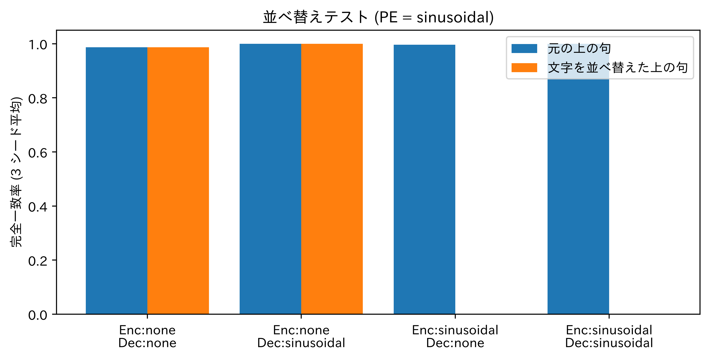
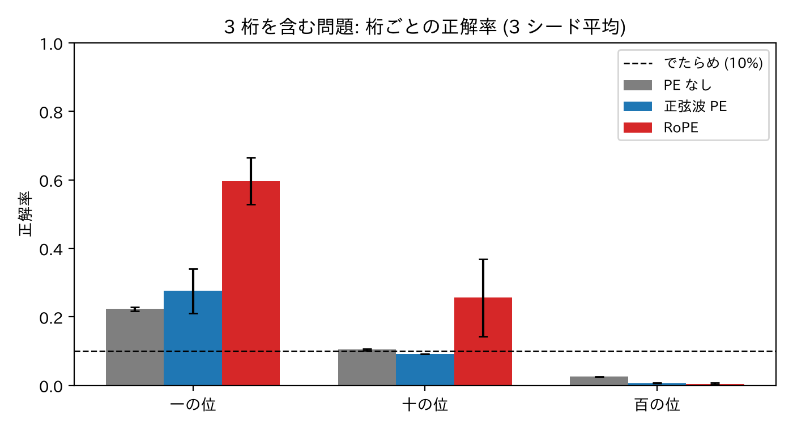
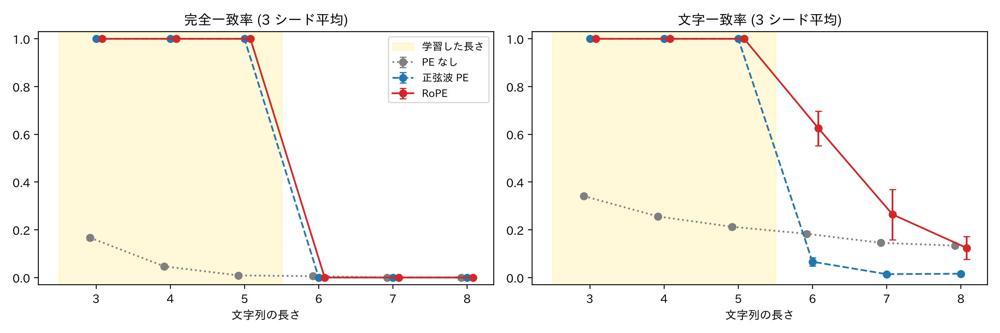
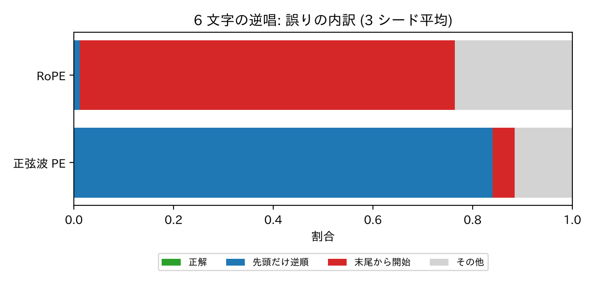

<link href="/css/asamarkdown.css" rel="stylesheet">

$$
\newcommand{\of}[1]{\left(#1\right)}
\newcommand{\Of}[1]{\left[#1\right]}
\newcommand{\OF}[1]{\left\{#1\right\}}
\newcommand{\bs}[1]{\boldsymbol{#1}}
\newcommand{\mb}[1]{\boldsymbol{#1}}
% \newcommand{\mb}[1]{\mathbf{#1}}
$$

<!-- $$
\newcommand{\Brc}[1]{\left(#1\right)}
\newcommand{\BRc}[1]{\left[#1\right]}
\newcommand{\Rank}{\text{rank}\;}
\newcommand{\Hat}[1]{\widehat{#1}}
\newcommand{\Prj}[1]{\mb{#1}\Brc{\mb{#1}^{\top}\mb{#1}}^{-1}\mb{#1}^{\top}}
\newcommand{\RegP}[2]{\Brc{\mb{#1}^{\top}\mb{#1}}^{-1}\mb{#1}^{\top}\mb{#2}}
\newcommand{\NSQ}[1]{\left|\mb{#1}\right|^2}
\newcommand{\Norm}[1]{\left|#1\right|}
\newcommand{\IP}[2]{\left({#1}\cdot{#2}\right)}
\newcommand{\Bar}[1]{\overline{\;#1\;}}
\newcommand{\of}[1]{\left(#1\right)}
\newcommand{\Of}[1]{\left[#1\right]}
\newcommand{\OF}[1]{\left\{#1\right\}}
\newcommand{\widebar}[1]{\overline{#1}}
$$ -->

<!-- # 位置符号化器 (PE) は何をしているのか — 足し算と逆唱で確かめる -->

## 実習

* 百人一首の 2×2 設計と並べ替えテスト | `pe_2x2_shuffle.ipynb` |  (`chihaya.json` も必要)
* 足し算: 12+34 と 21+43，理論上限，3 桁の分析 `pe_addition.ipynb` | 
* 逆唱: 長さの外挿と誤り方の分類  `pe_reversal.ipynb` | 
* 百人一首での 3 条件比較 (参考)  `pe_three_conditions.ipynb` | 

<!--
| `pe_2x2_shuffle.ipynb` | 百人一首の 2×2 設計と並べ替えテスト (`chihaya.json` も必要) | 3 節 |
| `pe_addition.ipynb` | 足し算: 12+34 と 21+43，理論上限，3 桁の分析 | 4 節 |
| `pe_reversal.ipynb` | 逆唱: 長さの外挿と誤り方の分類 | 5 節 |
| `pe_three_conditions.ipynb` | 百人一首での 3 条件比較 (参考) | — | -->

<!-- ## はじめに -->

位置符号化器 (positional encoding; PE) は，Transformer に文字の**並び**を教える部品である。同じ小さな Transformer で PE だけを入れ替える 3 つの実験から，次の 3 点がわかる。

1. **順序を見えるようにする。** PE がないと，Transformer は `12+34` と `21+43` を区別できない。
2. **何を外挿できるかを決める。** 学習した長さを超えると，絶対位置 (正弦波 PE，Transformer 原著) と相対位置 (RoPE) は違う誤り方をする。
3. **限界もある。** 学習データにない概念 (足し算の百の位) は，どんな PE でも補えない。
4. 数値はすべて，配布したノートブックを CPU で実行した結果 (3 シードの平均) 

<!--この資料は，授業で「位置符号化器にはどんな効果があるのか」という質問が出たことをきっかけに作った。-->

<iframe
    src="/2026ai/sinusoidal_pe_vs_rope_toy_2d.html"
    style="width: 55%; height: 600pt; border: none;"
    loading="lazy">
</iframe>

<!-- #### 図の読み方 -->

* 左（足す）オリジナルの位置符号化器 (PE: Position Encoder)

    - 点線の矢印が単語そのもの、細い矢印が足した「名札」（位置ベクトル）、太い矢印が足した結果。
    - p を動かすと、結果の点は単語の先端を中心とする円の上をぐるぐる回る。**単語の中身と位置が1本のベクトルに混ざる** ので、犬と噛むを比べた値（類似度）も p によって上下する。犬と噛むはいつも隣同士なのに、「文のどこにいるか」で関係の強さが変わる。

* 右（回す）RoPE 回転位置埋め込み器
    - 2 本の矢印は長さを保ったまま、一緒に回る。噛むは常に犬より 1 目盛り（約 57°）先にいるので、2 本の間の角度はどこまで行っても同じ。
    - すなわち類似度は一定であり、下のグラフの「回す」の線は水平となる。**比べた結果が「何個離れているか」だけで決まる**、のが RoPE の意味の本質。

たとえ話：

- **足す方式**は、座席番号の名札を服に縫い付けるようなもの。席を移ると、その人の見た目そのものが変わってしまう。
- **回す方式**は、全員が同じ方向に同じだけ向きを変えるようなもの。二人の向きの差、つまり関係だけが保たれる。

- Vaswani らの主張自体は正しく、PE(p) と PE(p+k) の内積は k だけで決まる。
- 問題は、実際に比べるのが「単語＋PE」どうしだという点。内積を展開すると「単語・単語」「単語・位置」「位置・単語」「位置・位置」の 4 項になり、**真ん中の 2 項（単語と位置が混ざった項）が絶対位置 p に依存する**。図の左側で類似度が揺れるのはこの項のため。
- RoPE は足さずに回すので、この混ざった項がそもそも生じない。そのため相対位置だけが **厳密に** 残る。

<!-- - 前回の逆唱実験で、正弦波 PE は「番地で覚え」、RoPE は「距離で覚えた」という違いが出たのも、この差の現れです。 -->

<!-- ## 図で簡略化したところ（学生に見せる前に把握しておいてください） -->

1. **Q, K の変換は省略してある。** 実際には単語ベクトルに行列 $W_Q$, $W_K$ をかけてから比べ、RoPE はその $Q$ と $K$ を回す。結論は変わりません。
2. **2 枚目の平面の回転の速さを変えてある。** 実際の base は 10000 だが、ここでは見えるように 100 にした。そのため 2 枚目の平面は 1 目盛りで約 6° しか回らない「遅い時計」になる。速い時計と遅い時計を組み合わせる点は、正弦波 PE も RoPE も同じ。
3. **RoPE は入力で 1 回だけでなく、注意の各層で比べるたびにかける。** また単語の「中身」（V）は回さない。

<!-- この図と説明をスライドの「位置の入れ方」の次に1〜2枚として追加することもできます。追加しますか？-->

## 1. Transformer は入力の順序を見ない

自己注意 (Self-attention) は，入力の並びを入れ替えると出力も同じように入れ替わるだけの演算である (置換同変性)。入力を行列 $X$ (行がトークン)，並べ替えを置換行列 P とすると，次が成り立つ。

$$\begin{aligned}
\mathrm{Attn}(PX) &= \mathrm{softmax}\!\of{\frac{PXW_Q \of{PXW_K}^\top}{\sqrt{d}}} PXW_V\\
& = P\,\mathrm{softmax}\!\of{\frac{XW_Q \of{XW_K}^{\top}}{\sqrt{d}}} P^\top P X W_V \\
&= P\,\mathrm{Attn}(X)
\end{aligned}$$

* ソフトマックス (softmax) は行ごとの演算なので P を外に出せる。最後に $P^{\top}P = I$ が残る。フィードフォワード層と層正規化は位置ごとの演算なので，やはり並びを入れ替えるだけ。
* このため PE がなければ，モデルにわかるのは入力の文字の **集まり (多重集合)** だけである。`12+34` も `21+43` も，どちらも {1, 2, 3, 4, +} に見える。
* デコーダは例外。因果マスク (未来を見ない制約) があるため，PE がなくても「見えている要素の数」から自分の位置をある程度推定できる。

## 2. 位置の入れ方: 足す (sinosidal) か，回す (rotery) か

* **正弦波 PE** (Vaswani+2017) は，位置 p ごとに決まったベクトルを文字の埋め込みに **足す**。モデルは「p 番目の文字だ」という **絶対位置** を直接見る。

$$\begin{aligned}
\mathrm{PE}(p, 2i)   &= \sin\!\left(\frac{p}{10000^{2i/d}}\right), \qquad\\
\mathrm{PE}(p, 2i+1) &= \cos\!\left(\frac{p}{10000^{2i/d}}\right)\\
\end{aligned}$$

* **RoPE** (Su+2021) は，self-attention の $q$ と $k$ を次元 2 つずつの組に分け，位置 $m$ のとき角度 $m\theta_i$ だけ **回す**。回転どうしの内積は角度の差だけで決まるので，注意の重みは **相対位置** $n − m$ だけに依存する。

$$
\langle R_{m\theta}\, q,\; R_{n\theta}\, k \rangle = \langle q,\; R_{(n-m)\theta}\, k \rangle, \qquad \theta_i = 10000^{-2i/d_k}
$$

|  | 正弦波 PE | RoPE |
|:---|:---|:---|
| 位置の入れ方 | 埋め込みに加算 | $q$, $k$ を回転 |
| モデルが見るもの | 絶対位置 (番地) | 相対位置 (距離) |
| 入れる場所 | 入力層で 1 回 | 各 self-attention 層 |
| 主な採用例 | 元の Transformer | Llama, Qwen など現在の多くの LLM |

RoPE は self-attention にだけかけ，エンコーダとデコーダをつなぐ cross-attention にはかけない。下の句の位置と上の句の位置は別の系列なので，その差に意味がないからである。

## 3. 実験 1: 並べ替えテスト (百人一首)

エンコーダに PE がないモデルは，上の句の文字をでたらめに並べ替えても**まったく同じ下の句**を出す。エンコーダに PE があるモデルは，並べ替えると正解率が 0 になる。

課題は百人一首 100 首の上の句 (ひらがな) から下の句を生成することである。PE の有無をエンコーダとデコーダで別々に切り替えた (2×2 設計)。

| エンコーダ PE | デコーダ PE | 元の上の句 | 並べ替えた上の句 | 出力の最大変化量 |
| --- | --- | --- | --- | --- |
| なし | なし | 0.987 | 0.987 | $4.3\times 10^{-5}$ |
| なし | 正弦波 | 1.000 | 1.000 | $6.4\times 10^{-5}$ |
| 正弦波 | なし | 0.997 | 0.000 | $35$ |
| 正弦波 | 正弦波 | 1.000 | 0.000 | $42$ |

並べ替えテストの棒グラフ。エンコーダに PE がない 2 条件は並べ替えても完全一致率が変わらず，エンコーダに正弦波 PE がある 2 条件は 0 になる

<!-- &#91;image: 並べ替えテストの棒グラフ。エンコーダに PE がない 2 条件は並べ替えても完全一致率が変わらず，エンコーダに正弦波 PE がある 2 条件は 0 になる\] -->

数値は完全一致率 (3 シード平均)。「出力の最大変化量」は，並べ替え前後でデコーダの出力 (ロジット) が最大でどれだけ変わったかである。エンコーダに PE がないときの変化は浮動小数点の丸め誤差だけである。

これは 1 節の式のとおりである。エンコーダの出力は行が並べ替わるだけで，cross-attention はその全行の重み付き和をとる。和は足す順序によらないので，結果は同じになる。

PE がないのに正解率が高いのは，100 首の上の句が**文字の集まりだけですべて区別できる**からである (ノートブックで確認済み)。順序が見えなくても解ける課題だったということである。

## 4. 実験 2: 足し算

PE なしのモデルは `12+34`，`21+43`，`34+12`，`43+21` の 4 問すべてに **55** と答える。正弦波 PE と RoPE はどれも正解する。

**課題。** 0〜99 どうしの足し算 10,000 問のうち 8,000 問で学習し，残り 2,000 問 (未学習の 2 桁問題) で規則を身につけたかを確かめる。さらに 3 桁・4 桁を含む問題を 500 問ずつ試す。

### 4.1 「55」は順序が見えないモデルの最善の賭け

* $\{1, 2, 3, 4, +\}$ からなる問題は 24 問あり，答えは 55 が 8 問，$37, 46, 64, 73$ が各 4 問。順序が見えないモデルにとっては，最も多い 55 と答えるのが最善であり，モデルはそれを学んでいる。
* `99+1` と `1+99` は文字が同じでも答えが同じなので (交換法則)，順序が見えなくても正解できる。
* 同じ考え方で全 10,000 問を文字の集まりでグループに分け，おおう

|  |  |  |  |  |
|:---|:---|:---|:---|:--- |
|  |  |  |  |  |
| 波 PE | 1.000 | 0.997 | 0.000 | 0.000 |
| RoPE | 1.000 | 0.999 | 0.000 | 0.000 |

* 完全一致率 (3 シード平均)。PE なしの 0.358 は理論上限 0.361 にほぼ張り付き，失敗の原因は順序が見えないことでほぼ説明できる。
* PE ありの 2 条件は未学習の 2 桁問題もほぼ全問正解するので，丸暗記ではなく規則を学んでいる。

### 4.2 3 桁は解けない: ただし PE のせいだけではない

3 桁を含む問題の完全一致率はどの PE でも 0 である。答えを下の桁から揃えて桁ごとに見ると，差が出る (でたらめなら約 10%)。

| 条件 | 一の位 | 十の位 | 百の位 |
|:---|:---|:---|:--- |
| PE なし | 0.22 | 0.11 | 0.03 |
| 正弦波 PE | 0.28 | 0.09 | 0.01 |
| RoPE | 0.60 | 0.26 | 0.01 |

3 桁を含む問題の桁ごとの正解率。RoPE は一の位 0.60，十の位 0.26 と偶然の 10% を上回るが，百の位はどの条件もほぼ 0

<!-- &#91;image: 3 桁を含む問題の桁ごとの正解率。RoPE は一の位 0.60，十の位 0.26 と偶然の 10% を上回るが，百の位はどの条件もほぼ 0\] -->

- **百の位はどの PE でもほぼ 0。** 学習データでは入力の数字が必ず一の位か十の位で，入力に百の位の数字が現れたことは一度もない。未知の位置ではなく，**未知の概念**が必要になる。PE が変えるのは位置の表し方であって，学ぶ内容ではない。
- **一の位・十の位では RoPE が優る。** これらは「末尾や + から何番目の数字か」という相対位置だけで決まり，3 桁の問題でも学習時と同じである。
- **答えの桁数も学習範囲で止まる。** 正弦波 PE と RoPE は，学習で見た最長の 3 桁 (99+99=198) を超える答えを一度も出さなかった。

つまり「2 桁で学習して 3 桁を解かせる」実験の完全一致率では，PE の良し悪しは判定できない。位置の外挿と未知の概念が混ざっているからである。位置の外挿だけを問うには，次の逆唱のような課題が必要になる。

|  | 足し算 2 桁 → 3 桁 | 逆唱 5 文字 → 6 文字 |
| --- | --- | --- |
| 見たことのない位置 | あり | あり |
| 見たことのない概念 | あり (百の位，4 桁の答え) | なし |
| PE の比較に使えるか | 完全一致率では使えない | 使える |

## 5. 実験 3: 逆唱で見る長さの外挿

3〜5 文字で学習したモデルに 6 文字を逆唱させると，完全一致率はどの PE でも 0 である。しかし文字一致率は **RoPE 0.63，正弦波 PE 0.07** と大きく違い，誤り方もはっきり分かれる。

**課題。** ひらがなをランダムに並べた文字列 (ほとんどが非語) を逆から言う (例: `さくらもち` → `ちもらくさ`)。学習は 3〜5 文字の 8,000 例，テストは未学習の 3〜5 文字と 6，7，8 文字 (各 300 例)。出力の i 文字目は入力の「後ろから i 番目」で決まるので，位置の情報がなければ解けない。入力が 6 文字になっても操作は同じなので，**位置の外挿だけ**を問う課題になっている。

**文字一致率 (3 シード平均)**

| 条件 | 3 文字 | 4 文字 | 5 文字 | 6 文字 | 7 文字 | 8 文字 |
| --- | --- | --- | --- | --- | --- | --- |
| PE なし | 0.34 | 0.26 | 0.21 | 0.18 | 0.15 | 0.13 |
| 正弦波 PE | 1.00 | 1.00 | 1.00 | 0.07 | 0.01 | 0.02 |
| RoPE | 1.00 | 1.00 | 1.00 | 0.63 | 0.26 | 0.12 |

長さごとの完全一致率と文字一致率。学習した 3〜5 文字では正弦波と RoPE が 1.0，6 文字以上で完全一致は 0，文字一致率は RoPE が高い

<!-- &#91;image: 長さごとの完全一致率と文字一致率。学習した 3〜5 文字では正弦波と RoPE が 1.0，6 文字以上で完全一致は 0，文字一致率は RoPE が高い\] -->

3〜5 文字が学習範囲。完全一致率は，正弦波と RoPE が 3〜5 文字で 1.00，6 文字以上で 0.00。PE なしは学習範囲でも解けない (エンコーダがどの文字が最後かを知りようがない)。

**誤り方。** 入力 `けこわめたこ` (正解 `こためわこけ`) に対する出力:

| 条件 | 出力 | 誤りの型 | 6 文字での割合 | 7 文字での割合 |
| --- | --- | --- | --- | --- |
| 正弦波 PE | `ためわこけ` | 入力の先頭 5 文字を逆にして止まる | 84% | 78% |
| RoPE | `こたわこけ` | 1 文字目 (入力の最後の文字) は正しいが，途中で落とす | 75% | 65% |

6 文字の逆唱での誤りの内訳。正弦波 PE は先頭だけ逆順が 84%，RoPE は末尾から開始が 75%

<!-- &#91;image: 6 文字の逆唱での誤りの内訳。正弦波 PE は先頭だけ逆順が 84%，RoPE は末尾から開始が 75%\] -->

**解釈。** 正弦波 PE のモデルは「1 文字目には入力の n 番目を出す」を n = 3, 4, 5 についてだけ学んだ。番地で覚えているため，6 番目という見たことのない番地を扱えず，見慣れた 5 番目から始めてしまう。RoPE のモデルは「末尾から何文字離れているか」で覚えている。この関係は 6 文字でも学習時と同じなので，出だしは正しく出せる。

**止まる位置と出す文字を分ける。** 学習した長さを超えると，モデルは 5 文字目で終わりの記号を出しやすい。正解の長さまで終わりを出させずに生成すると (長さ指定復号)，6 文字の文字一致率は RoPE 0.74，正弦波 0.21 である。差は「どこで止まるか」だけの問題ではない。

どの PE でも，学習した長さを超えると逆唱は崩れる。長さの外挿は Transformer にとって本質的に難しい。大規模言語モデルが文脈長を伸ばすときに YaRN などの追加の工夫を必要とするのも，同じ問題が背景にある。

## 6. まとめと演習問題

位置符号化器は，文字の集まりしか見えない Transformer に並びを見せる部品である。位置の表し方 (番地か距離か) は，学習範囲の外での振る舞いを決める。ただし，学習データにない概念はどんな PE でも補えない。

**演習問題**

1. PE なしのモデルが `99+1` と `1+99` の両方に正解できたのはなぜか。正解率が 0.361 を超えられないのはなぜか。
2. 百人一首の課題では，PE がなくてもほぼ全問正解できた。この結果から「PE は不要だ」と言ってよいか。
3. 「2 桁で学習して 3 桁を解かせる」実験で，PE の良し悪しを完全一致率で判定してよいか。桁ごとの正解率を見ると何がわかるか。
4. 逆唱で，正弦波 PE の「先頭 5 文字を逆にして止まる」誤りは，モデルが何を覚えていたことを示しているか。
5. 人間にも逆唱課題 (数唱の逆唱など，神経心理学検査で使われる) がある。人間の誤りの型とモデルの誤りの型を比べるには，何を測ればよいか。
6. 今回の逆唱はほとんどが非語だった。実在語を逆唱させたら結果は変わると思うか。それはなぜか。

## 文献

<!-- すべて Google Colab と手元の Mac で動く。共通コード `pe_transformer.py` (モデル) と `pe_tasks.py` (課題と評価) を同じフォルダに置く。CPU で各ノートブック 5〜10 分程度，時間を短くしたいときは `SEEDS = [0]` にする。

| ノートブック | 内容 | 本資料 |
| --- | --- | --- |
| `pe_2x2_shuffle.ipynb` | 百人一首の 2×2 設計と並べ替えテスト (`chihaya.json` も必要) | 3 節 |
| `pe_addition.ipynb` | 足し算: 12+34 と 21+43，理論上限，3 桁の分析 | 4 節 |
| `pe_reversal.ipynb` | 逆唱: 長さの外挿と誤り方の分類 | 5 節 |
| `pe_three_conditions.ipynb` | 百人一首での 3 条件比較 (参考) | — | -->

- Vaswani, A. et al. (2017). [Attention Is All You Need](https://arxiv.org/abs/1706.03762). NeurIPS.
- Su, J. et al. (2021). [RoFormer: Enhanced Transformer with Rotary Position Embedding](https://arxiv.org/abs/2104.09864).
- Kazemnejad, A. et al. (2023). [The Impact of Positional Encoding on Length Generalization in Transformers](https://arxiv.org/abs/2305.19466). NeurIPS.
- McLeish, S. et al. (2024). [Transformers Can Do Arithmetic with the Right Embeddings](https://arxiv.org/abs/2405.17399). NeurIPS.
- Peng, B. et al. (2023). [YaRN: Efficient Context Window Extension of Large Language Models](https://arxiv.org/abs/2309.00071).

