<link href="/css/asamarkdown.css" rel="stylesheet">

<div align="right">
<a href='mailto:educ0233@komazawa-u.ac.jp'>Shin Aasakawa</a>, all rights reserved.<br>
Date: 15/Nov/2024<br/>
Appache 2.0 license<br/>
</div>

$$
\newcommand{\of}[1]{\left(#1\right)}
\newcommand{\Of}[1]{\left[#1\right]}
% \newcommand{\KL}[2]{\operatorname{KL}\left(\left.{#1}\right\|{#2}\right)}
\newcommand{\given}[1]{\left|{#1}\right.}
\newcommand{\mb}[1]{\mathbf{#1}}
$$

# スキップ結合，経路分割

## 実習ファイル

* [オリベッティ顔データセットを用いた分類デモ ](https://github.com/komazawa-deep-learning/komazawa-deep-learning.github.io/blob/master/2026notebooks/2026_0914olivetti_face_classification_demo.ipynb){:target="_blank"}
* [オリベッティ顔データセットを用いた時系列データ処理 ](https://colab.research.google.com/github/komazawa-deep-learning/komazawa-deep-learning.github.io/blob/master/2026notebooks/2026_0924olivetti_face_as_time_series.ipynb){:target="_blank"}

* [XOR ](https://colab.research.google.com/github/komazawa-deep-learning/komazawa-deep-learning.github.io/blob/master/2026notebooks/2026miniumXOR.ipynb){:target="_blank"}

<!-- * [ [Karapetian+(2023)](https://direct.mit.edu/jocn/article/35/11/1879/117201/Empirically-Identifying-and-Computationally) ](https://colab.research.google.com/github/komazawa-deep-learning/komazawa-deep-learning.github.io/blob/master/2024notebooks/2024_115Karapetian_demo.ipynb){:target="_blank"}
* [ResNet 実習 ](https://colab.research.google.com/github/komazawa-deep-learning/komazawa-deep-learning.github.io/blob/master/2022notebooks/2022_0603ResNet_with_Olivetti_faces_.ipynb){:target="_blank"}
* [実習 LeNet PyTorch 版 ](https://colab.research.google.com/github/komazawa-deep-learning/komazawa-deep-learning.github.io/blob/master/notebooks/2021_0528LeNet_pytorch.ipynb){:target="_blank"} -->


#### 脱線 1. STEM 教育

* STEM 教育： Science, Technology, Engineering, Mathematics 教育の重要性，バラク・オバマ政権時のアメリカ合衆国の教育改革で叫ばれたスローガン
<!-- * 竹市先生の STEM: Statistics, Technology (プログラミングを含む IT 全般)，English, Mathematics  -->

| | S | T | E | M |
|---|---|---|---|---|
|O's STEM | Science   | Technology| Engineering| Mathematics|
|T's STEM | Statistics| Technology| English| Mathematics|

#### 脱線 2. [Cargo cult science](https://calteches.library.caltech.edu/51/2/CargoCult.htm){:target="_blank"}


## 経路仮説 (と 残差ネット ResNet)

* 腹側経路 ventral pathways ("what" 経路)
* 背側経路 dorsan pathways ("where" 経路)

<div class="figcenter figpair">

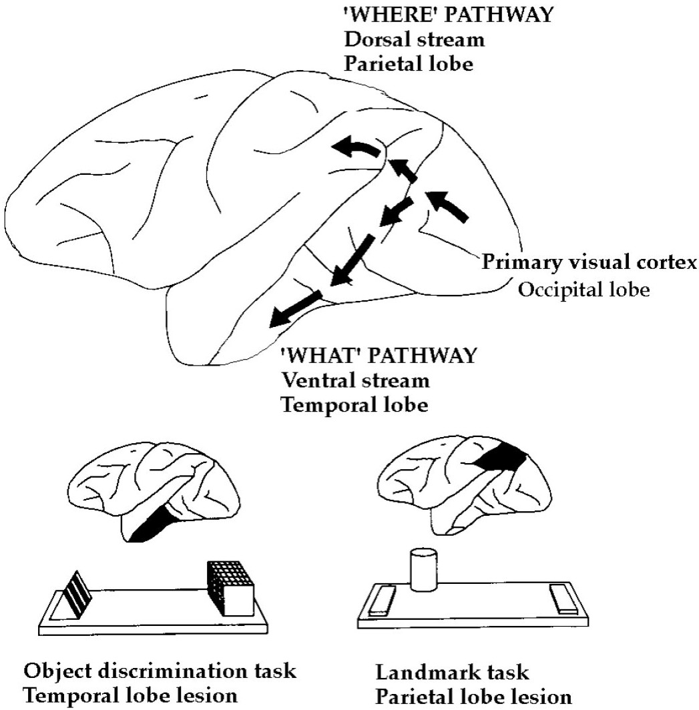
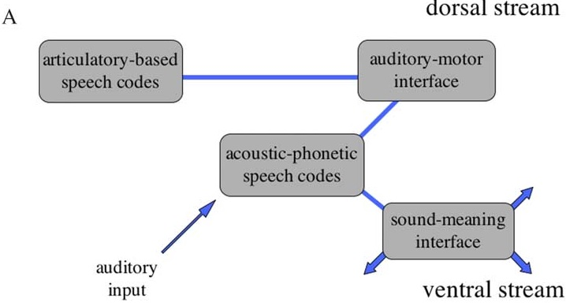<br/>
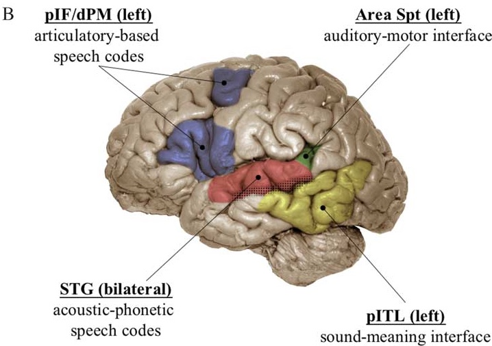
</div>


<div style="text-align:left;width:88%;color:teal">

左図：<br/>
* 左下: 物体弁別課題と下側頭回損傷。
* 右下: 目印課題と頭頂葉損傷。
Ungerleider&Mishkin1982 より。

右図：<br/>
左: 言語の機能解剖学的枠組み。Hickok&Poeppel2000 より<br/>
右: 脳の側面図に示したモデル構成要素の一般的な場所。<br/>
モデル内のある機能に関連する皮質領域は，その機能に特化しているという仮説ではない。
調音に基づく音声符号を支援すると考えられる前頭葉領域の定義は，物品の命名と調音リハーサル処理の機能画像研究における活性化領域の一般的な分布から得られる (例えば Awh+1996, Hickok+2003, Indefrey&Levelt)。
帯状の領域 (上側頭溝) は，音素レベルの表現を支援すると思われる領域。
</div>


### ResNet におけるスキップ結合

<div class="figcenter figpair" style="width:99%;">

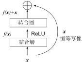
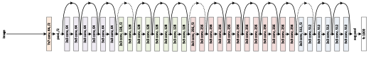
</div>


### R-CNN における経路分割

<div class="figcenter figpair">

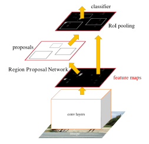
</div>
<!--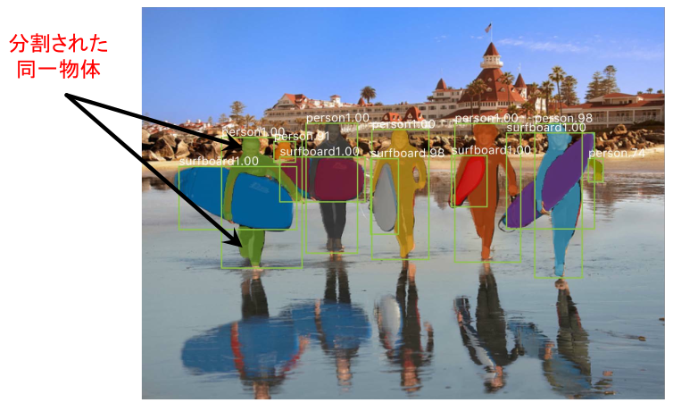
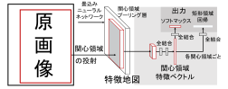
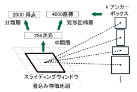
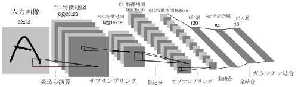
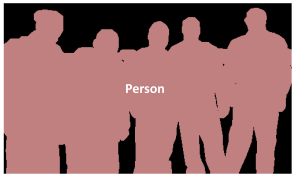
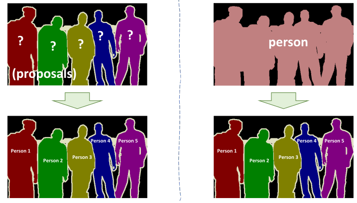
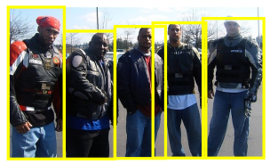
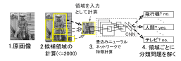 -->


### Dueling net における経路分割

<div class="figcenter">

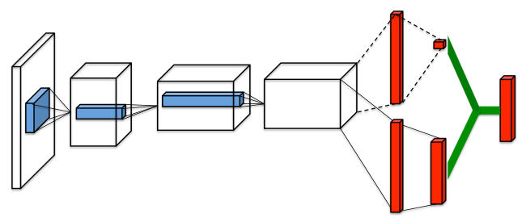
</div>


### Transformer における経路分割

<div class="figcenter">

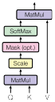
<!--  -->
</div>

<!-- 
<div style="display: flex; align-items: center; justify-content: center;">

</div>

<div class="figcaption">
Transformer ([2017Vaswani++](https://arxiv.org/abs/1706.03762)) Fig.2 を改変
</div>

</div> -->


#### 排他的論理和 (XOR) 回路

<div class="figcenter figpair" style="width:99%;">

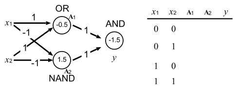
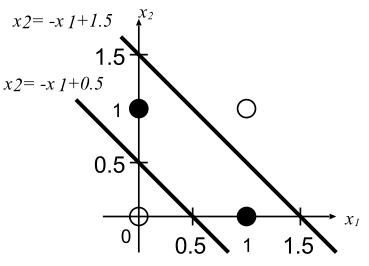
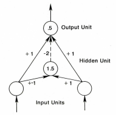
</div>

<!-- #### PDP book (1986) chapter 8 Figure 2 -->


# CORnet [Kubilius+2018](https://doi.org/10.1101/408385){:target="_blank"}

<div class="figcenter">
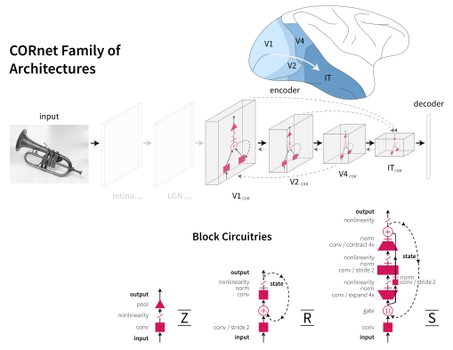
</div>
<div class="figcaption" style="width:77%;">

**図 1. CORnet 族のアーキテクチャ**<br/>
この族のすべてのモデルには，皮質領域 V1, V2, V4, IT にあらかじめ写像された 4 領域がある。
網膜と LGN の処理は現在のところモデル化されていない (灰色で塗りつぶされた領域)。
すべての領域はフィードフォワードかリカレント (領域内) のどちらかであるが，現在のところ，領域間のスキップ接続やフィードバック接続を持つモデルは考慮していない (灰色で塗りつぶした破線の矢印)。
本論文では，3  種類の CORnet を検討し，それぞれ異なる機能を提供する： CORnet-Z は軽量な AlexNet 代替モデル，CORnet-R は生物学的に説得力のある時間的アンロールを持つ単純なリカレントモデル，そしてCORnet-S は Brain-Score で現時点で最も高い性能を発揮するモデルである。
下段の図は各モデルの領域内の回路を表している。
<!-- Fig. 1. CORnet family of architectures.
All models in this family have four areas that are pre-mapped to cortical areas V1, V2, V4, and IT.
Retinal and LGN processing is currently not modeled (greyed-out areas).
All areas can be either feedforward or recurrent (within area) but currently we do not consider models with skip or feedback connections between areas (grayed-out dashed arrows).
In this paper, we consider three flavors of CORnet, each serving distinct functions: CORnet-Z is a lightweight AlexNet alternative, CORnet-R is a simple recurrent model with biologically-plausible unrolling in time, and CORnet-S is our highest-performing model on Brain-Score at the moment.
Diagrams in the bottom panel depict circuitry within an area of each model. -->
</div>

<div class="figcenter">
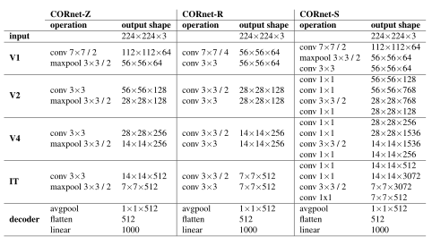
</div>

モデルの復号化部は，単純な線形分類器 (各物体カテゴリに対して 1 つの総和を持つ重み付き線形和の集合) を実装する。
ImageNet で学習する場合，最後のモデル領域 (再帰の場合は最後の時間ステップ) の応答は，さらにソフトマックス非線形に渡され，1000 通りの分類が実行される。
この分類器に投影される神経応答の量を減らすために，まず特徴地図ごとの受容野全体の応答を平均化する。
現在の CORnet 族の定義では，領域横断バイパス接続や領域横断フィードバック接続は存在しない。
網膜と LGN の処理は省略されている (考察参照)。
また，計算要求が高いため，CORnet-S の第 1 領域は簡略化され，2 つの畳み込みのみが含まれる (下記参照)。
<!-- The decoder part of a model implements a simple linear classifier – a set of weighted linear sums with one sum for each object category.
When training on ImageNet, responses of last model area (and last time step in the case of recurrence) are further passed through a softmax nonlinearity to perform a 1000-way classification.
To reduce the amount of neural responses projecting to this classifier, we first average responses over the entire receptive field per feature map.
There are no across-area bypass or across-area feedback connections in the current definition of CORnet family.
Retinal and LGN processing are omitted (see Discussion).
Also, due to high computational demands, the first area in CORnet-S is simplified to only include two convolutions (see below). -->

**CORnet-Z** (通称 Zero) は我々の最も単純なモデルであり，(i) AlexNet は既に深いモデル(Schrimpf+2018) とほぼ同程度に神経応答を予測しており，(ii) VGG (Simonyan&Zisserman2014) 以降に提案されたほとんどのアーキテクチャが 1 つの 1000-way 線形分類層のみを含むため，ImageNetの良好な性能を達成するために複数の完全連結層は必要ないようであることを観察することによって導き出された。
従って，CORnet-Z の面積回路は単一の畳み込み，それに続く ReLU 非線形と最大プーリングのみで構成される。
<!-- CORnet-Z (a.k.a. "Zero") is our simplest model, derived by observing that (i) AlexNet is already nearly as good in predicting neural responses as deeper models (Schrimpf+2018) and (ii) multiple fully-connected layers do not appear necessary to achieve good ImageNet performance, as most architectures proposed after VGG (Simonyan&Zisserman2014) contain only a singe 1000-way linear classification layer.
Thus, CORnet-Z’s area circuits consist of only a single convolution, followed by a ReLU nonlinearity and max pooling. -->

**CORnet-R** (通称 Recurrent) は，生物学的に妥当な方法でネットワークを伝播するリカレントダイナミクスを導入する (生物学的ネットワーク・アンローリングと非生物学的ネットワーク・アンローリングの比較については図 2 参照)。
CORnet-R では，リカレンスは領野内でのみ導入される (エリア間のフィードバック接続はない) ため，アンロールの特殊な方法は (より多くのメモリを消費することを除けば) ほとんど影響を及ぼさないが，それでもこのモデルを神経ダイナミクスの調査に役立てるため，生物学的に妥当なアンロールを使用することにした。
<!-- CORnet-R (a.k.a. "Recurrent") introduces recurrent dynamics that would propagate through the network in a biologically-valid manner (see Fig. 2 for a comparison between biological and non-biologicall network unrolling).
In CORnet-R, recurrence is introduced only within an area (no feedback connections between areas), so the particular way of unrolling has little effect (apart from consuming much more memory), but we chose to use biologically-valid unrolling nonetheless to make this model useful for investigating neural dynamics. -->

入力はまず，畳み込みを通すことでチャンネル数を 2 倍に増やしながら 2 倍にダウンスケールされ，続いて正規化と非線形化が行われる。
状態 (最初はゼロ) が結果に追加され，別の畳み込み，正規化，非線形性を経て，結果が領域の新しい状態として保存される。
我々は，群正規化 (Wu&He2018) と ReLU 非線形性を使用した。
<!-- The input is first downscaled twofold while increasing the number of channels twofold by passing it through a convolution, followed by normalization and a nonlinearity.
The state (initially zero) is added to the result and passed through another convolution, normalization, and nonlinearity, and the result is saved as a new state of the area.
We used group normalization (Wu and He, 2018) and ReLU nonlinearity -->

**CORnet-S** (通称 Skip) は，非常に深いフィードフォワードアーキテクチャを浅いリカレントモデルに変換することで，Brain-Score の最高モデルに匹敵することを目指している。
具体的には，CORnet-S は我々の行動ベンチマークで最も優れたモデルのいくつかである ResNets からインスピレーションを得ている (Rajalingham+2018, Schrimpf+2018)。
Liao&Poggio(2016) は ResNet 構造をアンロール型リカレントネットワークと考えることができると提案し，さらに最近の研究では CIFAR や ImageNet の性能に大きな損失を与えることなく重み共有が実際に可能であることを実証した (Jastrzebski+2017, Leroux+2018)。
<!-- CORnet-S (a.k.a. "Skip") aims to rival the best models on Brain-Score by transforming very deep feedforward architectures into a shallow recurrent model.
Specifically, CORnet-S draws inspiration from ResNets that are some of the best models on our behavioral benchmark (Rajalingham+2018, Schrimpf+2018).
Liao&Poggio(2016) proposed that ResNet structure could be thought of as an unrolled recurrent network and recent studies further demonstrated that weight sharing was indeed possible without a significant loss in CIFAR and ImageNet performance (Jastrzebski+2017, Leroux+2018). -->

CORnet-S は CORnet-R の回路の上にさらに 2 つの畳み込み（それぞれ正規化と非線形化が続く）を積み重ねる。
さらに，ResNet のボトルネックブロック構造に従い，2 回目の畳み込みでチャンネル数を4倍に拡大し，最後の畳み込みでチャンネル数を減少させる。
また，入力に状態を追加した結果が非線形を適用する直前に最後の畳み込みの出力と結合されるように，スキップ接続も含めた。
CORnet-S が領域内リカレント接続のみを有することを考慮し，メモリフットプリントを最小化するために，時間的にネットワークのアンロールを利用することなくこのモデルを訓練した (すなわち 図 2 に描かれているようなアンロールはないが，繰り返される計算にわたって重みは依然として共有される)。
特に，最初に情報が処理されるとき，3 回目の畳み込みとスキップ畳み込みは，入力をダウンスケールするために 2 のストライドを使用する。
そして，その出力は，さらなるリカレント処理（図 1 では gate と呼ばれる）のために，元の入力の代わりに使われる。
このモデルではバッチ正規化 (Ioffe&Szegedy2015) と ReLU 非線形性を使用し，バッチ正規化は (Jastrzebski+2017) が示唆するように経時的に共有されなかった。
<!-- CORnet-S stacks two more convolutions (each followed by a normalization and nonlinearity) on top of CORnet-R’s circuit.
Moreover, following ResNet’s bottleneck block structure, the second convolution expands the number of channels fourfold while the last one decreases them back.
We also included a skip connection, such that the result of adding the state to the input is combined with the output of the last convolution just prior to applying a nonlinearity.
Given that CORnet-S only has within-area recurrent connections, in order to minimize memory footprint we trained this model without making use of any network unrolling in time (i.e. no unrolling as depicted in Fig. 2, but weights are still shared over repeated computations).
In particular, the first time information is processed, the third convolution and the skip convolution use a stride of two to downscale inputs.
The output is then used instead of the original input for further recurrent processing (referred to as "gate" in Fig. 1).
We used batch normalization (Ioffe and Szegedy, 2015) and ReLU nonlinearity in this model, and batch normalization was not shared over time as suggested by (Jastrzebski+2017). -->


# [Brainscore](https://www.brain-score.org/){:target="_blank"}


Brain-Score の代表的な PLS ベンチマークでは、**説明変数 \(X\) はニューラルネットワークの層の活性値、被説明変数 \(Y\) は実測した神経応答**。
(PLS: Partial Least Squares)

* `sklearn.cross_decomposition.PLSRegression` : 部分最小二乗法（Partial Least Squares）を使って，ニューラルネットワークの中間層の活性値 X と神経活動 Y の関係をモデル化。
* X と Y との共分散を最大化する潜在変数を抽出しながら回帰を行うため、多重共線性がある場合や特徴量が多いデータに有効。
* V1・V2・V4・IT の代表的な `-pls` ベンチマークでは、**サルの各領域から電極で記録したスパイク応答** を予測。
* EEG, MEG からこれらの領域の活動を推定する手続きとは異なる。
* V1, V2 には FreemanZiemba2013, V4・IT には MajajHong2015 が用いられている。
* [V1・V2 の公式実装](https://github.com/brain-score/vision/blob/master/brainscore_vision/benchmarks/freemanziemba2013/benchmarks/benchmark.py)
* [V4・IT の公式実装](https://github.com/brain-score/vision/blob/master/brainscore_vision/benchmarks/majajhong2015/benchmark.py)］


* **PLS に渡すデータは、同じ画像に対する「モデル応答」と「神経応答」を対応させた二つの行列**

| 項目 | 説明変数 \(X\) | 被説明変数 \(Y\) |
|---|---|---|
| データの由来 | 評価するニューラルネットワーク | 生理実験による記録 |
| 行 | 刺激画像 | \(X\) と同じ刺激画像 |
| 列 | 対象領域に対応づけたモデル層のユニット・特徴次元 | 対象領域の各神経記録部位 |
| 各要素 | 画像を入力したときのユニットの活性値 | 同じ画像に対する記録部位の応答値 |
| 行列の大きさ | 画像数 \(N\) × 特徴数 \(p\) | 画像数 \(N\) × 記録部位数 \(q\) |

例えば IT を評価するなら、画像 \(i\) に対するモデルの特徴ベクトル \(\boldsymbol{x}_i\) から、IT の各記録部位の応答を次式のように予測する：
$$
\widehat{y}_{ij} = b_j+\sum_{k=1}^{p}x_{ik}B_{kj},
$$
ここで、$j$ は IT の記録部位、$k$ はモデルの特徴次元。<br/>
**モデルの一つのユニットを一つの生物学的ニューロンに対応させるのではなく、モデルの多数の特徴の重み付き和から各神経応答を予測**<br/>
V1, V2, V4, IT ごとに、対応するモデル層と回帰の重みを用いる。
* [領域とモデル層を対応づける公式実装](https://github.com/brain-score/vision/blob/master/brainscore_vision/model_helpers/brain_transformation/__init__.py)

* PLS を使う理由は、モデルの特徴が高次元で、特徴間の相関も強いため (多重共線性)。
* PLS は **神経応答 $Y$ との共変動を考慮して、モデル特徴 $X$ から少数の潜在成分を抽出し、その成分から $Y$ を予測。
* ** PCA のように $X$ 自体の分散だけで成分を選ぶ方法とは、この点で異なる。[scikit-learn 1.9.1 documentation](https://scikit-learn.org/stable/modules/cross_decomposition.html?utm_source=chatgpt.com)

* Brain-Score の標準実装では、次の設定で scikit-learn の `PLSRegression` を呼び出している。

```python
PLSRegression(n_components=25, scale=False)
```

* 上の **25 は潜在成分数**であり、画像数、神経記録部位数、モデル層数ではない。
* 実装では対象領域の複数の神経応答を行列 \(Y\) としてまとめて渡す、多出力の PLS 回帰を行っている。[PLS と評価処理の公式実装](https://github.com/brain-score/vision/blob/master/brainscore_vision/metrics/regression_correlation/metric.py)

* 神経応答は、標準的な静的ベンチマークでは、時間窓や同一画像の反復提示について集約される。
* 例えば FreemanZiemba2013 の実装では、刺激提示後 **50–200 ms** の応答を平均し、モデルとの比較には反復平均を用いる。
* したがって、この場合の行列の行は**時点ではなく画像**。
* 学習用画像で回帰を学習した後、別の画像に対する神経応答を予測し、各記録部位について予測値と実測値の Pearson 相関を求める。
* これを集約し、記録の信頼性に基づく ceiling で補正する。[時間平均・反復平均の実装](https://github.com/brain-score/vision/blob/master/brainscore_vision/benchmarks/freemanziemba2013/benchmarks/benchmark.py)
 <!-- [brain-score.org](https://www.brain-score.org/tutorials/benchmarks/neural-benchmarks/?utm_source=chatgpt.com) -->

* EEG については、現行の **Gifford2022** が具体例。
* この実装では、目的変数の列を **電極 × 時点** として構成し、登録された評価方法には PLS ではなく **ridge／ridgecv** を使っている。
* さらに、名称にある `IT` は、既存インターフェースに合わせた便宜上の割り当てであることがコードに明記されている。
* EEG 信号が解剖学的な IT 活動として局在化されたことを意味しない。[EEG データの構成](https://github.com/brain-score/vision/blob/master/brainscore_vision/benchmarks/gifford2022/benchmark.py)、[評価方法の登録](https://github.com/brain-score/vision/blob/master/brainscore_vision/benchmarks/gifford2022/__init__.py)

したがって、EEG, MEG を扱う際には、$Y$ の各列が「センサーの信号」なのか「ソース推定後の領域活動」なのかを確認する必要がある。
**PLS という回帰手法の選択だけで、信号と V1・V2・V4・IT との解剖学的対応が決まるわけではない。**

<!-- 確認日時：2026年11月20日 07:56 JST -->

