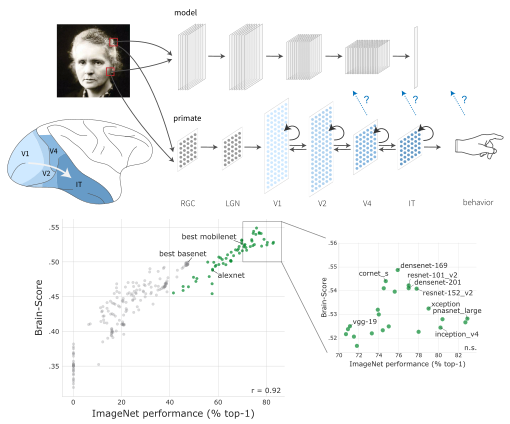
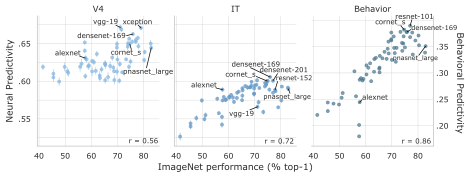
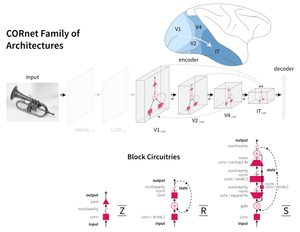
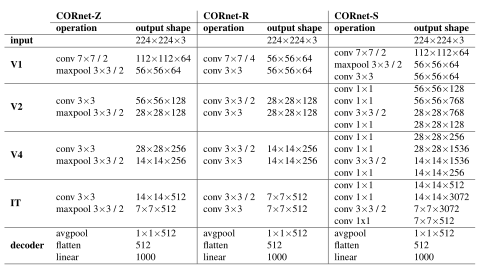
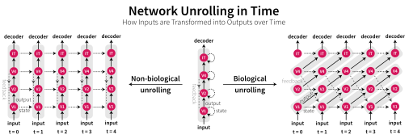

<link href="/css/asamarkdown.css" rel="stylesheet">

<div align="right">
<a href='mailto:educ0233@komazawa-u.ac.jp'>Shin Aasakawa</a>, all rights reserved.<br>
Date: 27/Nov/2026<br/>
Appache 2.0 license<br/>
</div>

$$
\newcommand{\of}[1]{\left(#1\right)}
\newcommand{\Of}[1]{\left[#1\right]}
% \newcommand{\KL}[2]{\operatorname{KL}\left(\left.{#1}\right\|{#2}\right)}
\newcommand{\given}[1]{\left|{#1}\right.}
\newcommand{\mb}[1]{\mathbf{#1}}
$$

# リカレント結合

## 実習ファイル


* [オリベッティ顔データセットを用いた分類デモ ](https://github.com/komazawa-deep-learning/komazawa-deep-learning.github.io/blob/master/2026notebooks/2026_0914olivetti_face_classification_demo.ipynb){:target="_blank"}
* [オリベッティ顔データセットを用いた時系列データ処理 ](https://colab.research.google.com/github/komazawa-deep-learning/komazawa-deep-learning.github.io/blob/master/2026notebooks/2026_0924olivetti_face_as_time_series.ipynb){:target="_blank"}

<!-- * [XOR ](https://colab.research.google.com/github/komazawa-deep-learning/komazawa-deep-learning.github.io/blob/master/2026notebooks/2026miniumXOR.ipynb){:target="_blank"}

* [ [Karapetian+(2023)](https://direct.mit.edu/jocn/article/35/11/1879/117201/Empirically-Identifying-and-Computationally) ](https://colab.research.google.com/github/komazawa-deep-learning/komazawa-deep-learning.github.io/blob/master/2024notebooks/2024_115Karapetian_demo.ipynb){:target="_blank"}
* [ResNet 実習 ](https://colab.research.google.com/github/komazawa-deep-learning/komazawa-deep-learning.github.io/blob/master/2022notebooks/2022_0603ResNet_with_Olivetti_faces_.ipynb){:target="_blank"}
* [実習 LeNet PyTorch 版 ](https://colab.research.google.com/github/komazawa-deep-learning/komazawa-deep-learning.github.io/blob/master/notebooks/2021_0528LeNet_pytorch.ipynb){:target="_blank"} -->


## 脱線

* [Cargo cult science](https://calteches.library.caltech.edu/51/2/CargoCult.htm)

* [LEAN （リーマン予想を解いたと言われている言語）](https://lean-ja.github.io/){:target="_blank"}，参考 [Lean verification of the Riemann Hypothesis](https://leanprover-community.github.io/blog/posts/riemann-hypothesis/){:target="_blank"}
* [ヒトとAI (岩波新書 新赤版 2122)，岡野原](https://www.amazon.co.jp/dp/4004321220/){:target="_blank"}


# Brain-Score, Schrimpf+(2018)

<!-- Brain-Score: Which Artificial Neural Network for Object Recognition is most Brain-Like?, Schrimpf+(2018) bioRxiv preprint doi: [https://doi.org/10.1101/407007](https://www.biorxiv.org/content/10.1101/407007v2){:target="_blank"} -->

* Brain-Score（brain-score.org）は、AI モデルが霊長類・ヒトの脳活動や行動とどれだけ一致するかを採点する、オープンソースのベンチマーク基盤。
* Brain-Score のデータセットは「視覚（主にマカク電気生理＋ヒト行動）」と「言語（ヒトfMRI/ECoG＋読み時間）」の 2 系統。
* 1 データセットに複数の指標を組み合わせて、ベンチマークとして運用されている。

---

* 基本情報

  - 起源： Martin Schrimpf の MIT 脳認知科学科での博士研究として始まり、その後 MIT Quest (現在は Siegel Family Quest for Intelligence/SQI マサチューセッツ工科大学内の組織) と EPFL (ローザンヌ連邦工科大学、スイスの大学)（現在 Schrimpf がここの教員になっている）の共同で発展。DiCarlo 研究室が中心。
  - 初出論文：bioRxiv 2018 年の Schrimpf らによる [Which Artificial Neural Network for Object Recognition is most Brain-Like?](https://www.biorxiv.org/content/10.1101/407007v1.full){:target="_blank"}。

* 仕組み

  - 複数の神経・行動ベンチマークの合成で、各ベンチマークは特定データセットに特定の指標を適用したもの。
  - 研究者が視覚・言語のモデルをアップロードし、数十の実験データセットにわたって神経活動や人間の行動選択との類似度を確認できる。
  - ローカル実行も可能だが、ローカルでは公開ベンチマークの一部しか使えず、全ベンチマークで採点するにはサイト経由で提出が必要。
  - モジュール式プラグインにより、データ・指標・ベンチマーク・モデルの追加が容易になった。

* 対象領域

  - 視覚：腹側視覚路（V1, V2, V4, IT）とコア物体認識。
  - 言語：Brain-Score 2.0 で Brain-Score Language が加わり、ヒト言語系に拡張。基盤は PNAS 2021 の論文で、transformer モデルが文に対する神経応答の説明可能分散をほぼ 100 % 予測し、その適合度は次単語予測の精度と強く相関した（他の言語課題とは相関しない）。

* 主要な知見

  - 脳スコアは視覚では物体分類性能で予測されるが、ImageNet 精度 70 % までに限られる。言語では次単語予測性能で予測される。
  - 50 以上のベンチマークを擁し、最良モデルでも脳データの説明分散は約 50 %。

* 使う前に押さえるべき限界

  1. **スコアが高くても、メカニズムが同じとは限らない。** Brain-Score の Gestalt ベンチマークで高得点の ANN が、人間のような Gestalt 処理を示さないという 2026 年の報告がある。線形写像による予測性は表現の同型性の証明にならない。
  2. **合成スコアは中身を隠す。** 少数の得意ベンチマークで順位が決まることがある。個別スコアを見ずにランキングを引用するのは粗い議論になる。
  3. **言語側はまだ飽和していない。** Schrimpf らは言語の脳整合ベンチマークはまだ未飽和で、改善の余地があると述べている。裏返せば、現行の言語ベンチマークの識別力と網羅性も発展途上ということ。

<!-- 確認できなかった点もあります。言語ベンチマークの具体的なデータセットの言語（英語以外があるか）は、今回の検索では確認できていません。日本語の心理言語データに使えるかが目的であれば、GitHub の brainscore_language` を直接確認する必要があります。
何に使うつもりか（モデル評価か、自前データのベンチマーク化か）を教えてもらえれば、そこを絞って調べます。 -->


<div class="figcenter">


<div class="figcaption">

Brain-Score の概要。2 種類の評価指標を用いてニューラルネットワークを比較。神経指標は、内部の活性化をマカクザルの腹側視覚経路の各領域と比較し、行動指標は出力の類似性を比較。
Brain-Score は、小規模でランダムに組み合わせたモデル（灰色の点）については ImageNet の性能と相関を示すが、トップ 1 性能が 70 % 未満の現在の最先端モデル（緑色の点）ではその相関が弱くなる。
Schrimpf+(2018) Fig. 1
<!-- Figure 1: Overview of the Brain-Score. We compare neural networks using two classes of metrics: neural metrics compare the internal activations to regions of the macaque ventral stream, and behavioral metrics compare the similarity in outputs. Brain-Score is correlated with ImageNet performance for small, randomly combined models (gray dots) but becomes weak for current state-of-the-art models (green dots) at 70% top-1 performance. -->
</div>


<div class="figcaption">

神経および行動ベンチマークにおける全モデルの予測精度。V4 および IT 領域については、神経予測精度に加え、I2n を用いた行動記録を用いて評価を行った。
現時点での最良のモデルは、V4 では VGG-19、IT では DenseNet-169、行動では ResNet-101。特に、DenseNet-169、CORnet-S、および ResNet-101 は、これら 3 つのベンチマークすべてにおいて優れた性能を示している。ノイズ天井値は、V4 で 0.892、IT で 0.817、行動データで 0.497。エラーバーは標準誤差（s.e.m.）。
<!-- Figure 2: Predictivities of all models on neural and behavioral benchmarks. We evaluated regions V4 and IT using the neural predictivity as well as behavioral recordings
using I2n. Current best models are: VGG-19 on V4, DenseNet-169 on IT and ResNet-101 on behavior. Notably, DenseNet-169, CORnet-S and ResNet-101 are strong models
on all three benchmarks. Noise ceilings are .892 for V4, .817 for IT and .497 for behavior. Error bars indicate s.e.m. -->
</div>
</div>


* 行動: 行動的ベンチマークの目的は、任意の課題において、ソース（例：ANN モデル）とターゲット（例：人間やサル）の行動反応間の類似度を算出すること。主要な物体認識課題において、霊長類（人間およびサル）は、グラウンドトゥルースラベルとは異なる行動パターンを示す。したがって、ここでの主要なベンチマークは、全体的な精度指標ではなく、行動反応パターンの指標であり、霊長類の成功および失敗のパターンを生成・予測する ANN ほど高いスコアが得られる。この結果として、100 ％ の精度を達成した ANN であっても、行動類似性得点では満点を獲得できないことになる。

<!-- * Behavioral. The purpose of behavioral benchmarks it to compute the similarity between source (e.g., an ANN model) and target (e.g., human or monkey) behavioral responses in any given task. For core object recognition tasks, primates (both human and monkey) exhibit behavioral patterns that differ from ground truth labels. Thus, our primary benchmark here is a behavioral response pattern metric, not an overall accuracy metric, and higher scores are obtained by ANNs that produce and predict the primate patterns of successes and failures. One consequence of this is that ANNs that achieve 100% accuracy will not achieve a perfect behavioral similarity score. -->

中核的な物体認識という視覚的行動領域内においても、考えられる行動指標は数多く存在する。ここでは、物体選択の選択肢ごとに分類された画像ごとの難易度パターン（I2n と呼ばれる）という指標を用いる。これは、最近の研究（Rajalingham et al., 2018）において、（十分な量の行動データが利用可能であることを前提として）この指標が、異なる ANN を区別する上で最も有効であることが示唆されているためである。
<!-- Even within the visual behavioral domain of core object recognition, there are many possible behavioral metrics. We here use the metric of the image-by-image patterns of difficulty, broken down by the object choice alternatives (termed I2n), because recent work (Rajalingham et al., 2018) suggests that it has the most power to distinguish among alternative ANNs (assuming that sufficient amounts of behavioral data are available).  -->

* I2n：正規化された画像レベルの行動一貫性 合計 $i$ 枚の画像に対するソースデータ（モデル特徴量）は、まず以下の手順に従って、行動データが利用可能な $c$ つの物体カテゴリと $i_b$ 枚の画像からなる $i_b \times c$ 行列に変換される。まず、行動反応が得られていない画像（すなわち、$i−i_{b}$ 枚の画像）を用いて、ソースデータから各画像に対する $c$ 値の確率ベクトルへの $c$ 値ロジスティック回帰モデルを構築する。ここで、各確率は、特定の物体がその画像に含まれている確率である。次に、この回帰モデルを用いて、テスト用として保留された $i_b$ 枚の画像に対する確率を推定する。各画像について、$c$-way 確率ベクトルから、すべての正規化されたターゲット-ディストラクタ対の確率が計算される。例えば、画像に犬が含まれており、ディストラクタがクマである場合、ターゲット-ディストラクタの得点は $\displaystyle \frac{p(dog)}{p(dog)+p(bear)}$ となる。ソースデータとターゲットデータを比較するために、まず$i_b\times c$ の応答行列に含まれるこれらの生精度を、$i_b\times c$ 行列の各セルに対する $d^{\prime}$ 尺度へと変換する：

<!--* I2n: Normalized Image-Level Behavioral Consistency Source data (model features) for a total of $i$ images are transformed first into a $i_b \times c$ matrix of $c$ object categories and ib images with behavioral data available using the following procedure. First, images where behavioral responses are not available (namely, $i−i_{b}$ images) ar  e used to build a $c$-way logistic regression from source data to a c-value probability vector for each image, where each probability is the probability that a given object is in the image. This regression is then used to estimate probabilities for the held-out $i_b$ images. For each image, all normalized target-distractor pair probabilities are computed from the $c$-way probability vector. For instance, if an image contains a dog and the distractor is a bear, the target-distractor score is $\displaystyle \frac{p(dog)}{p(dog)+p(bear)}$. In order to compare source and target data, we first transform these raw accuracies in the $i_b\times c$ response matrix to a $d^{\prime}$ measure for each cell in the $i_b\times c$ matrix:  -->
$$
d^{\prime}=Z\of{\text{Hit Rate}} - Z\of{\text{False Alarms Rate}},
$$
ここで、$Z$ は応答の推定 z 得点であり、ヒット率は特定のターゲット・ディストラクター対の正答率を指し、誤警報率は、別の物体が提示された画像において、観察者がそのターゲット物体を誤って認識したと報告した頻度に相当する。例えば、ある画像に犬が含まれており、注意散漫刺激がクマである場合、その画像における犬とクマのペアのヒット率は  $i_b\times c$  行列から直接得られる。一方、誤警報率を求めるには、その行列のうち、画像内に犬が含まれていないにもかかわらず、デストラクタ刺激として犬が設定されていたすべてのセルを平均し、その値から 1 を引いたものを誤警報率として用いる。5 を超えるすべての $d_0$ はクリップされた。この変換は、応答のバイアスを除去し、天井効果を軽減するのに役立つ（多くの霊長類の正答率が 1 に近いことから）。しかし、このデータセットにおける $d^{\prime}$ の実証的に観察された利点は小さい。詳細な説明については、Rajalingham et al. (2018) を参照。
<!-- where $Z$ is the estimated z-score of responses, Hit Rate is the accuracy of a given target-distractor pair while the False Alarms Rate corresponds to how often the observers incorrectly reported seeing that target object in images where another object was presented. For instance, if a given image contains a dog and distractor is a bear, the Hit Rate for the dog-bear pair for that image comes straight from the $i_b\times c$ matrix, while in order to obtain the False Alarms Rate, all cells from that matrix that did not have dogs in the image but had a dog as a distractor are averaged, and 1 minus that value is used as a False Alarm Rate. All d0 above 5 were clipped. This transformation helps to remove bias in responses and also to diminish ceiling effects (since many primate accuracies were close to 1), but empirically observed benefits of $d^{\prime}$ in this dataset are small; see Rajalingham et al. (2018) for a thorough explanation. -->


得られた応答行列は、同じターゲット・ディストラクターの組み合わせにおける全試行の平均ヒット率を差し引くことで、さらに精緻化される（例えば、犬と熊の組み合わせの試行については、各試行からその平均値が差し引かれる）。このような正規化により、各画像に固有の分散が明らかになり、モデルが捉えやすい可能性のある全体的な傾向が除去される。例えば、犬と熊の試行は、平均的に犬とシマウマの試行よりも難しかった可能性がある。この正規化を行わない場合、モデルはこの傾向のみを捉えることで非常に高いスコアを出す可能性がある。正規化後、すべての反応はゼロを中心に配置されるため、全体的な傾向のみを捉えて各画像固有の特性を捉えられないモデルでは、高い順位を獲得するには不十分となる。
<!-- The resulting response matrix is further refined by subtracting the mean Hit Rate across trials of the same target-distractor pair (e.g., for dog-bear trials, their mean is subtracted from each trial). Such normalization exposes variance unique to each image and removes global trends that may be easier for models to capture. For instance, dog-bear trials on average could have been harder than dog-zebra trials. Without this normalization, a model might score very well by only capturing this tendency. After normalization, all responses are centered around zero, and thus capturing only global trends but not each image’s idiosyncrasies would be insufficient for a model to rank well.-->


正規化後、式（1）を用いて、ソースデータとターゲットデータ間のピアソン相関係数 $r_{st}$ を算出する。さらに、ノイズシーリング、すなわち測定された行動反応に含まれるノイズを考慮した際に理想的なモデルがどの程度良好な性能を発揮し得るかを推定するため、ターゲットデータを試行ごとに半分に分割し、それぞれの半分について正規化された $d^{\prime} i_b\times c$ 行列を算出し、2つの半分間のピアソン相関係数 $r_{tt}$ を算出する。ソースデータが確率過程によって生成される場合、ソースデータに対しても同様の手順を実行することで、ソースの信頼性 $r_{ss}$ を求めることができる。
<!-- After normalization, a Pearson correlation coefficient rst between source and target data is computed using Eq. 1. We further estimate noise ceiling, that is, how well an ideal model could perform given the noise in the measured behavioral responses, by dividing target data in half across trials, computing the normalized $d^{\prime} i_b\times c$ matrices for each half, and computing the Pearson correlation coefficient rtt between the two halves. If source data is produced by a stochastic process, the same procedure can be carried out on the source data, resulting in the source’s reliability $r_{ss}$.  -->

各 ANN の最終的な行動予測スコアは、次のように計算される：<!--The final behavioral predictivity score of each ANN is then computed by: -->

$$
r=\frac{r_{st}}{\sqrt{r_{ss}r_{tt}}}
$$

これまでに検証したすべてのモデルは決定論的な応答を示したため、評価では $r_{ss}=1$ となった。
<!-- All models that we tested so far produced deterministic responses, thus rss = 1 in our scoring. -->

-------------------------------------------------------------
<!-- ## Brain-Score -->

出典:
- [Brain-Score — MIT Quest](https://sqi.mit.edu/research/platforms/brain-score){:target="_blank"}
- [Brain-Score Language — MIT Quest](https://sqi.mit.edu/research/projects/brain-score-language){:target="_blank"}
- [Schrimpf et al. 2018, bioRxiv](https://www.biorxiv.org/content/10.1101/407007){:target="_blank"}
- [Schrimpf et al. 2021, PNAS (DSpace@MIT)](https://hdl.handle.net/1721.1/138214){:target="_blank"}
- [GitHub: brain-score](https://github.com/dicarlolab/brain-score){:target="_blank"}
- [EPFL IC Colloquium](https://memento.epfl.ch/event/ic-colloquium-advancing-system-models-of-brain-lik){:target="_blank"}
- [NTU Seminar 2025](https://www.ntu.edu.sg/computing/news-events/events/detail/2025/04/28/default-calendar/seminar--vision-and-language-in-brains-and-machines){:target="_blank"}

<!-- 2026-10-26 07:00 JST -->

---------------

* 前提：データとベンチマークの関係

  - ベンチマークの識別子は「データ名-指標名」の形式（例：Rajalingham2018-i2n）。
  - スコアはノイズ天井（ceiling）で正規化された 0〜1 の値で、1 は天井レベルの一致を意味する。
  - ローカルで使えるのは公開ベンチマークの一部だけ。全ベンチマークで採点するにはサイト経由で提出する必要があり、非公開データ（held-out）が存在する。

* 視覚（brainscore_vision）

  - 神経データ（マカク電気生理）：BERGのドキュメントによると、領域ごとの公開ベンチマーク
    - V1：FreemanZiemba2013、102 ニューロン
    - V2：FreemanZiemba2013、103 ニューロン
    - V4：MajajHong2015、88 ニューロン
    - IT：MajajHong2015、168 ニューロン

- 行動データ：Rajalingham2018（物体認識の画像単位パターン、i2n）、Geirhos2021（色・コントラストなどのサブセットで、誤り一貫性を測定）。
- 規模：50 以上のベンチマーク。
<!-- - 今回の検索では、視覚ベンチマークの全リストを一次資料から取得できていません。私の知識ではMarques2020（V1特性）、Kar2019（IT時間動態）などもありますが、未検証です。 -->

* 言語（brainscore_language）

| データ | 計測 | 提示 | 内容 |
|---|---|---|---|
| Pereira2018 | fMRI | 読み | Exp2：9名・384文、Exp3：6名・243文 |
| Blank2014 | fMRI | 聴取 | 5名がNatural Stories Corpusの8物語を聴取。ROI平均 |
| Fedorenko2016 | ECoG | 読み（単語逐次提示） | 短文 |
| Futrell2018 | 読み時間（行動） | 読み | Natural Stories |
| Tuckute2024 | fMRI | 読み | 短文 |

- 研究によっては Narratives（fMRI、聴取、長文）や Wehbe2014 も使われている。<!--ただし、これらがプラットフォームの公式ベンチマークかどうかは確認できていません。-->
- ノイズ天井（PNAS 2021 時点）：Pereira2018 が 0.32、Fedorenko2016 が 0.17、Blank2014 が 0.20。

* 注意点
  1. **言語データは天井が低くノイズが大きい。** TopoLM 論文は、Fedorenko2016 は正規化に使うデータのノイズが大きく、平均スコアがこのデータセットに支配されると警告。平均スコアだけ見るのは危険。
  2. **言語刺激は英語のみ。** 日本語の心理言語指標で検証したいなら、既存ベンチマークは使えない。自前でベンチマークを作る（プラグイン方式で追加可能）ことになる。
  3. **視覚の公開データは小さい。** V4・IT は百数十ニューロン程度。公開データだけで出した結果を Brain-Score と呼ぶのは誤解を招く。

<!-- 次に詰めるべき点として、目的がどちらかで調べる対象が変わります。
- (a) 既存ベンチマークでモデルを評価する
- (b) 日本語データ（例：JALEX 系の読み時間）をベンチマークとして登録する

(b)ならベンチマーク追加の手順と、Futrell2018の実装を雛形として調べます。 -->

文献:
- [BERG: brainscore_vision model card](https://brain-encoding-response-generator.readthedocs.io/en/stable/models/model_cards/brainscore_vision.html){:target="_blank"}
- [BERG: brainscore_language model card](https://brain-encoding-response-generator.readthedocs.io/en/stable/models/model_cards/brainscore_language.html){:target="_blank"}
- [Brain-Score docs: Benchmarks](https://brain-score.readthedocs.io/en/latest/modules/benchmarks.html){:target="_blank"}
- [brainscore_core docs](https://brain-score-core.readthedocs.io/en/latest/modules/benchmarks.html){:target="_blank"}
- [GitHub: brain-score/vision](https://github.com/brain-score/vision){:target="_blank"}
- [Instruction-tuning Aligns LLMs to the Human Brain (arXiv 2312.00575)](https://arxiv.org/pdf/2312.00575){:target="_blank"}
- [From Language to Cognition (arXiv 2503.01830)](https://arxiv.org/html/2503.01830v1){:target="_blank"}
- [Schrimpf et al. 2021 PNAS, Fig. 2](https://pmc.ncbi.nlm.nih.gov/articles/PMC8694052/figure/fig02){:target="_blank"}
- [TopoLM (arXiv 2410.11516)](https://arxiv.org/pdf/2410.11516){:target="_blank"}
- [AlKhamissi 2024 CCN poster](https://nlp.epfl.ch/resources/pdf/posters/alkhamissi-2024-ccn-poster.pdf){:target="_blank"}

----------------------
<!-- # Brainscore -->


Brain-Score の代表的な PLS ベンチマークでは、**説明変数 $X$ はニューラルネットワークの層の活性値、被説明変数 $Y$ は実測した神経応答**。

* V1・V2・V4・IT の代表的な `-pls` ベンチマークでは、**サルの各領域から電極で記録したスパイク応答** を予測。
* EEG, MEG からこれらの領域の活動を推定する手続きとは異なる。
* V1, V2 には FreemanZiemba2013, V4・IT には MajajHong2015 が用いられている。
* [V1・V2 の公式実装](https://github.com/brain-score/vision/blob/master/brainscore_vision/benchmarks/freemanziemba2013/benchmarks/benchmark.py){:target="_blank"}
* [V4・IT の公式実装](https://github.com/brain-score/vision/blob/master/brainscore_vision/benchmarks/majajhong2015/benchmark.py){:target="_blank"}


* **PLS に渡すデータは、同じ画像に対する「モデル応答」と「神経応答」を対応させた二つの行列**

PLS: Partial Least Squares を使って神経活動を予測

| 項目 | 説明変数 \(X\) | 被説明変数 \(Y\) |
|---|---|---|
| データの由来 | 評価するニューラルネットワーク | 生理実験による記録 |
| 行 | 刺激画像 | \(X\) と同じ刺激画像 |
| 列 | 対象領域に対応づけたモデル層のユニット・特徴次元 | 対象領域の各神経記録部位 |
| 各要素 | 画像を入力したときのユニットの活性値 | 同じ画像に対する記録部位の応答値 |
| 行列の大きさ | 画像数 \(N\) × 特徴数 \(p\) | 画像数 \(N\) × 記録部位数 \(q\) |

例えば IT を評価するなら、画像 \(i\) に対するモデルの特徴ベクトル \(\boldsymbol{x}_i\) から、IT の各記録部位の応答を次式のように予測する：

$$
\widehat{y}_{ij} = b_j+\sum_{k=1}^{p}x_{ik}B_{kj},
$$

ここで、$j$ は IT の記録部位、$k$ はモデルの特徴次元。<br/>
**モデルの一つのユニットを一つの生物学的ニューロンに対応させるのではなく、モデルの多数の特徴の重み付き和から各神経応答を予測**<br/>
V1, V2, V4, IT ごとに、対応するモデル層と回帰の重みを用いる。
* [領域とモデル層を対応づける公式実装](https://github.com/brain-score/vision/blob/master/brainscore_vision/model_helpers/brain_transformation/__init__.py)

* PLS を使う理由は、モデルの特徴が高次元で、特徴間の相関も強いため (多重共線性)。
* PLS は **神経応答 $Y$ との共変動を考慮して、モデル特徴 $X$ から少数の潜在成分を抽出し、その成分から $Y$ を予測。
* ** PCA のように $X$ 自体の分散だけで成分を選ぶ方法とは、この点で異なる。[scikit-learn 1.9.1 documentation](https://scikit-learn.org/stable/modules/cross_decomposition.html?utm_source=chatgpt.com)

* Brain-Score の標準実装では、次の設定で scikit-learn の `PLSRegression` を呼び出している。

```python
PLSRegression(n_components=25, scale=False)
```

* 上の **25 は潜在成分数**であり、画像数、神経記録部位数、モデル層数ではない。
* 実装では対象領域の複数の神経応答を行列 \(Y\) としてまとめて渡す、多出力の PLS 回帰を行っている。[PLS と評価処理の公式実装](https://github.com/brain-score/vision/blob/master/brainscore_vision/metrics/regression_correlation/metric.py)

* 神経応答は、標準的な静的ベンチマークでは、時間窓や同一画像の反復提示について集約される。
* 例えば FreemanZiemba2013 の実装では、刺激提示後 **50–200 ms** の応答を平均し、モデルとの比較には反復平均を用いる。
* したがって、この場合の行列の行は**時点ではなく画像**。
* 学習用画像で回帰を学習した後、別の画像に対する神経応答を予測し、各記録部位について予測値と実測値の Pearson 相関を求める。
* これを集約し、記録の信頼性に基づく ceiling で補正する。[時間平均・反復平均の実装](https://github.com/brain-score/vision/blob/master/brainscore_vision/benchmarks/freemanziemba2013/benchmarks/benchmark.py)
 <!-- [brain-score.org](https://www.brain-score.org/tutorials/benchmarks/neural-benchmarks/?utm_source=chatgpt.com) -->

* EEG については、現行の **Gifford2022** が具体例。
* この実装では、目的変数の列を **電極 × 時点** として構成し、登録された評価方法には PLS ではなく **ridge／ridgecv** を使っている。
* さらに、名称にある `IT` は、既存インターフェースに合わせた便宜上の割り当てであることがコードに明記されている。
* EEG 信号が解剖学的な IT 活動として局在化されたことを意味しない。[EEG データの構成](https://github.com/brain-score/vision/blob/master/brainscore_vision/benchmarks/gifford2022/benchmark.py)、[評価方法の登録](https://github.com/brain-score/vision/blob/master/brainscore_vision/benchmarks/gifford2022/__init__.py)

したがって、EEG, MEG を扱う際には、$Y$ の各列が「センサーの信号」なのか「ソース推定後の領域活動」なのかを確認する必要がある。
**PLS という回帰手法の選択だけで、信号と V1・V2・V4・IT との解剖学的対応が決まるわけではない。**

<!-- 確認日時：2026年11月20日 07:56 JST -->


# CORnet [Kubilius+2018](https://doi.org/10.1101/408385){:target="_blank"}

CORnet とは Core Object Recognition NETwork の

`sklearn.cross_decomposition.PLSRegression` : 部分最小二乗法（Partial Least Squares）を使って，説明変数 X と目的変数 Y の関係をモデル化。
説明変数 X と目的変数 Y の共分散を最大化する潜在変数を抽出しながら回帰を行うため、多重共線性がある場合や特徴量が多いデータに有効。

<div class="figcenter">

</div>
<div class="figcaption" style="width:77%;">

**図 1. CORnet 族のアーキテクチャ**<br/>
Cornet 全モデルには，皮質領域 V1, V2, V4, IT にあらかじめ写像された 4 領域がある。網膜と LGN の処理は現在のところモデル化されていない (灰色で塗りつぶされた領域)。すべての領域はフィードフォワード か リカレント (領域内) のどちらかであるが，現在のところ，領域間のスキップ接続やフィードバック接続を持つモデルは考慮していない (灰色で塗りつぶした破線の矢印)。本論文では，3  種類の CORnet を検討し，それぞれ異なる機能を提供する： CORnet-Z は軽量な AlexNet 代替モデル，CORnet-R は生物学的に説得力のある時間的アンロールを持つ単純なリカレントモデル，そしてCORnet-S は Brain-Score で現時点で最も高い性能を発揮するモデルである。下段の図は各モデルの領域内の回路を表している。
<!-- Fig. 1. CORnet family of architectures.
All models in this family have four areas that are pre-mapped to cortical areas V1, V2, V4, and IT. Retinal and LGN processing is currently not modeled (greyed-out areas). All areas can be either feedforward or recurrent (within area) but currently we do not consider models with skip or feedback connections between areas (grayed-out dashed arrows). In this paper, we consider three flavors of CORnet, each serving distinct functions: CORnet-Z is a lightweight AlexNet alternative, CORnet-R is a simple recurrent model with biologically-plausible unrolling in time, and CORnet-S is our highest-performing model on Brain-Score at the moment. Diagrams in the bottom panel depict circuitry within an area of each model. -->
</div>

<div class="figcenter">

</div>

モデルの復号化部は，単純な線形分類器 (各物体カテゴリに対して 1 つの総和を持つ重み付き線形和の集合) を実装する。
ImageNet で学習する場合，最後のモデル領域 (再帰の場合は最後の時間ステップ) の応答は，さらにソフトマックス非線形に渡され，1000 通りの分類が実行される。
この分類器に投影される神経応答の量を減らすために，まず特徴地図ごとの受容野全体の応答を平均化する。
現在の CORnet 族の定義では，領域横断バイパス接続や領域横断フィードバック接続は存在しない。
網膜と LGN の処理は省略されている (考察参照)。
また，計算要求が高いため，CORnet-S の第 1 領域は簡略化され，2 つの畳み込みのみが含まれる (下記参照)。
<!-- The decoder part of a model implements a simple linear classifier – a set of weighted linear sums with one sum for each object category.
When training on ImageNet, responses of last model area (and last time step in the case of recurrence) are further passed through a softmax nonlinearity to perform a 1000-way classification.
To reduce the amount of neural responses projecting to this classifier, we first average responses over the entire receptive field per feature map.
There are no across-area bypass or across-area feedback connections in the current definition of CORnet family.
Retinal and LGN processing are omitted (see Discussion).
Also, due to high computational demands, the first area in CORnet-S is simplified to only include two convolutions (see below). -->

**CORnet-Z** (通称 Zero) は我々の最も単純なモデルであり，(i) AlexNet は既に深いモデル(Schrimpf+2018) とほぼ同程度に神経応答を予測しており，(ii) VGG (Simonyan&Zisserman2014) 以降に提案されたほとんどのアーキテクチャが 1 つの 1000-way 線形分類層のみを含むため，ImageNetの良好な性能を達成するために複数の完全連結層は必要ないようであることを観察することによって導き出された。
従って，CORnet-Z の面積回路は単一の畳み込み，それに続く ReLU 非線形と最大プーリングのみで構成される。
<!-- CORnet-Z (a.k.a. "Zero") is our simplest model, derived by observing that (i) AlexNet is already nearly as good in predicting neural responses as deeper models (Schrimpf+2018) and (ii) multiple fully-connected layers do not appear necessary to achieve good ImageNet performance, as most architectures proposed after VGG (Simonyan&Zisserman2014) contain only a singe 1000-way linear classification layer.
Thus, CORnet-Z’s area circuits consist of only a single convolution, followed by a ReLU nonlinearity and max pooling. -->

**CORnet-R** (通称 Recurrent) は，生物学的に妥当な方法でネットワークを伝播するリカレントダイナミクスを導入する (生物学的ネットワーク・アンローリングと非生物学的ネットワーク・アンローリングの比較については図 2 参照)。
CORnet-R では，リカレンスは領野内でのみ導入される (エリア間のフィードバック接続はない) ため，アンロールの特殊な方法は (より多くのメモリを消費することを除けば) ほとんど影響を及ぼさないが，それでもこのモデルを神経ダイナミクスの調査に役立てるため，生物学的に妥当なアンロールを使用することにした。
<!-- CORnet-R (a.k.a. "Recurrent") introduces recurrent dynamics that would propagate through the network in a biologically-valid manner (see Fig. 2 for a comparison between biological and non-biologicall network unrolling).
In CORnet-R, recurrence is introduced only within an area (no feedback connections between areas), so the particular way of unrolling has little effect (apart from consuming much more memory), but we chose to use biologically-valid unrolling nonetheless to make this model useful for investigating neural dynamics. -->

入力はまず，畳み込みを通すことでチャンネル数を 2 倍に増やしながら 2 倍にダウンスケールされ，続いて正規化と非線形化が行われる。
状態 (最初はゼロ) が結果に追加され，別の畳み込み，正規化，非線形性を経て，結果が領域の新しい状態として保存される。
我々は，群正規化 (Wu&He2018) と ReLU 非線形性を使用した。
<!-- The input is first downscaled twofold while increasing the number of channels twofold by passing it through a convolution, followed by normalization and a nonlinearity.
The state (initially zero) is added to the result and passed through another convolution, normalization, and nonlinearity, and the result is saved as a new state of the area.
We used group normalization (Wu and He, 2018) and ReLU nonlinearity -->

**CORnet-S** (通称 Skip) は，非常に深いフィードフォワードアーキテクチャを浅いリカレントモデルに変換することで，Brain-Score の最高モデルに匹敵することを目指している。
具体的には，CORnet-S は我々の行動ベンチマークで最も優れたモデルのいくつかである ResNets からインスピレーションを得ている (Rajalingham+2018, Schrimpf+2018)。
Liao&Poggio(2016) は ResNet 構造をアンロール型リカレントネットワークと考えることができると提案し，さらに最近の研究では CIFAR や ImageNet の性能に大きな損失を与えることなく重み共有が実際に可能であることを実証した (Jastrzebski+2017, Leroux+2018)。
<!-- CORnet-S (a.k.a. "Skip") aims to rival the best models on Brain-Score by transforming very deep feedforward architectures into a shallow recurrent model.
Specifically, CORnet-S draws inspiration from ResNets that are some of the best models on our behavioral benchmark (Rajalingham+2018, Schrimpf+2018).
Liao&Poggio(2016) proposed that ResNet structure could be thought of as an unrolled recurrent network and recent studies further demonstrated that weight sharing was indeed possible without a significant loss in CIFAR and ImageNet performance (Jastrzebski+2017, Leroux+2018). -->

CORnet-S は CORnet-R の回路の上にさらに 2 つの畳み込み（それぞれ正規化と非線形化が続く）を積み重ねる。
さらに，ResNet のボトルネックブロック構造に従い，2 回目の畳み込みでチャンネル数を4倍に拡大し，最後の畳み込みでチャンネル数を減少させる。
また，入力に状態を追加した結果が非線形を適用する直前に最後の畳み込みの出力と結合されるように，スキップ接続も含めた。
CORnet-S が領域内リカレント接続のみを有することを考慮し，メモリフットプリントを最小化するために，時間的にネットワークのアンロールを利用することなくこのモデルを訓練した (すなわち 図 2 に描かれているようなアンロールはないが，繰り返される計算にわたって重みは依然として共有される)。
特に，最初に情報が処理されるとき，3 回目の畳み込みとスキップ畳み込みは，入力をダウンスケールするために 2 のストライドを使用する。
そして，その出力は，さらなるリカレント処理（図 1 では gate と呼ばれる）のために，元の入力の代わりに使われる。
このモデルではバッチ正規化 (Ioffe&Szegedy2015) と ReLU 非線形性を使用し，バッチ正規化は (Jastrzebski+2017) が示唆するように経時的に共有されなかった。
<!-- CORnet-S stacks two more convolutions (each followed by a normalization and nonlinearity) on top of CORnet-R’s circuit.
Moreover, following ResNet’s bottleneck block structure, the second convolution expands the number of channels fourfold while the last one decreases them back.
We also included a skip connection, such that the result of adding the state to the input is combined with the output of the last convolution just prior to applying a nonlinearity.
Given that CORnet-S only has within-area recurrent connections, in order to minimize memory footprint we trained this model without making use of any network unrolling in time (i.e. no unrolling as depicted in Fig. 2, but weights are still shared over repeated computations).
In particular, the first time information is processed, the third convolution and the skip convolution use a stride of two to downscale inputs.
The output is then used instead of the original input for further recurrent processing (referred to as "gate" in Fig. 1).
We used batch normalization (Ioffe and Szegedy, 2015) and ReLU nonlinearity in this model, and batch normalization was not shared over time as suggested by (Jastrzebski+2017). -->


<div class="figcenter">


</div>
<div class="figcaption">

図 2. 時間軸に沿ったネットワークの展開。<br/>
リカレントネットワークでは、情報を計算素子を通じて複数回渡す必要がある。これにより、計算の順序をどう定めるかという問題が生じる。リカレントモデルの標準的な機械学習実装（左）では、各時間ステップで情報が入力から出力（この例では復号化器）へと渡される。対照的に、生物系（右）では、入力は段階的に出力へと変換される。$t=0$ の時点では、最初の領域（この場合は  V1）のみが入力を処理し、その計算結果を出力として V2 に送る。$t=1$ の時点では、V2 が V1 の出力を処理する一方で、V1 はすでに更新された内部状態を用いて新しい入力を処理している。元の入力が最終的に IT に到達するまでには 4 つの時間ステップを要する。一方、非生物学的ネットワークのアンロールでは、入力は V1 に供給されると同時にITに到達する。右図は、CORnet-R において再帰をどのように適用しているかを示している。水平の破線は、図 1 で破線として示された領域内再帰の実装である。この 2 種類のアンロール法の違いは、フィードバック接続（V4 から V1 への薄い灰色の破線矢印）が導入されたときに最も顕著になる。標準的な再帰ネットワークでは、V4 からの情報は V1 へと送られるが、V1 はすでにその入力を処理済みであるため、この情報は利用されない。生物系では、$t=1$ の時点で V4 からのフィードバックが V1 への入力と組み合わされるため、V1 の下流におけるさらなる処理に即座に影響を及ぼすことになる。
<!-- Fig. 2. Network unrolling in time. 
A recurrent network needs to pass information through its computational units multiple times. This poses a problem: What is the order of computations? In standard machine learning implementations of recurrent models (left), information is passed at each time step from inputs to outputs (i.e., to decoder in our case). In contrast, in biological systems (right), inputs are transformed to outputs in a stepwise fashion. At $t=0$, only the first area (V1 in this case) processes an input and sends the output of this computation to V2. At t = 1, V2 processes V1’s output, while V1 is already processing a new input with an updated internal state. It takes four time steps for the original input to finally reach IT, whereas in a non-biological unrolling of a network the input reaches IT at the same time as it is fed to V1. The diagram on the right illustrates how we apply recurrence in CORnet-R. The horizontal dashed lines are the implementation of the within area recurrence shown as dashed lines in Fig. 1. The difference between the two kinds of unrolling would become most dramatic when a feedback connection is introduced (dim gray dashed arrows from V4 to V1). In standard recurrent networks, information from V4 would be sent down to V1 but since V1 has already processed its inputs, this information would not be utilized. In biological systems, at $t=1$ feedback from V4 would be combined with inputs to V1, so it would readily affect further processing downstream of V1. -->
</div>


