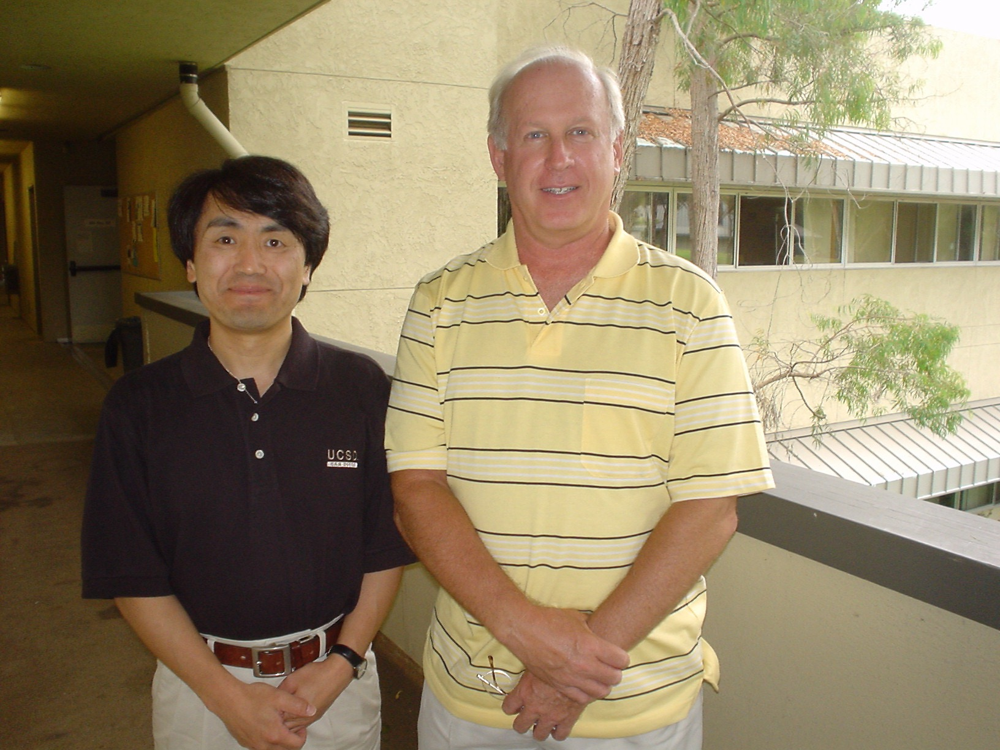
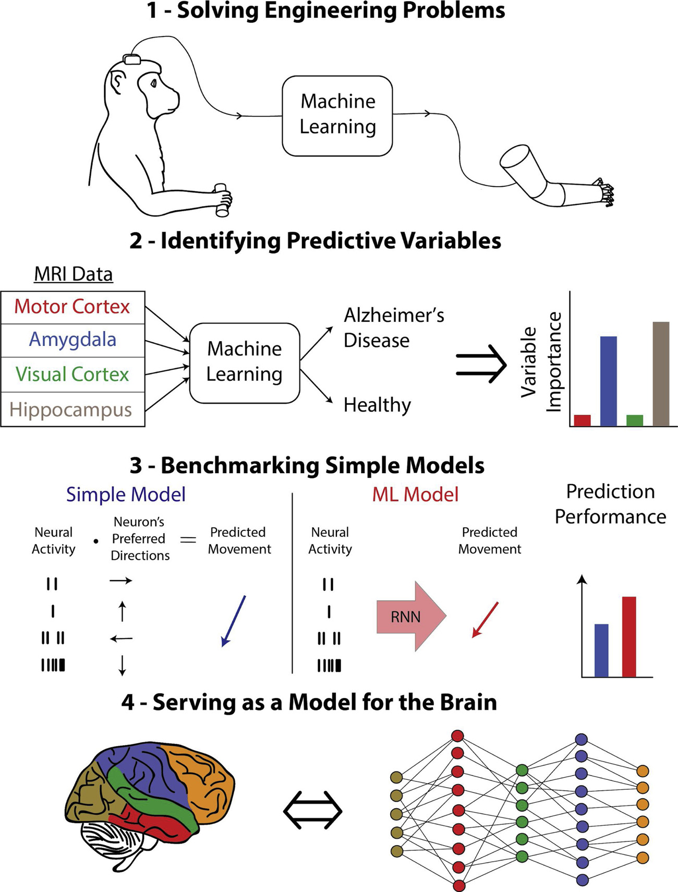
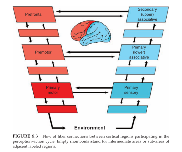
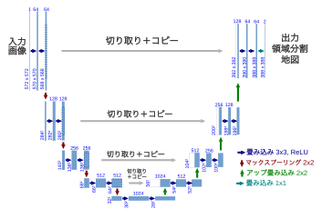

<link href="/css/asamarkdown.css" rel="stylesheet">

- 授業名: 認知心理学研究 (1) b
- 担当者名: 永田 陽子, 竹市 博臣, 浅川 伸一 (アサカワ シンイチ)
- 電子メールアドレス: <educ20233@komazawa-u.ac.jp>, <asakawa@cis.twcu.a.jp>
- 開講年度・期:　2026年 後期
- 開講曜日・時限: 金曜日 2 限 10:40-12:10
- 教室: 2 号館 研-001 教場
- 単位数　2

## 授業概要

認知心理学・神経生理学・人工知能のリレー講義です。認知を情報処理過程として捉え，共通トピックとして「多感覚統合」を取り上げます。
認知心理学・神経生理学・人工知能の３領域の結びつきがわかるように，幅広くお話ししてゆく予定です。理解を深めるためのハンズオンを取り入れます。

## 到達目標(ねらい)

本講義の到達目標は、受講生各自が、①認知心理学と関連する神経生理学および人工知能のキーワードを理解し，関係を説明できるようになること、②心理学と関連する分野の話題を理解し，多様な見方を持った実践ができるようになることです。

### 自己紹介

浅川伸一 博士(文学) 東京女子大学情報処理センター勤務。早稲田大学在学時はピアジェの発生論敵認識論に心酔する。
卒業後エルマンネットの考案者ジェフ・エルマンに師事，薫陶を受ける。
以来人間の高次認知機能をシミュレートすることを通して知的であるとはどういうことかを考えていると思っていた。
著書に「Python で体験する深層学習」(2016) コロナ社。
「深層学習教科書 ディープラーニング G検定（ジェネラリスト）公式テキスト」(2017) 共著，翔泳社。
「ディープラーニング，ビッグデータ，機械学習あるいはその心理学」(2015) 新曜社。
「ニューラルネットワークの数理的基礎」「脳損傷とニューラルネットワークモデル，神経心理学への適用例」いずれも守
一雄他編「コネクショニストモデルと心理学」(2001)北大路書房など

 

## 授業計画

* 09月18日 第01回
* 09月25日 第02回
* 10月02日 第03回
* 10月09日 第04回
* 10月16日 第05回
* 10月23日 第06回
* 11月06日 第07回
* [11月13日 第08回 畳み込みニューラルネットワークの基礎](2026cogpsy_lect08){:target="_blank"}
  <!-- 浅川：畳み込みニューラルネットワークの基礎 [Spoerer+2020](https://doi.org/10.1371/journal.pcbi.1008215) での提案モデルを用いるているので，この論文を取り上げる。畳み込みニューラルネットワークの種類と技法を検討する。 -->
* 11月20日 第09回
  <!-- * 残差結合 浅川：リカレントネットワークの基礎 BL ネットワークと異なるモデルである [CORnet](https://doi.org/10.1101/408385){:target="_blank"} を取り上げる。
スキップ結合，すなわち ResNet で提案された残差結合の意義を考察する ([He+2015](https://arXiv.org/abs/1406.4729/){:target="_blank"}) 下記の論文をダウンロードしてアブストラクトと図の脚注に目を通しておく：[CORnet](https://doi.org/10.1101/408385){:target="_blank"}, [He+2015](https://arXiv.org/abs/1406.4729/){:target="_blank"} -->
* 11月27日 第10回
  <!-- * リカレントネットワークによる時空間表現 下記の論文をダウンロードしてアブストラクトと図の脚注に目を通しておく：[Carion+2020](https://arxiv.org/abs/2005.12872/){:target="_blank"} -->
* 12月04日 第11回
  <!-- * ボトムアップとトップダウン処理の相互作用 浅川：BU-TD ネットワーク [Ullman+2020](https://arxiv.org/abs/2105.05592){:target="_blank"} の BU-TD モデルを取り上げ，リカレント結合の異なる意味を考える。
下記の論文をダウンロードしてアブストラクトと図の脚注に目を通しておく：[Ullman+2020](https://arxiv.org/abs/2105.05592){:target="_blank"} -->
* 12月11日 第12回
  <!-- * 物体認識と領域切り分けとの相互作用 【浅川：物体情報と位置情報】 前回でのモデルを考慮した上で，画像切り分けと物体同定との相互作用の問題を考える。[Neyshabur+2021](https://arxiv.org/abs/2008.11687/){:target="_blank"} -->
* 12月18日 第13回
  <!-- * Transformer の導入 浅川：Transformer Transformer を取り上げ，リカレント表現以外の State-of-the-arts である時間表現を取り上げる([Vaswani+2017](https://arXiv.org/abs/1706.03762/){:target="_blank"})。
下記の論文をダウンロードしてアブストラクトと図の脚注に目を通しておく：[Vaswani+2017](https://arXiv.org/abs/1706.03762/){:target="_blank"} -->
* 01月08日 第14回
  <!-- * エンコーダ・デコーダモデル 浅川：エンコーダ・デコーダモデル [Gwilliams&King2020](https://doi.org/10.7554/eLife.56603){:target="_blank"} では，出力系まで考慮したモデルが求められる。入力と出力との相互作用に，リカレント，フィードフォワードのいずれの処理を考える。
  [End-to-End Object Detection with Transformers](https://arxiv.org/abs/2005.12872){:target="_blank"} 及び，その [コード](https://github.com/facebookresearch/detr){:target="_blank"} をダウンロードして眺めておく。 -->

# Glaser(2019) の 教師あり機械学習の 4 つのレベル

<!-- 

Glaser+2019 による，機械学習の 4 レベル
[Glaser+2019](https://www.sciencedirect.com/science/article/abs/pii/S0301008218300856?via%3Dihub) Fig. 2 より

-->

1. 工学的な問題の解決: 機械学習は，医療診断，ブレインコンピュータインターフェース，研究ツールなど，神経科学者が使用する手法の予測性能を向上させることができる。
2. 予測可能な変数の特定: 機械学習により，脳や外界に関連する変数がお互いを予測しているかどうかをより正確に判断することができる。
3. 単純なモデルのベンチマーク: 解釈可能な簡易モデルと精度の高い ML モデルの性能を比較することで，簡易モデルの良し悪しを判断するのに役立つ。
4. 脳のモデルとしての役割: 脳が機械学習システム，例えばディープニューラルネットワークと同様の方法で問題を解決しているかどうかを論じることができる。

[Glaser+2019](https://www.sciencedirect.com/science/article/abs/pii/S0301008218300856?via%3Dihub) Fig. 2 より

## 文献資料

1. [ディープラーニング概説, 2015, LeCun, Bengio, Hinton, Nature](https://komazawa-deep-learning.github.io/2021/2015LeCun_Bengio_Hinton_NatureDeepReview.pdf){:target="_blank"}
1. [ゴール駆動型深層学習モデルを用いた感覚皮質の理解 Yamins(2016) Nature](https://project-ccap.github.io/2016YaminsDiCarlo_Using_goal-driven_deep_learning_models_to_understand_sensory_cortex.pdf){:target="_blank"}
1. [ディープラーニングレビュー Storrs ら, 2019, Neural Network Models and Deep Learning, 2019](https://komazawa-deep-learning.github.io/2021/2019Storrs_Golan_Kriegeskorte_Neural_network_models_and_deep_learning.pdf){:target="_blank"}
<!-- * [Storrs ら, Neural Network Models and Deep Learning, 2019](2019Storrs_Golan_Kriegeskorte_Neural_network_models_and_deep_learning.pdf){:target="_blank"} -->
1. [深層学習と脳の情報処理レビュー Kriegestorte, 2015, Deep Neural Networks: A New Framework for Modeling Biological Vision and Brain Information Processing](2015Kriegeskorte_Deep_Neural_Networks-A_New_Framework_for_Modeling_Biological_Vision_and_Brain_Information_Processing.pdf){:target="_blank"}
1. [生物の視覚と脳の情報処理をモデル化する新しい枠組み Kriegeskorte, Deep Neural Networks: A New Framework for Modeling Biological Vision and Brain Information Processing, 2015](https://project-ccap.github.io/2015Kriegeskorte_Deep_Neural_Networks-A_New_Framework_for_Modeling_Biological_Vision_and_Brain_Information_Processing.pdf){:target="_blank"}
1. [計算論的認知神経科学 Kriegeskorte and Douglas, 2018, Cognitive computational neuroscience](https://project-ccap.github.io/2018Kriegeskorte_Douglas_Cognitive_Computational_Neuroscience.pdf){:target="_blank"}
1. [視覚系の畳み込みニューラルネットワークモデル，過去現在未来 Lindsay, 2020, Convolutional Neural Networks as a Model of the Visual System: Past, Present, and Future](https://project-ccap.github.io/2020Lindsay_Convolutional_Neural_Networks_as_a_Model_of_the_Visual_System_Past_Present_and_Future.pdf){:target="_blank"}
1. [計算論的視覚と正則化理論 Poggio, Torre, Koch, 1985](https://komazawa-deep-learning.github.io/2021cogpsy/1985Poggio_Computational_Vision_and_Regularization_Theory.pdf){:target="_blank"}
1. [皮質における物体認識の階層モデル Riesenhuber and Poggio (1999) Nature](https://komazawa-deep-learning.github.io/2021cogpsy/1999Riesenhuber_Poggio_Hierarchical_models_of_object_recognition_in_cortex.pdf){:target="_blank"}
1. [注意レビュー論文 Lindsay, 2020, Attention in Psychology, Neuroscience, and Machine Learning](https://project-ccap.github.io/2020Lindsay_Attention_in_Psychology_Neuroscience_and_Machine_Learning.pdf){:target="_blank"}

<!-- 
 -->
<!--  -->
<!--  -->
<!--  -->
<!--  -->
<!-- 
 -->

